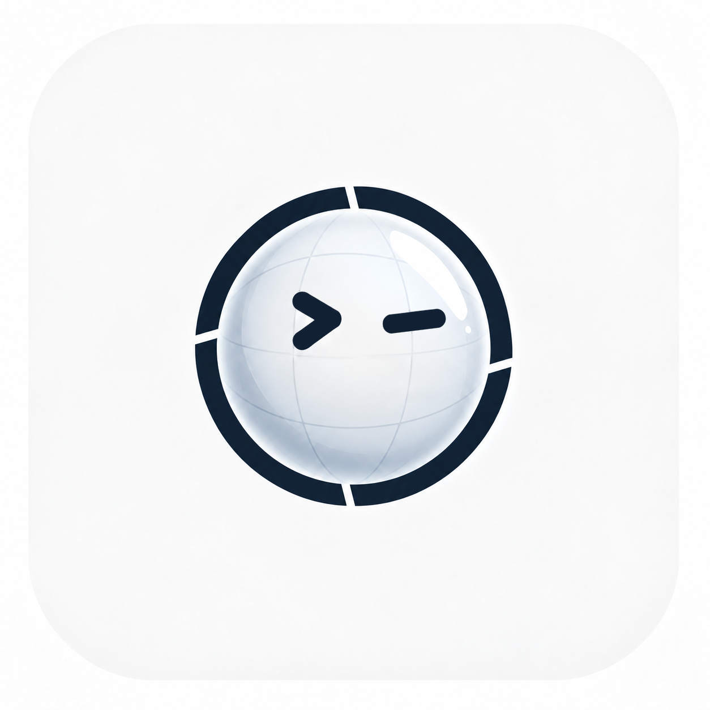
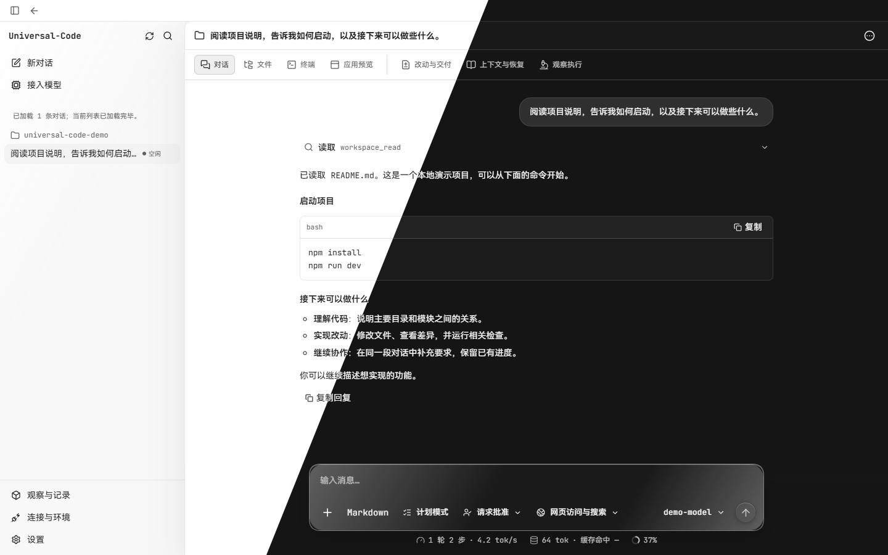
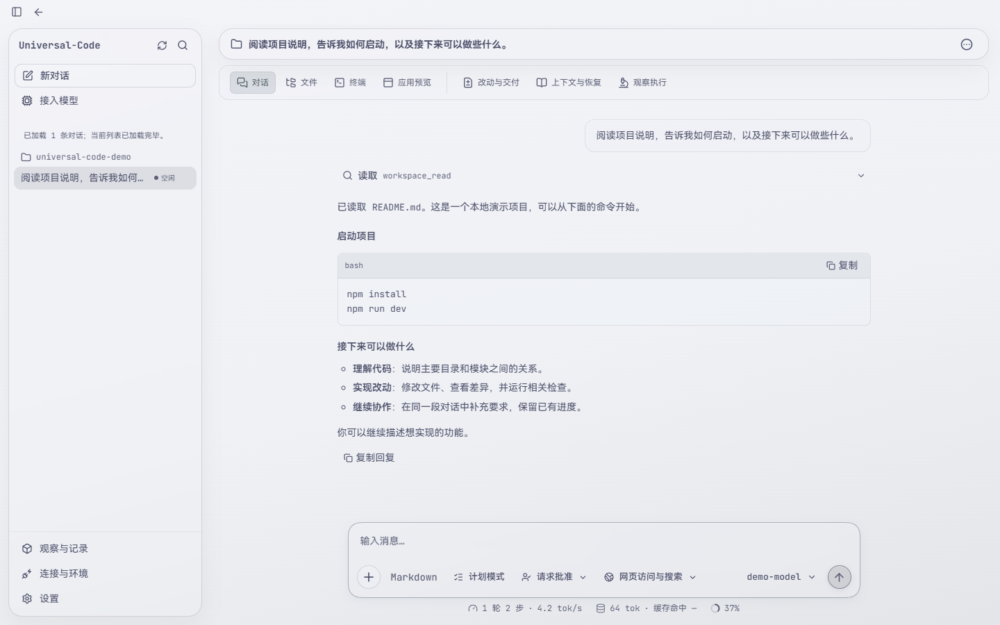

<div align="center">
  
  <h1>Universal-Code</h1>
  <p><strong>Open-source AI coding workbench for local projects</strong></p>
  <p>Connect cloud or local LLMs to read and edit code, run terminal commands, research docs, and review diffs with safety controls.</p>

  <p>
    <a href="README.md">简体中文</a> |
    <a href="README.en.md">English</a>
  </p>

  <p>
    <a href="https://github.com/CWNU-Open-Source-Community/Universal-Code/actions/workflows/ci.yml"></a>
    <a href="https://github.com/CWNU-Open-Source-Community/Universal-Code/releases"></a>
    <a href="LICENSE"></a>
    
    
    
    
    <a href="CONTRIBUTING.md"></a>
  </p>
  <p>
    <a href="https://github.com/CWNU-Open-Source-Community/Universal-Code/stargazers"></a>
    <a href="https://github.com/CWNU-Open-Source-Community/Universal-Code/network/members"></a>
    <a href="https://github.com/CWNU-Open-Source-Community/Universal-Code/issues"></a>
  </p>
</div>

---

## Highlights

- **Built for Local Repositories**: Read, inspect, and edit local codebases with built-in line-by-line diff inspection and auditable checkpoints (Rewind).
- **Transparent Permission Control**: Choose between read-only analysis, approval-gated runs, and automated Full Access. High-risk actions (file deletion, unlisted commands) always require manual confirmation.
- **Ready for Any Model**: Native support for OpenAI, Anthropic Claude, DeepSeek, Kimi, local Ollama models, and custom OpenAI-compatible endpoints with on-the-fly model switching. Also supports quick browser-based ChatGPT account sign-in.
- **Traceable Web Research**: Prioritizes provider-hosted native search, fetches GitHub Issues/PRs, Hacker News, and RSS/Atom feeds, and keeps source snapshots and citations.
- **Modern Liquid Glass Aesthetic**: Crafted with pure CSS optical refraction (macOS / VisionOS acrylic style), supporting Dark, Light, and Mist frosted themes at a responsive 120fps.

---

## Quick Start

### Option 1: Download Pre-built Binaries

| OS | Instructions |
| :--- | :--- |
| **Windows 10/11** | Get the current Actions test package and launch steps from the [Windows download guide](docs/windows-release.md). The executable is named `TraverseBoard.exe`; double-click it to launch. Edge WebView2 Runtime is required. The newest public Release remains the [older preview from 2026-09-05](https://github.com/CWNU-Open-Source-Community/Universal-Code/releases/tag/v0.1.0-pr195-preview). |
| **macOS (Apple Silicon / Intel)** | Get the Actions preview ZIP for your architecture from the [macOS download guide](docs/macos-release.md), unpack it, and open `TraverseBoard.app`. It is ad-hoc signed and unnotarized. Public Releases do not yet contain Mac packages. |

Use the [Desktop release run list](https://github.com/CWNU-Open-Source-Community/Universal-Code/actions/workflows/release-desktop.yml) as the ongoing candidate entry point. Actions downloads require a GitHub login and expire. Each platform guide records the candidate version, source revision, and expiry date.
Packages retain their historical filenames; the product name shown in the application is Universal-Code.

### Option 2: Build from Source

Install **Go as pinned in [go.mod](go.mod), currently 1.26.9**, and **Node.js 24** (CI uses 24.16.0), then clone the repository:

```bash
git clone https://github.com/CWNU-Open-Source-Community/Universal-Code.git
cd Universal-Code
```

On Windows, run in PowerShell from the repository root:

```powershell
.\scripts\build-desktop.ps1 -Version v1.0.0-dev
.\build\desktop\TraverseBoard.exe
```

On macOS, install Xcode Command Line Tools, then run from the repository root:

```sh
CGO_ENABLED=1 bash scripts/build-desktop-darwin.sh -Version v1.0.0-dev
open build/desktop/TraverseBoard.app
```

The scripts install locked frontend dependencies, check and build the embedded UI, and use the platform's required Go tags and linker options.
The desktop application includes its backend. See the [Windows](docs/windows-release.md) / [macOS](docs/macos-release.md) guides for the full requirements.

---

## Connecting Models

When opening the app or starting a new thread, click the model selector above the composer:

1. **Cloud Providers (OpenAI, Claude, DeepSeek, Kimi, etc.)**:
   - Pick your provider, enter your API Key, model identifier, and service Base URL if needed.
   - Click **Save and Check** to verify credentials and quota.
2. **ChatGPT Account Sign-in (No API Key Required)**:
   - Select **ChatGPT** in model settings and click **Continue with ChatGPT**.
   - Authorize in your default system browser to use your account's available models.
3. **Local Ollama (Offline / Private)**:
   - Ensure Ollama is running locally (default: `http://127.0.0.1:11434`).
   - Select **Ollama** in the provider list, enter the model name (e.g. `qwen2.5-coder:7b`, `deepseek-r1:8b`), and start querying.

---

## Interface Preview

| Light & Dark Split | Mist Frosted Glass |
| :---: | :---: |
|  |  |

Switch between **System, Light, Dark, and Mist** under **Settings → Appearance**.

---

## Documentation Index

| Topic | Document | Description |
| :--- | :--- | :--- |
| **User Guide** | [Usage Guide](docs/usage.md) | Client walkthrough, CLI commands, and typical workflows |
| **Web Research** | [Search & Citations](docs/web-evidence.md) | Search setup, snapshot storage, URL provenance, and diagnostics |
| **Code Auditing** | [Workspace Checkpoints](docs/workspace-checkpoints.md) | Line-by-line diff review, snapshots, and safe Rewind |
| **Extensions** | [Extensions & MCP](docs/extensions.md) | Integrating Model Context Protocol (MCP) and custom skills |
| **Code Intelligence** | [LSP Support](docs/code-intelligence.md) | Symbol jump, type inference, and repository index |
| **Architecture** | [Architecture Specs](docs/architecture.md) | Go control plane, execution state machines, and security policies |
| **Changelog** | [Release Notes](docs/releases/v1.0.0.md) | v1.0.0 verified scope, compatibility, and milestone records |

---

## Contributing

Contributions, issues, and feature requests are welcome! Check out our [Contributing Guide](CONTRIBUTING.md) to get started.

## License & Font Compliance

- Distributed under the [Apache License 2.0](LICENSE).
- **Third-party Font Notice**: The Chinese UI bundles HarmonyOS Sans Fonts licensed by Huawei Device Co., Ltd. The complete [font license](web/public/licenses/HarmonyOS-Sans.txt) is shipped with the app; see [font provenance and hashes](web/src/assets/fonts/PROVENANCE.md) for details.
