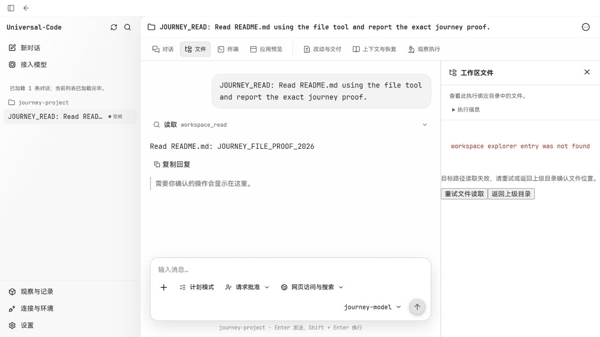
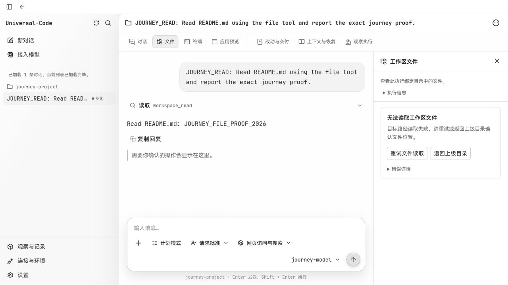
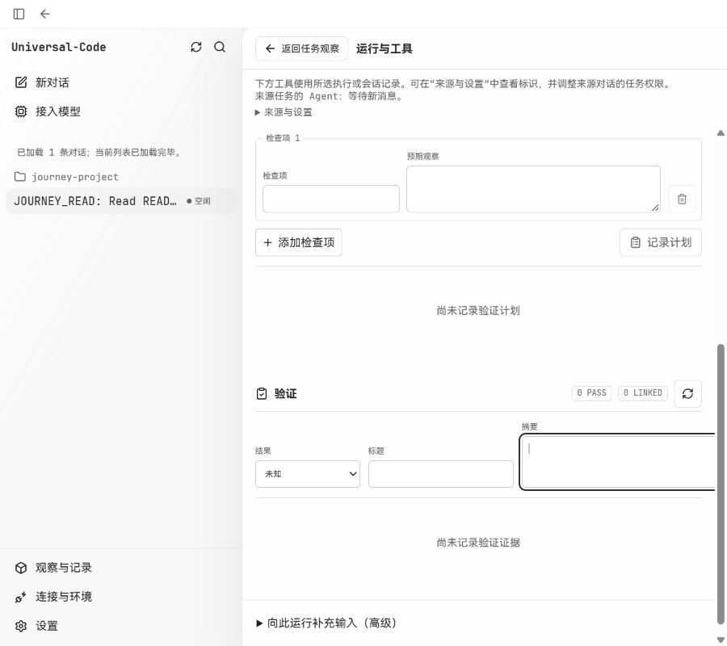
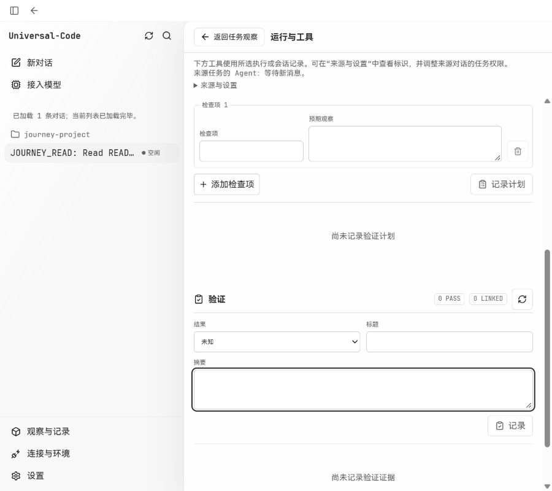

# 2026-10-14 页面排版验收

基于 `88a7ba864a0ce8ffb7d2da33bd5ecc6d77254aed`。本次检查文件抽屉、常规设置、运行与工具，以及模型和连接页面，修复六组实际排版问题。

## 修复与页面核对

| 页面 / 状态 | 复现与修复 | 实际查看的尺寸 |
| --- | --- | --- |
| 工作区文件读取失败 | 错误、加载和未绑定状态绕过容器内边距；错误按钮使用浏览器默认样式。统一容器、按钮和提示层次，技术错误放入可展开详情，长详情可在卡片内滚动。工作区确认阶段的加载与重试也补齐样式。 | 1280×720、390×844；长详情及确认阶段组件夹具 390×420 |
| 验证记录表单 | 900px 窗口展开侧栏后，固定列宽让摘要和记录按钮超出内容区。根据表单容器宽度换行。修复前表单宽 553px、内容宽 659px；修复后两者均为 553px。 | 1024×800、900×800 |
| 仓库历史 | 提交详情、文件历史行的操作按钮在侧栏展开后被截断。将原来按整窗判断的窄屏规则改为按历史面板宽度判断，并整理文件历史行的列位置。 | 900×800、390×844 |
| 常规设置 | 320px 窗口中的语言按钮受值区 48% 宽度限制，紧贴卡片右边。小窗口改为上下排列，值区允许使用完整宽度。 | 390×844、320×844 |
| 内置分析器 | 执行按钮引用未定义的 `primary-button`，显示原生样式。复用现有 `command-button`。 | 900×800，文本输入和确认勾选后查看 |
| 原生粘贴恢复提示 | 提示和 `v2-button` 均无对应样式，按钮相贴。添加提示间距、长文件名换行和操作区，按钮复用现有样式。 | 390×844，实际 hook 的恢复记录组件夹具 |

浅色和深色实际查看了文件错误态；雾透实际查看了对话、输入区、文件列表、连接与模型页面。模型目录在 900px / 390px、模型表单在 390px、连接页面在 900px 未发现新的溢出。本次保留现有字体、配色和主题材质。

## 截图

文件读取失败，1280×720，同一真实 API 文件缺失场景：

| 修复前 | 修复后 |
| --- | --- |
|  |  |

验证记录，900×800、侧栏展开：

| 修复前 | 修复后 |
| --- | --- |
|  |  |

## 环境与验证范围

- Windows，Codex 内置 Chromium 浏览器；通过真实控件导航并截图。
- 前端由 Vite 提供，后端为仓库现有 `workbenchjourney` 的真实 Go API，使用独立临时数据库和项目；模型由离线固定响应服务提供。
- 临时 README 文件被移走后，点击文件列表触发真实读取错误；恢复文件后，点击“重试文件读取”成功显示内容，错误详情可以展开。
- 原生粘贴提示使用实际 `useNativeClipboard` 和恢复存储，放入独立测试记录；检查提示、长文件名、加入及结束核对状态。未调用系统剪贴板。文件抽屉长错误、加载和绑定确认失败使用实际组件配合固定 API 返回值。
- 6 个相关测试文件、63 项测试通过；生产构建通过，保留已有的大分块警告。
- 两位子代理只读检查了本次组件和样式差异；页面操作与截图由主代理完成。完整本地截图、临时夹具和构建日志保存在本次工作目录的 `output/visual-acceptance/`，未整体提交。

用户截图中的 `sql: no rows in result set` 尚未在临时数据库复现，其具体运行绑定仍需核对原始数据。此次真实文件缺失复现命中了相同错误渲染分支。桌面 WebView 的 DPI、中文输入、窗口材质合成和原生剪贴板恢复没有在本次浏览器验收中验证。

参考 Anthropic 官方 [Improving frontend design through Skills](https://claude.com/resources/articles/improving-frontend-design-through-skills) 对排版和统一主题变量的指导。该文章不能证实用户提供的社交截图中关于 Claude 精确字重和 90ms 动效的数字，本次未据此修改字体或流式动画。
