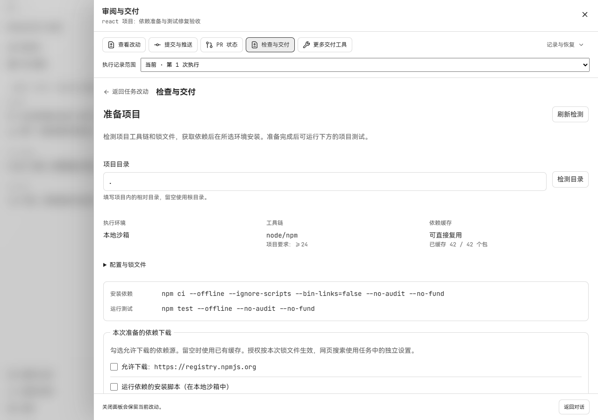
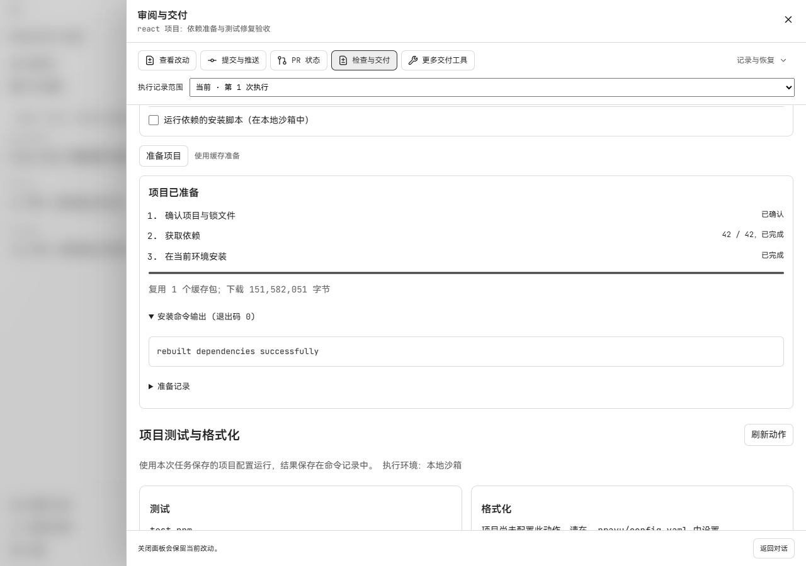
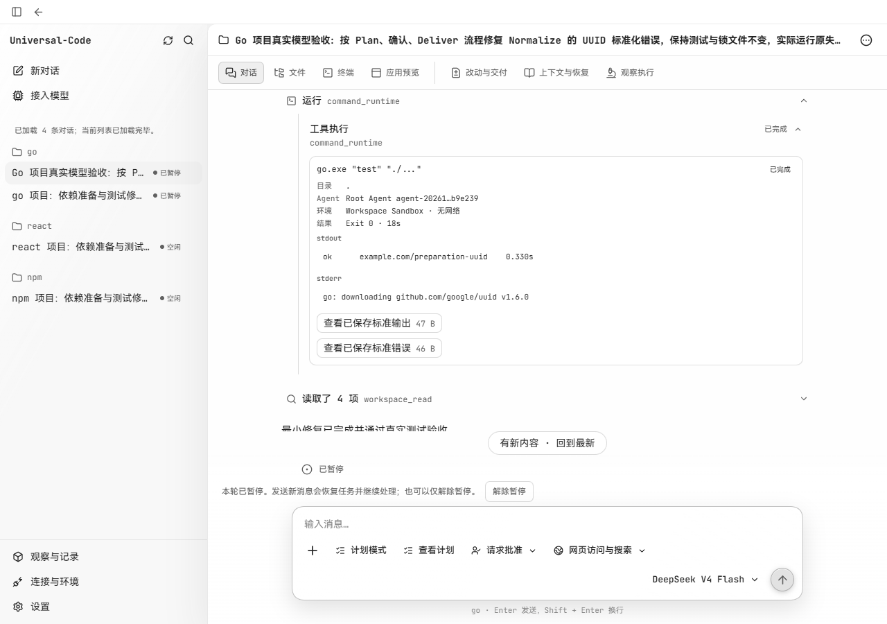
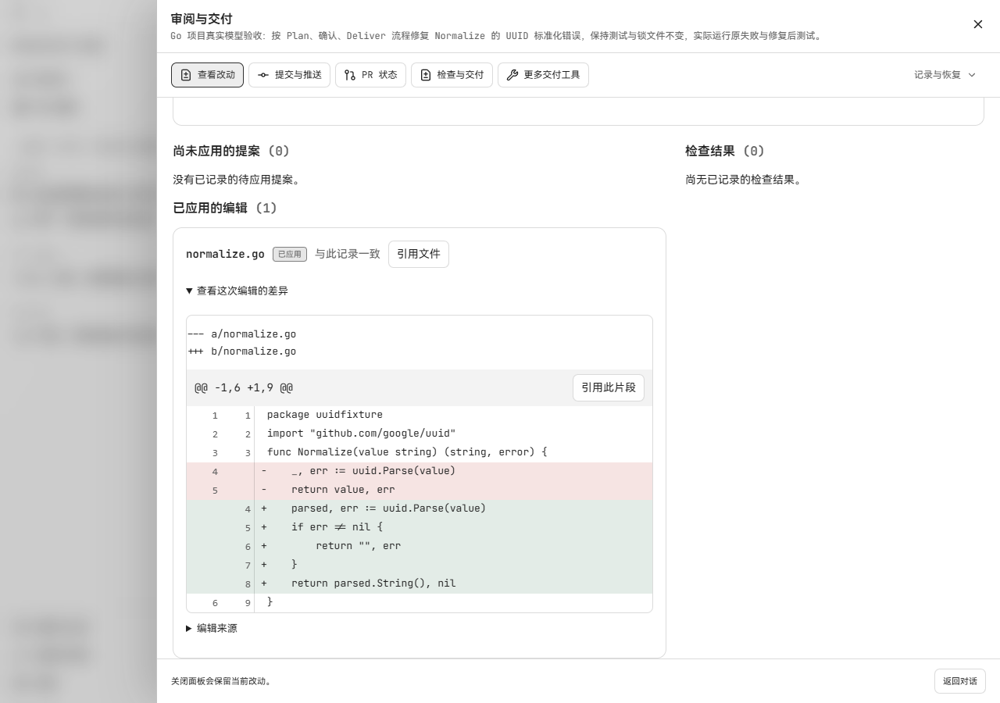
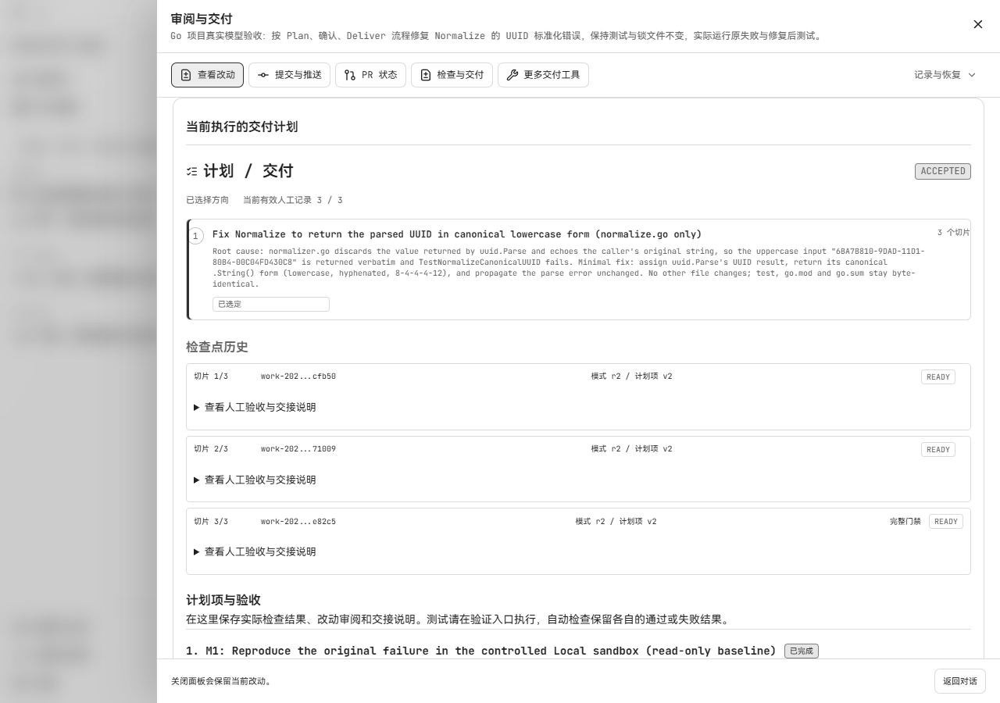
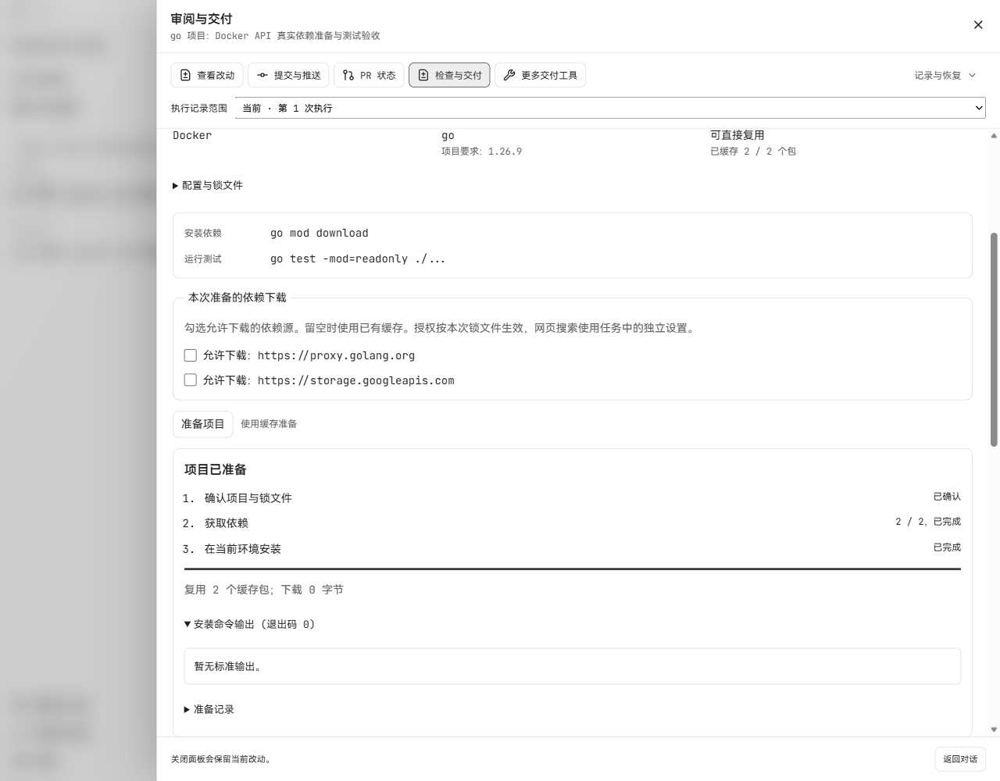
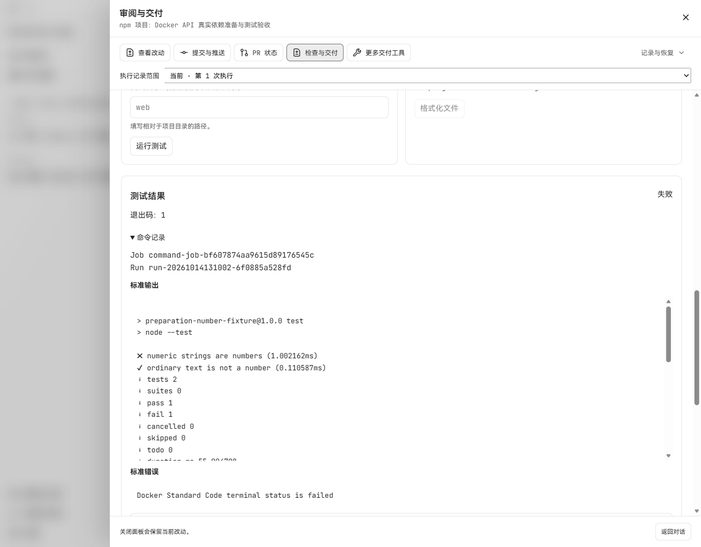

# 项目依赖准备与连续交付验收

日期：2026-10-14。关联 [#317](https://github.com/CWNU-Open-Source-Community/Universal-Code/issues/317)
和 [PR #318](https://github.com/CWNU-Open-Source-Community/Universal-Code/pull/318)。
实现从 main `88a7ba864a0ce8ffb7d2da33bd5ecc6d77254aed` 的独立工作树开始。

Docker React 与 SBX Go 的真实模型修复、原测试及恢复补验见
[2026-10-16 补验记录](2026-10-16-project-preparation-delivery.md)。下文保留本日原始结果。

## 范围与真实环境

使用三个独立 Git 项目，锁定真实发布的依赖，并预置保留不变的回归测试：

| 项目 | 外部依赖 | 需要修复的行为 |
| --- | --- | --- |
| npm | `is-number@7.0.0` | 接受数字字符串，继续拒绝普通文本 |
| Go | `github.com/google/uuid@v1.6.0` | 返回规范的小写 UUID |
| React | React `19.2.8`、Vite `8.2.1` | 计数器加法，随后执行测试和生产构建 |

项目由 `scripts/test-project-preparation.ps1 -Mode Prepare -IncludeReact` 创建。
创建步骤只写文件和锁定信息，依赖下载与安装由产品准备流程执行。
这些是使用真实依赖的小型验收项目；结果用于核对相应工作流。

Windows 本机实测使用生产 HTTP API、独立 SQLite 数据目录、正常 Run 租约、
Local LPAC、Node `24.14.0`、Go `1.26.9`。沙箱安装和测试进程保持网络关闭。
网页截图来自连接该 API 的真实 Edge，桌面视口为 1280×900，窄屏为 390×844。
模型验收使用已配置的真实 `deepseek/deepseek-v4-flash`。

## 已完成的准备与恢复检查

| 场景 | 实际结果 |
| --- | --- |
| npm / Go 缓存缺失、未选下载来源 | 操作失败，下载字节数为 0 |
| npm / Go 来源授权 | 分别下载 3,730 / 32,011 字节，经校验进入缓存 |
| npm / Go 缓存复用 | 安装成功，复用 1 / 2 个缓存条目，新增下载 0 字节 |
| React 下载中取消 | 1 个包完成后取消；取消结果持久保存 |
| 重启 API 后确认原 React 请求 | 返回原取消记录，保持原操作 ID |
| 显式重试 React 准备 | 42/42 条目完成，复用 1 条，下载 151,582,051 字节 |
| React 离线安装及已确认的安装脚本 | 安装完成，最终 `npm rebuild` 退出 0 |
| 无依赖 npm 项目的安装收尾 | 空目录测试通过；无需虚构 `node_modules` |

React 准备结果：`prep-e92052a3a9da345e34a812e97a8ae07d41c70c01f69332f647c4402b2c149f20`；
安装脚本 Job：`command-job-520a842f542ce1ff4f8ee02e`。





[390px 完成状态截图](../evidence/project-preparation/react-ready-narrow.png)已检查无横向溢出。

## 模型修复与最终交付

Go 已完成真实模型修改及原测试复测，默认 `go vet` 保持启用：

| 步骤 | 实际结果 |
| --- | --- |
| 新 Run 准备依赖 | 2/2 缓存命中，新增下载 0 字节，安装成功 |
| 原始回归 | `command-job-10ab0e03fb99d7e301797483` 退出 1，UUID 大小写断言失败 |
| 模型修改 | 通过正常提案应用 `normalize.go`，返回解析后的 `UUID.String()` |
| 模型运行原测试 | `command-job-157ec72f75cdaeca903ff22a` 完成，退出 0 |
| 独立复测 | `command-job-bb9eeb50f34e3934a5217d7c` 完成，退出 0 |
| 文件核对 | `normalize_test.go`、`go.mod`、`go.sum`、`README.md` 的前后 SHA256 一致 |

该会话使用真实 `deepseek/deepseek-v4-flash`，共 14 次模型调用、242,795 token，
18 次工具调用。代码修改由模型通过产品提案流程完成；操作者确认了计划方向、
进入交付、准备依赖、提交原测试与修复请求，并进行了独立复测。
计划选用了人工验收，三个所选工作项已完成、人工检查点为 3/3。
Run 保持 `paused/Deliver`，执行租约已释放。Plan 首次响应留下的一个未选中待办
仍按历史状态保留。记录中的“完成”指本次所选计划与原测试验收。

按不同的操作者控制动作计，验收驱动通过正常 API 发起 19 次控制：创建任务与
Local 配置 2 次、计划与修复消息 2 次、方向确认与进入交付 2 次、准备依赖 1 次、
原始与独立复测 2 次、暂停 1 次、三个工作项的启动/检查点/完成共 9 次。
计数包含首次 Plan 响应失败，不计只读轮询、文件摘要核对和同一动作重试。
宿主机源码补丁为 0，额外文件编辑审批为 0。此计数记录验收驱动承担的操作者
步骤，可用于后续比较减少介入后的流程。

[结构化结果与文件摘要](../evidence/project-preparation/go-repair-result.json) ·
[模型实际源码改动](../evidence/project-preparation/go-model-source.diff) ·
[模型回复截图](../evidence/project-preparation/go-model-summary-desktop.png)。







第一轮模型会话使用 120,000 总 token 预算，调试期间原 Run 已超过 20 分钟，
随后进入新 Run。该轮真实调用模型 7 次、使用 99,533 token；源码修改因未选择
交付计划被拒绝，后续上下文规划触及剩余预算，结果未完成。旧记录保留。
上表是后续按正常计划确认流程执行的单独会话，预算为
800,000 token / 32 轮 / 64 次工具调用。Plan 阶段曾出现末尾响应格式错误，
已保存的合法计划保留，操作者核对后继续确认；该错误也保留在原会话中。

Windows Local 的 npm 测试原生进程超时，未执行模型修复；React 的完整测试与构建
尚未计为通过。准备成功与测试成功分别记录。
本批三个小型验收项目均完成依赖准备，其中一个完成模型修改至原测试通过。
这组记录用于检验准备与修复流程，复杂项目成功率还需要更多真实项目样本。

## 实测发现并修复的问题

- 安装进程退出后，命令 reconciler 可能抢先完成 checkpoint，与安装收尾冲突。
  现在前台租约覆盖收尾，checkpoint 完成路径串行核对持久记录。
- Windows Node 模块加载会访问盘根元数据。固定 Node 环境保留符号路径解析，
  实际 npm 离线安装和普通脚本通过；私有文件与 loopback 访问仍被拒绝。
- Windows 的 Go 模块目录过长会使 `vet.exe` 的子进程工作目录无效。
  现在通过固定 `file://` 缓存源读取模块，在短私有目录展开，保留默认 vet。
  含空格、中文、逗号的长路径及只读缓存已用真实 LPAC 运行核对。
- 空依赖 npm 项目的成功安装可能没有 `node_modules`。收尾现在接受这一合法结果，
  仍拒绝目标缺失、目录被文件替代及链接异常。
- 模型下一轮读取先前启动的测试时，活动详情误要求观察与启动属于同一 attempt。
  详情读取现在支持同一 Agent 跨 attempt 的 `read/wait/list`，保留 Thread、Run、
  Root 归属校验；启动和控制动作的归属要求保持精确。
- Windows 原生短路径与目录大小写、macOS 的系统目录别名曾使缓存初始化失败。
  初始化现在使用对应平台的真实目录身份，仍拒绝应用目录内的链接和 junction。
  Windows 真实 8.3 路径与目录链接回归、macOS 原生缓存测试及两平台桌面构建
  已在提交 `bde6f6b0` 的 CI 中通过。
- Docker npm 需要私有 HOME；Go 编译需要更大的临时目录。固定 runner 补齐 HOME，
  Go 临时目录设为 512 MiB，其他工具链保留 128 MiB，总内存仍为 2 GiB。

## 执行环境的验证边界

| 环境 | 已执行 | 待完成 |
| --- | --- | --- |
| Windows Local | 真实 npm、Go、React 准备；取消、重启、重放；Go 模型修复、原测试通过与三个计划工作项验收 | 兼容 Node 的完整测试与构建 |
| Docker Engine | 固定 runner 与生产 HTTP API 中 npm / Go 离线安装退出 0，原回归退出 1；原请求重放、重启后的显式重试和自有容器清理 | Docker 内的模型修复闭环、React 完整测试与构建 |
| Docker Sandboxes | 适配代码与定向测试 | 本机 daemon 已停止，真实执行未验证 |

Docker 实测镜像为
`sha256:c3fbe9ca922a26b4230203d277c19651963314dce67b06e59be030b027259850`，
包含 Node `24.21.0` 和 Go `1.26.9`。固定容器使用关闭网络、只读根目录、删除
全部 capabilities、`no-new-privileges`、2 GiB 内存和 128 个进程限制。
挂载仅为此次创建的验收目录及私有临时目录。结束后已清除测试容器。

Windows Local 的 Node 子进程管道存在上游兼容问题：实测 libuv 的全局管道路径
被 AppContainer 拒绝，库反复重试，使 `node --test` 挂起。
[libuv #5181](https://github.com/libuv/libuv/pull/5181)提供对应修复。
原生回归验证了全局管道拒绝、应用自身 `LOCAL` 管道允许的区别；没有扩大文件、
网络或 DACL 权限。后续使用包含该修复的 Node 工具链复测，或采用 Docker 执行环境。
本机私有 Node 构建还缺 Visual Studio ClangCL 组件，未进行大型系统安装。

首次启动完整 Docker API 时，工具返回 `blocked by policy`，未提供更具体原因。
用户随后明确要求重试；通过原命令工具重新提交后启动成功，保留独立数据目录、
loopback 地址、独立读写令牌和原有权限控制。此次结果无法确定首次拒绝的原因。

## Docker API 补验

生产 API 为两个新项目选中 Docker，完成工作区信任确认和正常执行权限配置。
未授权包源时均保持下载 0 字节；授权后 npm 下载 3,730 字节、Go 下载 32,011 字节。
首次安装实际暴露 `configuration_mismatch`：Docker 继承固定镜像的
`org.traverse-board.project-actions=1` 和 `org.traverse-board.project-preparation=1`，
原检查只接受任务归属标签，因此两个容器都停在 Created，未启动安装命令。

修复只对完整验证的 Standard Code 配置认可这两个固定元数据标签。
每个归属标签仍须精确匹配；未知标签、错误值和通用配置保留原拒绝行为。
定向回归先复现创建后的失败，修后覆盖创建、生命周期观察、启动及日志/归档读取。

使用修复后的程序在相同数据目录和端口重启，旧失败记录保持原状态。
通过新操作键显式重试后，结果如下：

| 项目 | 安装结果 | 原请求重放 | 未修改的原测试 |
| --- | --- | --- | --- |
| npm | Docker 中完成，退出 0；复用 1 个包，新增下载 0 字节 | 返回同一准备操作 | `node --test` 正常完成；数字字符串断言失败，退出 1 |
| Go | Docker 中完成，退出 0；复用 2 个包，新增下载 0 字节 | 返回同一准备操作 | UUID 大小写断言失败，退出 1 |

原测试预置的代码错误用于检查真实命令与失败结果的传递。本次 Docker 补验
保留源码、测试、锁文件和配置的前后 SHA256，不执行模型修复。
生产 API 的 SQLite 记录、Run 归属、命令结果与退出清理均参与此次流程。
两次旧失败留下的容器和本轮执行容器都已由产品清理，按各自 Run 标签读取的
剩余容器数为 0。

随后在真实 Edge 的“检查与交付”页面点击“运行测试”，生成
`command-job-bf607874aa9615d89176545c`，页面显示同一预置断言失败及退出码 1。
下方两张截图采用 1280×1000 视口。

[结构化 Docker API 结果、界面测试记录、原始输出与文件摘要](../evidence/project-preparation/docker-api-result.json)。





## 复现入口

使用 PowerShell 7，先创建项目：

```powershell
./scripts/test-project-preparation.ps1 -Mode Prepare -IncludeReact
```

通过产品导入对应目录并选择执行环境。使用独立应用数据目录核对首次下载；
为当前进程设置 API 的读取令牌和控制令牌后运行：

```powershell
./scripts/test-project-preparation.ps1 -Mode Exercise -Project go -RunID '<run-id>' -ApiURL 'http://127.0.0.1:8765/api/v1'
```

`Exercise` 检查缓存缺失时的来源授权、真实安装、原请求重放、原测试失败和缓存复用。
在产品中让真实模型形成计划，确认后修复源码，保留测试与锁文件，再运行：

```powershell
./scripts/test-project-preparation.ps1 -Mode VerifyRepair -Project go -RunID '<run-id>' -ApiURL 'http://127.0.0.1:8765/api/v1'
```

保存命令生成的 JSON 报告、实际 Job 输出、模型调用记录和修复前后文件摘要。
测试未通过或环境未执行时，报告保留对应失败和未完成状态。
