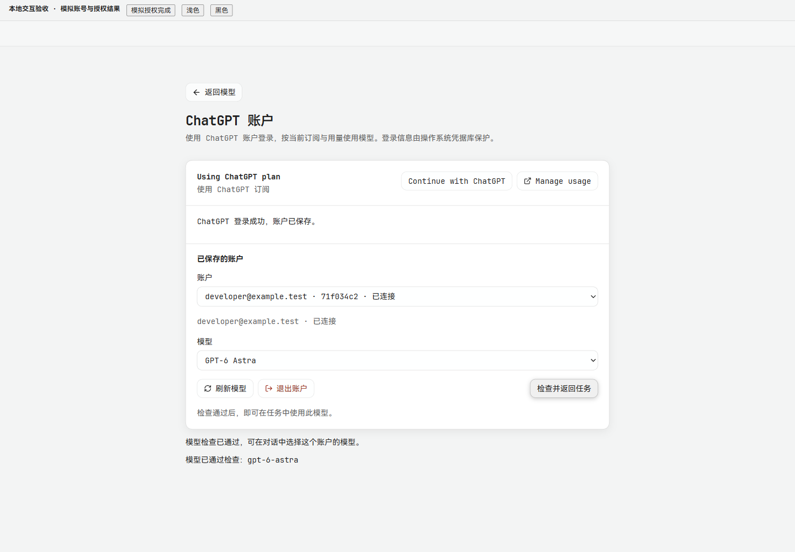

# ChatGPT 账户登录

入口：桌面应用「接入模型」或「设置 → 模型 → ChatGPT」。点击 **Continue with ChatGPT**，在系统浏览器中完成授权，再选择该账户返回的模型并运行「检查模型」。从任务进入时，检查通过后可返回任务使用所选模型。页面也支持取消等待、重新登录所选账户、刷新模型、退出账户和 **Manage usage**。

该入口使用 ChatGPT 订阅授权；原有 OpenAI API Key 配置继续独立显示。模型列表来自当前账户的接口响应，不在代码中承诺固定的可用模型或额度。

## 实现来源与边界

- 参考 [OCR #1622 / c7734212](https://github.com/alibaba/open-code-review/commit/c7734212e1bb2aa6049c0c26bbbb8fd23ffd1134) 和 [#1718](https://github.com/alibaba/open-code-review/pull/1718)，保留原始 Apache-2.0 归属，具体改动见 [UPSTREAM.md](../../internal/chatgptauth/UPSTREAM.md)。
- 按 OpenAI 的 [开源客户端令牌共享](https://developers.openai.com/siwc/token-sharing-open-source)、[登录](https://developers.openai.com/siwc/sign-in)和[模型推理](https://developers.openai.com/siwc/models-and-inference)约定实现动态客户端注册、PKCE、严格回调与身份验证、刷新恢复，以及公共 Responses 流式调用。
- OAuth 令牌和待验证的刷新响应保存在应用目录 `credentials/chatgpt/accounts.enc`。AES-GCM 密钥保存在操作系统凭据库；凭据库不可用时拒绝登录，不退回明文。
- 浏览器入口由 Go 打开。前端只收到单次本地启动链接，不接收访问令牌、刷新令牌、OAuth state 或完整授权 URL。用量入口固定为 `https://chatgpt.com/settings/usage`。
- 模型运行时绑定具体账户与登录会话。正常刷新不使运行时失效，退出或重新登录使旧运行时失效；调用固定发送到 `https://api.openai.com/v1/responses`。
- 本次接入桌面控制面；独立 CLI 的登录命令不在本次交付范围。

## 验证结果

Windows 本地验证：

- Go：授权包、模型注册与 Responses 适配测试通过；授权与应用服务的相关 race 检查通过。HTTP API 包完整测试通过，包含控制令牌、严格请求体、接口生成和路由覆盖。
- 桌面包完整测试首次发现 bootstrap 精确字段断言缺少新字段。补齐字段并保留默认关闭断言后，相关 bootstrap 与浏览器 URL 验证测试通过；未再重复运行整个桌面包。
- 前端：账户协议、连接状态、桌面桥接、模型设置和账号页面的 63 个相关测试通过。另有此前运行的相关 API/设置测试通过。生产构建通过。
- Windows 桌面程序使用 `desktop,production,wv2runtime.error` 标签编译通过；本次未启动该程序进行真实账户登录。
- 在实际浏览器中挂载产品组件及其样式，以明确标注的本地模拟账户验证等待、取消、授权完成、模型选择、检查返回、退出，以及浅色和黑色主题。1440 × 1000 与 390 × 844 视口检查通过；窄屏页面宽度与内容宽度均为 390 CSS px。

**真实账户授权、真实订阅模型推理及远程撤销尚未验证。** 截图中的邮箱、模型和授权结果都是本地验收数据。截图是浏览器直接保存的 PNG，没有拉伸或重绘。

[窄屏浅色截图](assets/chatgpt-sign-in/connected-390-top.png) · [窄屏黑色截图](assets/chatgpt-sign-in/dark-390.png)

## OCR delegate 审阅覆盖

OCR 负责文件选择与规则解析，主 agent 和审阅子 agent 实际阅读代码。范围为本 PR 的 38 个可审阅生产文件：全部审阅，未跳过；其中 16 个新增文件全文审阅，22 个已有文件审阅全部改动及相关调用上下文。该比例不表示既有文件或仓库全文审阅完成。

全文审阅的新文件：

- `internal/chatgptauth/{api_error,jwt,lock_unix,lock_windows,models,oauth,store}.go`
- `internal/application/chatgpt_auth.go`
- `internal/httpapi/chatgpt_auth.go`
- `internal/desktop/chatgpt_browser{,_unix,_windows}.go`
- `internal/llm/chatgpt.go`、`internal/modelregistry/chatgpt.go`
- `web/src/api/chatgpt-auth.ts`、`web/src/v2/components/chatgpt-account-settings.tsx`

全部改动及相关上下文审阅：

- `internal/desktop/{bridge,control_plane}.go`
- `internal/httpapi/{handlers,openapi,runtime_capabilities,server}.go`
- `internal/llm/{openai,openai_responses,provider_runtime}.go`
- `internal/modelregistry/{provider_definition,registry}.go`
- `web/src/api/client.ts`
- `web/src/components/{connection-gate,model-availability-dialog}.tsx`
- `web/src/lib/desktop-bridge.ts`、`web/src/state/connection.ts`
- `web/src/v2/app.tsx`、`web/src/v2/client-session.ts`
- `web/src/v2/components/{model-settings,provider-settings,settings}.tsx`、`settings.css`

修复了两处实际问题：正常刷新错误地递增会话版本，导致原模型运行时拒绝后续请求；前端把账号管理能力错误绑定到任务执行开关，导致允许管理模型但关闭执行的连接无法登录。对应回归测试通过。最终复核未留下已确认的阻塞问题。

OCR 默认排除测试文件；新增授权测试及受影响断言进行了针对性人工阅读，未声明测试文件全文覆盖。生成的 `docs/openapi.json`、`web/src/api/schema.d.ts` 排除逐行审阅，以生成与契约测试验证；截图、文档和本地 `output/` 也不计入上述生产文件覆盖。
