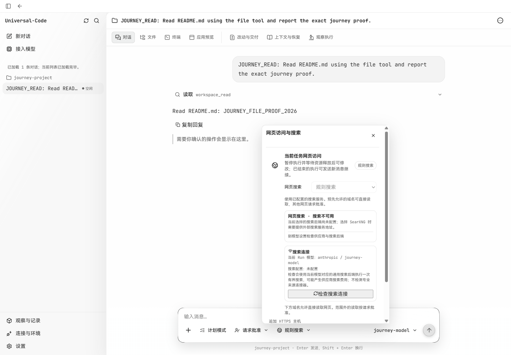
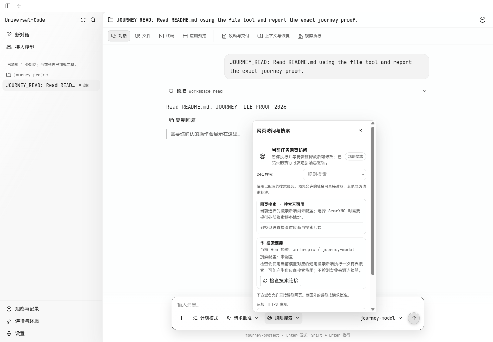
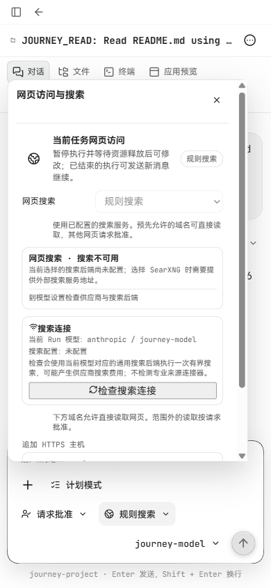
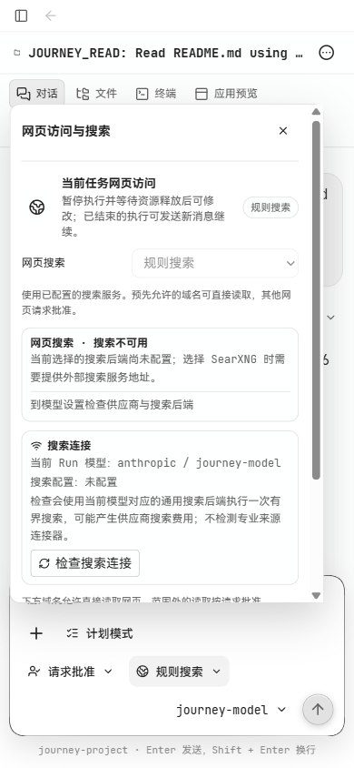

# 输入框网页访问弹层排版验收

2026-10-15，基于 `a05a1446`（已包含 #320）。范围是输入框内、权限按钮右侧的“网页访问与搜索”弹层。

展开后，搜索模式、说明文字和搜索状态卡片继承了设置面板的 44px 左缩进，卡片明显变窄；“检查搜索连接”使用浏览器默认按钮，图标与标题缺少间距。修复将弹层内部内容对齐，增加说明文字字号和行高，并复用项目按钮样式。

## 实际页面检查

- 使用本地 `workbenchjourney` 的 Go API、SQLite 会话和离线模型完成文件读取后展开弹层。修复前使用构建产物，修复后使用 Vite 连接同一 API 和会话。
- 浅色主题，1440×1000、900×800（侧栏展开）以及 390×844（侧栏收起）。弹层没有横向溢出，900px 窗口可滚动至底部主机输入和追加按钮。
- 1440px 窗口的权限、网页访问、模型选择控件同高 34px，顶部对齐。390px 窗口沿用现有换行布局。
- 本次截图覆盖未配置搜索后端的状态；没有执行收费搜索探针，未将诊断成功结果记作已验收。

截图均为浏览器原始 PNG，尺寸与上述视口一致，没有拉伸或重采样。同组修复前后使用相同视口、主题、会话和展开状态。

### 1440×1000

修复前：

修复后：

### 390×844

修复前：

修复后：

## 代码检查

- `npm test -- src/v2/components/search-diagnostics-control.test.tsx src/v2/components/approval-network-layout.test.tsx`：2 个文件、21 项测试通过。
- `npm run build`：通过。
- OCR delegate 提供文件选择和规则；主 agent 全文阅读 `search-diagnostics-control.tsx`，阅读 `v2/styles.css` 的全部改动及相关上下文。2/2 代码文件的 diff 已审阅，无跳过；CSS 未全文审阅。未确认本次改动引入的缺陷。
