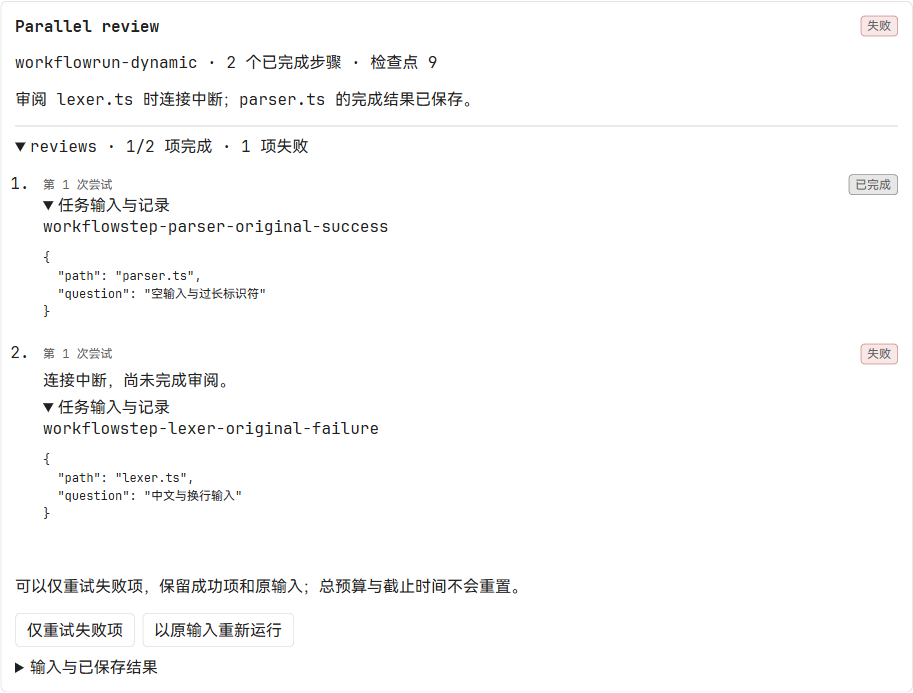
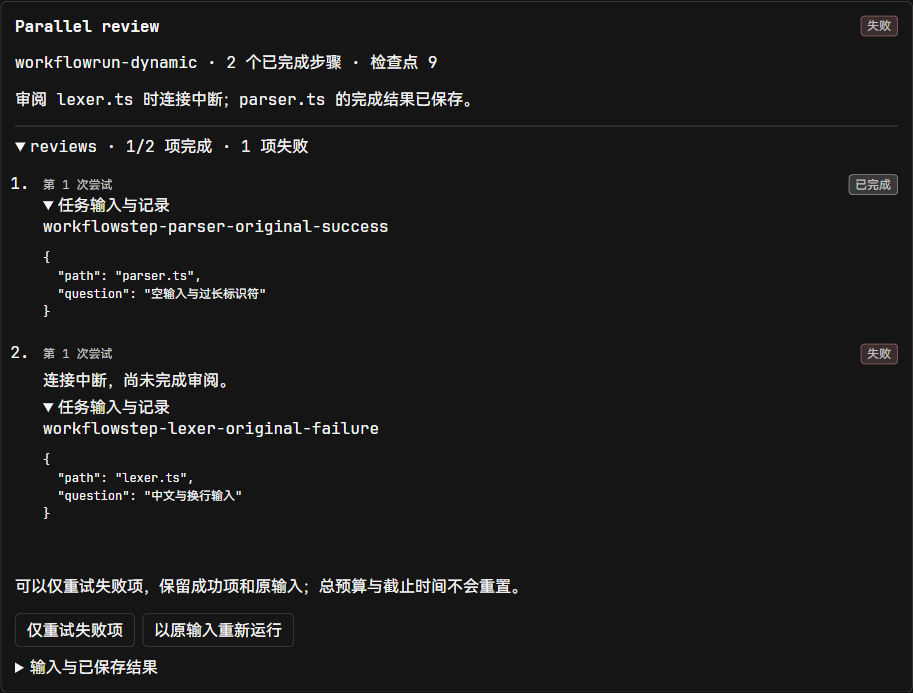
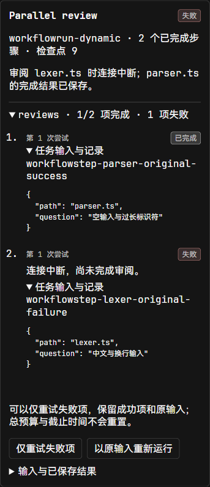

# 动态工作流、并行汇合与失败项重试

2026-10-18，Windows。基于工作流验证收据消费者 `83745f84`，继续使用既有子代理、宿主调度、权限、Run lease 和 SQLite 检查点，不需要数据库迁移。

## 行为

- 子代理完成报告可返回最多 4 KiB、深度最多 8 层的结构化 `data`。沿用脱敏和输出策略检查，JSON 中的大整数保持原值。
- `map` 从已有输入或步骤结果的数组展开固定任务，最多两项并行。任务、工具范围、预算和代码验收规则来自已保存定义；结果中的文本不增加执行权限。
- 首次展开持久化原数组、输入和每项身份。重启后读取原生完成记录，按原数组顺序汇合；空数组直接汇合，非数组或超过上限的输入在委派前失败。
- 同一轮的文件应用和删除依次提交共享工作区检查点；模型和读取仍可并行，等待用户审批不占写入队列。两个不同文件同时获批的回归已通过。
- 失败后明确点击“仅重试失败项”。成功项与原始结果保留，失败项使用新一代子任务；累计次数、模型用量和原截止时间不会重置。重复提交同一操作键不产生第二次重试。
- 代码交付型子任务继续消费原生验证收据，模型 `data` 中自报成功不会替代实际测试。结束前再次核对当前代码与测试结果。

## 页面与请求验收

独立 Edge 使用正式 `WorkflowPanel`、API client 和主题样式，HTTP 数据由本地夹具提供。这部分确认组件布局、保存和重试请求；不作为模型自主执行或后端持久化的证明。

已实际保存动态模板、展开各项详情，并点击重试。请求带当前 revision、明确确认字段和操作键；响应展示原成功项及失败项的新代数。1280 × 1000 的浅色、深色以及 390 × 844 的窄窗口均无横向溢出，长任务身份正常换行。截图直接保存浏览器原始像素，未拉伸。







`npm --prefix web test -- --maxWorkers=1 src/components/workflow-panel.test.tsx src/api/workflows.test.ts`：22 项通过。覆盖动态模板保存、失败项显示、明确重试请求、版本和响应身份校验、暂停或缺少操作权限时禁用操作。重新生成 API 类型后 `npm --prefix web run build` 通过，包含 TypeScript 检查；构建仍提示部分 chunk 超过 500 kB。

## 后端检查与复审

后端定向用例使用真实 SQLite、子代理和工具执行记录，模型响应使用确定性测试 transport。动态工作流尚未单独进行真实远端模型自主执行验收；真实模型连续压缩验收记录在压缩恢复 PR 中。

主工作树已通过以下定向检查：

```text
go test -p 1 ./internal/application -run 'TestCompletionDataUsesDecodedOutputPolicy|TestSafeSpecialistActionRetainsRedactedCompletionData|TestSubagentRunnerRejectsMalformedToolAndDangerousResponses' -count=1 -timeout 180s
go test -p 1 ./internal/httpapi -run 'TestWorkflow|TestOpenAPIRoutesMatchAuthenticatedLiveHandlers|TestOpenAPIGoldenDocumentMatchesGoDTOs' -count=1 -timeout 240s
go test -p 1 ./internal/protocolregistry -run TestRepositoryRegistryIsValidSynchronizedAndNonAuthorizing -count=1 -timeout 120s
go run -p 1 ./cmd/protocolregistry -check -baseline 83745f8496d7b262c11e0d585cdb43a63436a827
go run -p 1 ./cmd/surfacecheck
```

Data 输出策略用例覆盖嵌套值、转义后的字段名、换行和大指数数字后仍需检查的文本；HTTP 用例通过真实 SQLite 构造失败项，核对明确确认、控制权限、Run 身份、revision、操作键及原成功项保留。API golden 保持实际路由成功状态断言。

预算回收及审批恢复修复后的工作流回归通过：

```text
go test -p 1 ./internal/store ./internal/application -run TestWorkflow -count=1
```

store 用时 3.307 秒，application 用时 97.206 秒。最后补齐截止时间回收与旧版普通 worker 兼容后，以下增量检查再次通过，store 用时 1.179 秒，application 用时 30.050 秒：

```text
go test -p 1 ./internal/store ./internal/application -run 'TestWorkflow(MapApprovalCapacityAndSiblingProgressSurviveRestart|DueExpiresDormantWaitsEvenWhenRunIsPausedOrBusy|MapRejectsInvalidExpansionAndRoundBudgets)' -count=1
```

这些用例覆盖两项审批占满预算后的原任务继续执行、未运行项回收、暂停或有其他 Run 租约时到期、没有 map 状态的旧版普通 worker，以及非法展开与轮次预算。回收只在持有当前 Run 租约时修改原生子任务，租约竞争不会把仍在运行的任务提前判为失败。

最终后端提交 `7db98743` 已无冲突整合为 `381afd3a`；整合后没有重新跑 Go。OCR delegate 的阅读范围、问题修复和生成文件排除见[复审记录](../reviews/workflow-dynamic/README.md)。

## 主线组合

#381、#383、#385、#386、#387 合并后，本分支以 `c1caf99b3fe4169d4d195f9587ff56b5957b759d` 同步 main `506e279f2c005765beaa82ca08cfbeac62192809`。自动合并无冲突，相对主线仍为原动态工作流范围；没有新增业务实现或迁移。

`npm --prefix web run generate:api` 重新生成的类型与自动合并结果一致；`npm --prefix web run typecheck` 和 `git diff --check` 通过。原分支 `b5c3c81e` 的 22 项远端 CI 已全部通过；主线组合另交由 #388 更新后的远端 CI 验证，本次没有运行本地 Go。
