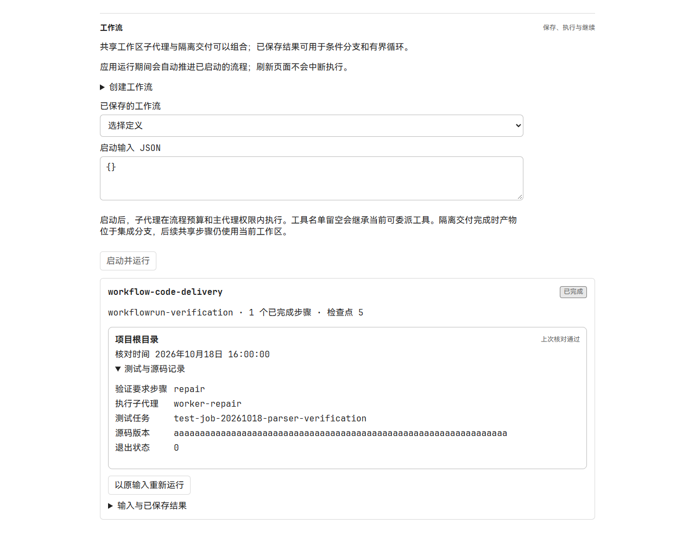
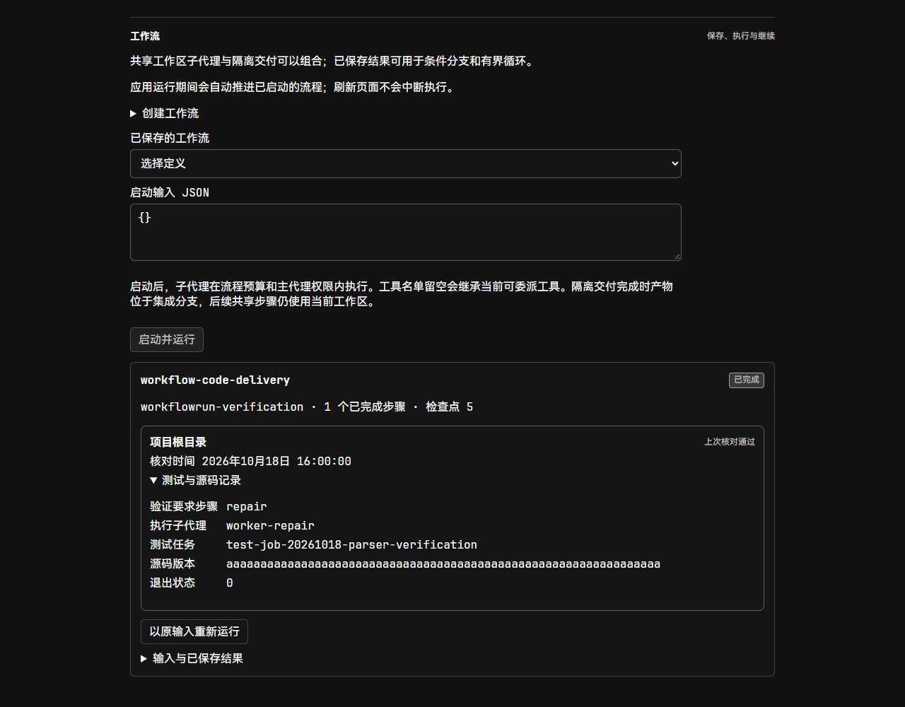
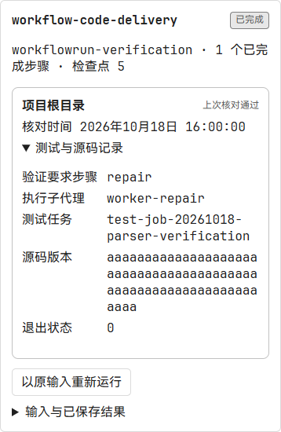

# 工作流代码交付验证

2026-10-18，Windows。基于长项目验证收据实现 `08b9f146`，沿用原生 Job、工作区版本和现有权限；本改动不需要数据库迁移。

## 行为

- 新建执行型工作流默认选择“代码交付：验证通过后完成”；分析任务可选择“分析报告”。旧定义省略 `completion` 时保持报告式完成。
- 代码步骤必须有当前源码对应的成功测试 Job，且进程树已回收。模型报告里的成功文字或 Job 编号不会替代原生记录。
- 宿主只检查当前工作流委派的子代理。起始测试与最终报告可以来自该子代理的不同轮次；普通工具读取仍遵守原有 actor 所有权。
- 工作流结束前再次核对；后续源码变化、同目录更新的失败或未结束测试使旧成功失效。分析步骤运行的后续失败测试也参与此判断。
- 界面显示“上次验证核对”、核对时间、测试子代理、Job 和源码版本。这是持久化的核对结果，重新打开页面不会重新执行测试。

## 页面验收

独立 Edge 加载正式 `WorkflowPanel`、API client、样式和主题初始化函数；HTTP 响应来自本地确定性夹具。此项覆盖组件显示与保存交互，后端执行行为由下述 Go 集成测试覆盖。

已操作代码交付和分析报告两种创建路径，确认保存请求保留选定类型，切换到分析报告后不会携带隐藏的测试目录。浅色、深色均检查了 1280 × 1000 和 390 × 844 CSS 像素窗口。窄窗口的页面宽度与文档宽度均为 390px，测试任务编号和源码版本正常换行。

截图按浏览器原始比例保存。窄窗口图片是执行卡片的元素截图。

## 执行检查

后端定向测试覆盖真实本机测试 Job、同子代理跨轮 start/wait、源码与权限变更、后续测试覆盖、重启回放、工作流暂停和 claim 丢失。模型响应使用测试 transport；没有把这些用例计为真实模型自主交付验收。

已完成的定向检查：

- `go test -p 1 ./internal/application -run TestWorkflow -count=1` 通过（53.360s）。包含核对开始与结束时、单步骤与最终完成时发生 Run Pause 的四个恢复用例：原生完成报告保留，恢复后模型调用仍为两次、测试 Job 仍为一个。Run Cancel 的两个时点均拒绝完成。运行于后端修复提交 `4e759f94`；随后整合了依赖 PR 的取消回收补丁 `08b9f146`。
- domain 的工作流合同测试、store 的工作流测试通过；生产 Desktop/API 接线编译通过。
- 整合后运行 `go test -p 1 ./internal/httpapi ./internal/protocolregistry -run 'TestWorkflow|TestOpenAPIGoldenDocumentMatchesGoDTOs|TestRepositoryRegistryIsValidSynchronizedAndNonAuthorizing' -count=1 -timeout 180s` 通过（7.578s / 3.974s）。
- `go run -p 1 ./cmd/cyberagent api openapi --output docs/openapi.json`、`npm --prefix web run generate:api` 和 `go run -p 1 ./cmd/surfacecheck` 通过。
- `npm --prefix web test -- --maxWorkers=1 src/components/workflow-panel.test.tsx src/api/workflows.test.ts`：16 项通过。
- `npm --prefix web run build` 通过，包含 TypeScript 检查。构建仍提示部分 chunk 超过 500 kB；本改动没有调整此提示。

Go 检查使用 `GOMAXPROCS=2 GOMEMLIMIT=3GiB` 串行构建。未运行仓库全量测试；CI 状态以 PR 为准。

## OCR delegate 复审

OCR 负责文件选择和规则解析，主 agent 与独立子 agent 阅读代码。独立复审发现 Run 暂停期间收据核对会误判为失败；修复后复审通过，新增暂停恢复测试也通过。详见 [审阅范围和结论](../reviews/workflow-verification/README.md)。
