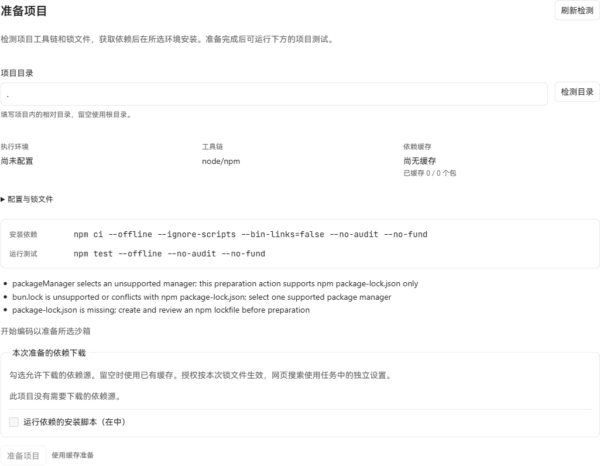
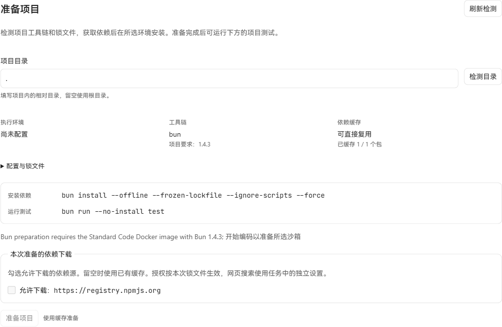

# Bun 锁定依赖准备验收

日期：2026-10-20。基线 `a1a06a508f0bc74ab2f168ad9fef0d8209cfc80e`。Windows 上使用真实 Bun 1.4.3、生产 API、SQLite 和生产前端，没有模型调用、模拟路由或 DOM 改写。

## 交付范围

显式选择独立项目目录，要求 `packageManager: bun@1.4.3` 和文本 `bun.lock`（lockfileVersion 2/configVersion 1）。JSONC 使用 `github.com/tidwall/jsonc v0.3.3` 转换后由标准 JSON 解析器校验。根依赖须与 manifest 一致，默认 registry 包须有 SHA-256/SHA-512 integrity。原文件与解析后的包身份、版本、URL 和摘要继续绑定本次准备授权。

broker 复用现有精确来源授权与下载缓存，核验 tarball 后在任务内生成 Bun 1.4.3 的 `name@version@@@1` 缓存目录。共享缓存不挂入执行环境；归档链接、路径越界、大小写冲突、设备名和超限内容被拒绝。固定命令为：

```text
bun install --offline --frozen-lockfile --ignore-scripts --force --backend=copyfile --cache-dir=<任务内缓存>
bun run --no-install test
```

`--force` 会从核验后的缓存恢复同名同版本的已修改依赖；`copyfile` 避免安装目录与缓存硬链接。测试入口使用原 `scripts.test`，安装始终忽略生命周期脚本。

产品执行路径限于含固定 Bun 1.4.3 的 Standard Code Docker 镜像。新工具链沿用现有 namespace、Job、权限、资源上限、离线网络与清理合同；旧镜像显示重建要求。镜像构建脚本新增 `CYBERAGENT_STANDARD_CODE_BUN_IMAGE_DIGEST`，需预先提供本地 `name@sha256:digest` Bun 镜像；构建不拉取镜像或开放网络，并检查复制后的 Bun 版本。

旧 `bun.lockb`、workspace、Git/file/link/alias、自定义 registry、pre-release/build 版本、bunfig/.npmrc、patch/override 及额外锁配置均显示具体不支持原因。Local、SBX、Full 不会被自动选为替代环境。本批没有数据库迁移。

## 已执行结果

| 验证 | 结果 |
| --- | --- |
| 原生 Bun 缓存原型 | 冷缓存的 `--offline` 安装失败；由生产 broker 复验的真实 tarball 解包后，两个新目录均 frozen 安装并通过原测试，manifest/锁文件/测试文件摘要不变 |
| 生产检测器与 broker 的原生整链 | `is-number@7.0.0` 与 scoped `@colors/colors@1.6.0`；两次新建中文/空格路径，每次复用 2 个已核验包，下载 0 字节；改写已安装的 is-number 后强制离线重装恢复，原 `bun:test` 通过 |
| 生命周期脚本 | 真实 `esbuild@0.25.0` 的 postinstall 原型及根 postinstall 哨兵：使用本批 ignore-scripts/force/copyfile 后，根哨兵未写，esbuild 入口保持 tarball 原字节；代理请求计数为 0 |
| 来源授权与错误 | 无授权冷缓存拒绝，下载 0 字节；损坏摘要、非 registry 来源、冲突配置、归档链接/路径/大小写、超限、取消和权限撤销的聚焦检查通过 |
| 生产 API 与界面 | 正确显示 Bun 1.4.3、来源、固定安装/测试命令和已校验缓存 1/1；当前环境不可执行，明确提示所需 Docker 镜像，POST 准备返回 FAILED_PRECONDITION，未创建命令 Job |
| SQLite | schema_migrations 最大版本 217，foreign_key_check 无错误，命令 Job 数为 0 |

本机 broker 直接 HTTPS 下载返回 EOF。上述成功路径使用真实 npm tarball，经公开 SRI 核对后预置下载缓存，再由生产 broker 重新核验和解包；没有计为 broker 网络下载成功。Bun 原生离线过程的 HTTP 代理计数为 0；操作系统级的无网络容器运行尚未验证。

本机 Docker CLI 存在，但 `dockerDesktopLinuxEngine` 管道不可用；Docker 镜像构建、完整产品安装/测试 Job 与 SBX 均未实跑。产品界面没有显示安装成功状态。

## 检查与依据

已通过 projectprep/dependencycache 全包测试（显式设置真实 Bun 和两个 registry tarball 输入）；application 准备/检测/命令绑定聚焦测试；Docker namespace、版本标签、生命周期/IO 所有权合同及固定 runner 检查；HTTP 准备/OpenAPI DTO 检查；相关包 vet、tidy-diff 和协议注册表检查。生产前端构建成功。CI 增加摘要固定的 Bun 1.4.3 和 tarball 输入，使原生验证进入 dependencycache 测试。

官方资料说明硬性离线和 frozen 行为：[bun install](https://bun.com/docs/pm/cli/install)、[文本锁文件](https://bun.com/docs/pm/lockfile)。缓存内部键由 [Bun 1.4.3 源码](https://github.com/oven-sh/bun/blob/bun-v1.4.3/src/install/PackageManager/PackageManagerDirectories.rs) 与实际安装共同确认。[生命周期文档](https://bun.com/docs/pm/lifecycle)说明默认 trusted allowlist，因此本批始终显式禁用脚本。

整合 Yarn、Cargo 与 Python 准备入口后，projectprep/application 的 Bun、Yarn、Cargo、Python 聚焦检查通过；重新执行真实 Bun 检测、缓存、双目录离线安装、强制复装和原测试也通过。Windows Go 1.26.9 使用含正斜杠的 `GOTMPDIR` 时，`t.TempDir()` 返回的混合分隔符路径被生产缓存构造器拒绝；测试改为该临时目录内的 `cache` 子目录，保留生产路径校验。

一次更广的 application 检查达到 3 分钟超时，停在已有 PNPM manifest-changes 场景，未计为通过；随后按本批共享入口执行的上述检查通过。Docker 容器整链仍未运行。

同步主线 npm workspace 与 Python 父分支后，再次运行 Bun 检测/缓存/原生安装、npm workspace 检测/命令目录/成员排除规则、Python 命令边界和原生语言预设检查，全部通过；主线的 workspace 链接与 Python seed 指纹绑定均保留。

最终整合与原生 Bun 日志保存在本机 `output/playwright/bun-delivery`；下面两张生产页面截图随本文件提交。

改动前：



改动后：


