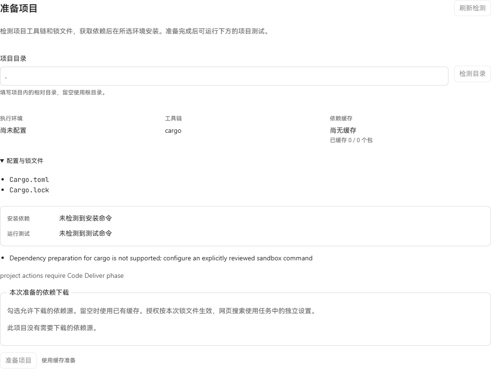
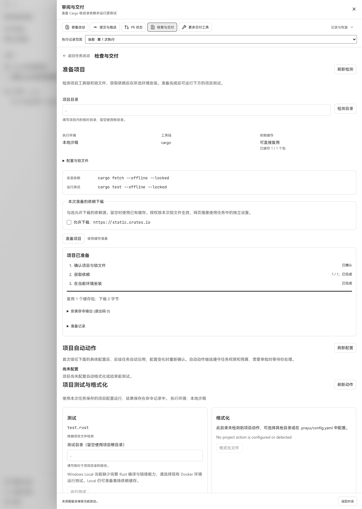
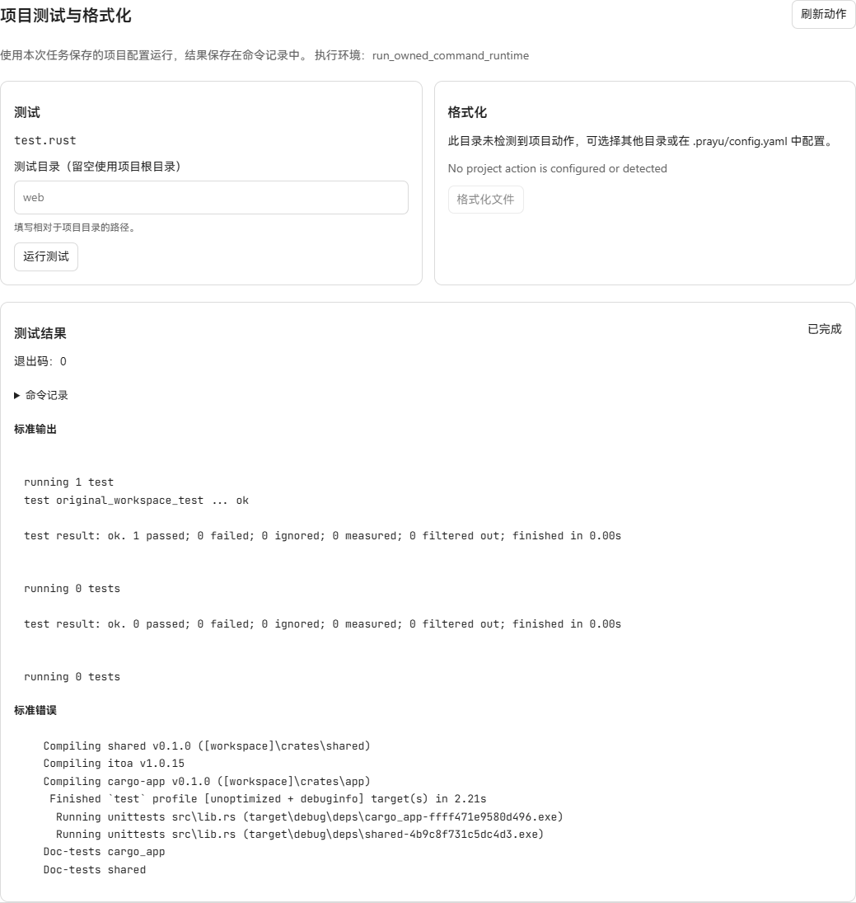

# Cargo 项目依赖准备验收

日期：2026-10-20。Windows，Cargo/rustc 1.97.1，生产 API、真实 SQLite 和生产前端。没有模型调用、修复测试、模拟路由或 DOM 改写。

## 交付行为

在“准备项目”显式选择含 `Cargo.lock` v3/v4 的 Cargo 项目或 workspace 根。检测绑定根、成员及递归本地依赖的 `Cargo.toml`，并绑定会影响 Cargo 的仓库内配置文件。成员目录不会自动借用祖先锁文件。

下载限定为锁文件中带 SHA-256 的 crates.io `.crate`。每次下载仍需具体来源授权；缓存命中重新校验 SHA-256。broker 在当前任务内生成 Cargo directory source 及逐文件校验信息，现有命令运行时执行 `cargo fetch --offline --locked`。对应的已配置或检测出的 `test.rust` 使用同一 vendor 来源运行 `cargo test --offline --locked`。没有数据库迁移。

Git、自定义 registry、根目录外的本地依赖、patch/replace、显式 workspace 重定向、rust-toolchain 文件及 source/build/env 等 Cargo 配置会显示具体问题。当前 workspace glob 支持 `*`、`**`、`?`，不支持括号或花括号语法。

## 实际结果

验收项目包含 `crates/app`、`crates/shared` 和 crates.io `itoa=1.0.15`。原有测试调用 shared 与 itoa，并断言输出 `42`；两个运行目录的跟踪文件和锁文件均未修改。

| 路径 | 实际结果 |
| --- | --- |
| 改动前生产界面 | Cargo 被识别，但依赖准备不受支持 |
| 未授权来源、冷缓存 | 失败，下载 0 字节，没有执行安装 |
| 已授权来源下载 | 本机请求返回 EOF；未计为下载成功 |
| Windows Local 准备 | 将实际 `.crate` 按公开 index SHA-256 校验后预置共享缓存；生产 broker 再校验并命中 1 包，下载 0 字节，LPAC 内 offline/locked fetch 退出 0，操作进入 ready；相同请求键复用原操作 |
| Windows Local 测试 | 原实测出现 E0463（标准库不可读）及子进程目录错误 267；当前在执行前显示工具链/链接能力不足，测试按钮不可用 |
| 显式 Full 宿主测试 | 同一原项目独立目录、无 Drydock；在界面确认 Full，通过现有 profile API 选择 local，点击运行 test.rust；使用 broker 准备的 vendor，退出 0，`original_workspace_test ... ok` |
| 原生 Cargo 验证 | 两个全新目录、空 CARGO_HOME、中文/空格路径；真实 broker 缓存复用后 fetch/test 成功，原始文件保持不变 |
| SQLite | schema_migrations 最大版本 217，foreign_key_check 无错误 |

Local fetch Job：`command-job-96d9b61107678e39c19c25c4`；Full test Job：`command-job-09b176a1724df10734803e91`。持久 Job 分别记录 `sandboxed_workspace/local_windows_lpac/ask` 与 `host_unsandboxed/run_owned_command_runtime/full`，命令声明 network disabled、credentials none。Full 使用宿主权限；此结果不代表沙箱编译测试成功。

本机未运行 Docker Engine 或 SBX 成功链。Local 任务已有的 Drydock 不会被自动切换为 Full；本批保留现有权限与运行时选择规则。

## 检查

- `go test ./internal/projectprep ./internal/dependencycache -count=1 -timeout=3m`，设置真实 Cargo 与 itoa 归档路径，包含原生 Cargo 验证。
- `go test ./internal/application -run 'TestNativeLanguage|Cargo|TestProjectPreparation' -count=1 -timeout=3m`。
- `go vet ./internal/projectprep ./internal/dependencycache ./internal/application`。
- HTTP 准备/OpenAPI DTO、release gate、product e2e 合同检查；协议注册表与 surface check 同步；生产前端构建成功。

解析、归档和 broker 检查覆盖成员摘要变化、Git/registry 拒绝、锁文件校验和、归档路径及大小上限、链接/大小写冲突、缓存损坏、权限撤销和取消。原始网络 EOF 和 Local 编译失败均保留在本机 `output/playwright/cargo-project-preparation`，没有改为成功记录。

Windows Go1.26.9 使用含正斜杠的 `GOTMPDIR` 时，`t.TempDir()` 返回的混合分隔符路径被生产缓存构造器拒绝。测试改用该临时目录下的 `cache` 子目录，保留原有绝对路径与规范路径校验；重新运行真实 Cargo，在两个中文/空格目录中的离线 fetch、编译及原测试全部通过。此次结果保存在本机 `output/playwright/cargo-native-fixture/native-cargo.log`。

## 界面截图

改动前：

Local 准备成功与测试限制：

Full 下原项目测试成功：

