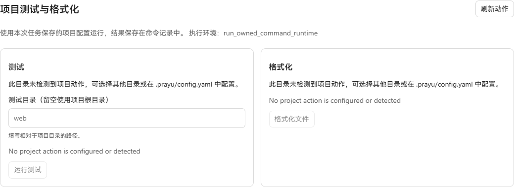
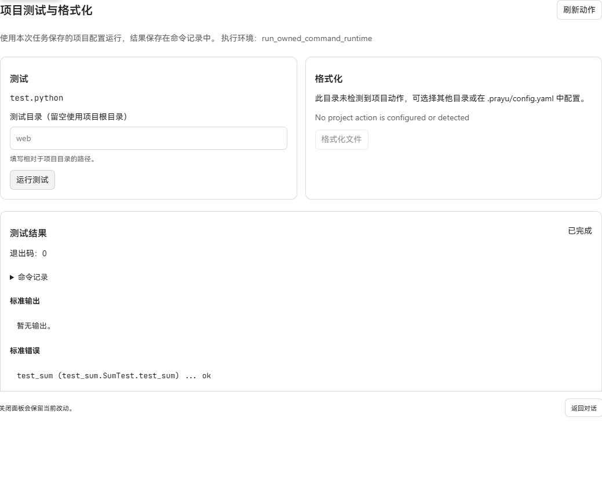

# Native Python and Rust project tests — 2026-10-20

The existing project action registry now accepts `test.python` (`python -m unittest discover -v`), `test.pytest` (`python -m pytest`), and `test.rust` (`cargo test --offline`). The checks panel and reviewed before-finish configuration use these registered IDs and the existing command runtime, permissions and Job records.

## Real browser captures

Windows Chromium with the production renderer, a real Go API and an isolated SQLite database. The fixture contains a Python unittest project and a dependency-free Rust library. Requests and screenshots were not replaced or mocked in the browser.

| Before | After |
| --- | --- |
|  |  |

The before executable was built from `2bbdab93`. The Python project had no configured native action. For the after capture, `.prayu/config.yaml` selects the new `test.python` ID before a new task is created. The Rust project similarly selects `test.rust`. This change adds explicit presets; automatic language detection is unchanged.

- `after-python.png`: the actual unittest action completed with exit code 0. Python reported version 3.13.12.
- `python-failure.png`: an intentionally incorrect fixture assertion produced an actual failed Job with exit code 1. Correcting that fixture and running again produced the successful capture above.
- `after-rust.png`: actual `cargo test --offline` completed with exit code 0 and one passing unit test. Cargo reported 1.97.1.
- `after-python-hooks.png`: the actual project-action review panel shows `test.python` as the before-finish action, awaiting initial trust.

The native executions used the existing Full-access host command adapter in an isolated disposable workspace. The before-finish configuration was loaded and its action displayed; an automatic model turn executing that hook was not exercised here. The existing hook lifecycle is unchanged.

## Checks

Passed the focused registry, project configuration and application tests, including native argument selection, pinned configuration, excluded and escaping paths, guest paths independent of host PATH, unavailable host toolchains and unsupported SBX rejection. The frontend project-hook parser tests passed (7 tests), as did API generation and the production frontend build.

The Docker daemon was unavailable on this machine, so Docker executable-path selection was tested but these commands were not run in a container. The local Python interpreter has no pytest installed; `test.pytest` has command/configuration test coverage but was not executed successfully here. Test actions use preinstalled dependencies and do not install packages or enable network access.
