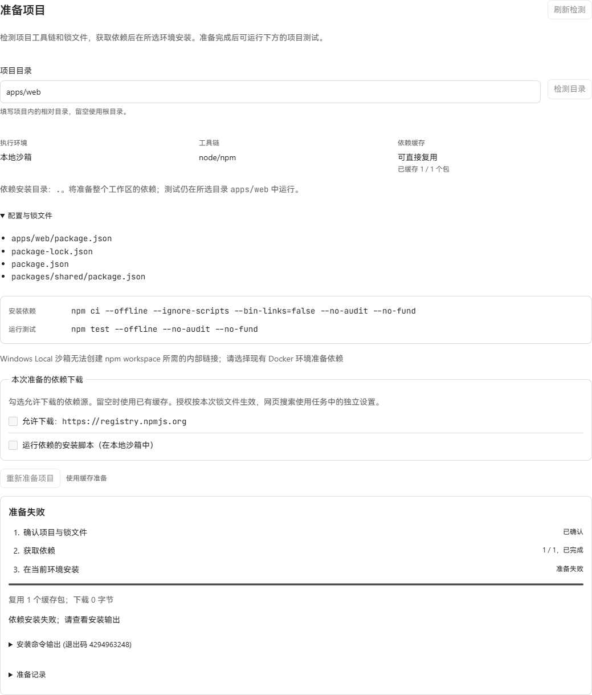

# npm workspace 项目准备验收

日期：2026-10-20。实现从 main `2bbdab93ec244426b431cbc2f0595917e802931e` 开始，
迁移 219 叠加在侧栏迁移 218（`69a5b6ff`）之上。

本批让 npm workspace 共享根锁文件和安装目录，绑定根配置、全部成员清单及内部链接；
所选成员的测试继续在成员目录运行。下载、安装脚本授权和命令运行时沿用已有机制。
支持 package-lock v2/v3，成员模式支持相对路径及 `*`、`**`、`?` 和排除模式；
超出这些模式的配置会明确拒绝。内部链接必须精确指向已声明、已绑定的成员。

## 已验证

- `go test ./internal/projectprep ./internal/dependencycache -count=1` 通过。
- `go vet ./internal/projectprep ./internal/dependencycache` 通过。
- 相关 store 测试通过：新建库、v218 → v219、多个历史版本升级后与新建库的结构一致；
  npm 安装收据绑定共享根目录，错误目录和变更根目录被拒绝，旧更新触发器保持不变。
- HTTP 项目准备、OpenAPI golden、releasegate、producte2e、Surface 和协议注册检查通过。
- `TestProjectPreparation`、npm workspace 和 workspace 路径范围相关 application 测试通过；
  应用和 store 的 vet、改前与改后生产前端构建通过。
- 命令定向测试验证共享根安装、成员测试目录、断网与空凭据保持不变，以及排除的兄弟成员不可进入准备范围。
- Windows 原生 Node `24.14.0` / npm `11.9.0` 实际执行离线 `npm ci`，
  外部包 `is-number@7.0.0`、内部 `shared` 包及其命令均可从成员测试中使用。
  根入口和成员入口均通过；含中文、空格的路径通过；新工作目录复用校验缓存。
  根和成员的 postinstall 没有运行，原清单、锁文件、测试和源码保持原样。
- 原生验证先确认未授权来源时下载字节数为 0。随后使用从 npm registry 取得、
  经锁定 SHA-512 复核的 tarball 预置缓存，由产品 broker 再校验和准备私有缓存。
  npm 与测试进程使用网络拒绝预加载器执行。
- 改前截图来自本批独立 SQLite、生产 API 和构建后的生产 UI。已按正常流程
  确认自有验收项目来源、配置 Local 沙箱并进入 Deliver，截图显示成员目录缺失独立锁文件。
  浏览器未替换网络响应或修改 DOM。
- 改后真实 API 能在 `apps/web` 识别根锁文件、根清单与两个成员清单，缓存状态为 1 / 1。
  独立 SQLite 从 v217 升级至 v219，外键检查通过；历史安装 Job 的目录为 `.`、网络为 disabled。
- 实际 Local LPAC 安装在创建 workspace 链接时收到 `EPERM`，没有通过安装。
  根据此结果，预检对 npm workspace + Windows Local 返回具体原因并提示选择 Docker；
  POST 返回 412，操作和 Job 数量不增加。普通 npm Local 准备的定向测试通过。




改后截图保留了预检提示及此前真实 Local 安装的失败收据；“缓存已完成”表示获取依赖完成。

## 覆盖限制

本机 Docker daemon 无法连接（`dockerDesktopLinuxEngine` named pipe 不存在），
未执行真实 Docker 容器或 SBX 安装，完整沙箱成功链尚未实测。
产品 broker 的真实远程下载本次返回 `request dependency artifact: EOF`；
原生离线安装使用锁定完整性的真实 tarball 缓存。未运行模型修复流程。

包含全部 pnpm 准备场景的额外 application 组合在 Windows 的 5 分钟上限超时，
第二次运行停在 `cancel-between-phases` 的 Git 工作目录摘要子进程；该组合未通过。

真实 API、SQLite 与浏览器脚本和未裁改输出保存在本批独立目录
`output/playwright/npm-workspace-preparation/`，不包含在发布包中。

## 原生复现

```powershell
$env:TRAVERSE_NPM_TEST_NODE = '<absolute-node-path>'
$env:TRAVERSE_NPM_TEST_CLI = '<absolute-npm-cli.js-path>'
# 可选：使用与锁文件完整性一致的 is-number 7.0.0 tarball，验证离线缓存路径。
$env:TRAVERSE_NPM_TEST_TARBALL = '<absolute-is-number-7.0.0.tgz-path>'
go test ./internal/dependencycache -run 'TestNPMNativeWorkspace|TestFinalizeNPMWorkspace' -v -count=1
```

CI 为 dependencycache 检查准备 Node/npm 和 SHA-512 锁定的同一 tarball，
原生测试使用产品检测器、broker、安装/测试命令构造器和安装收尾逻辑。
