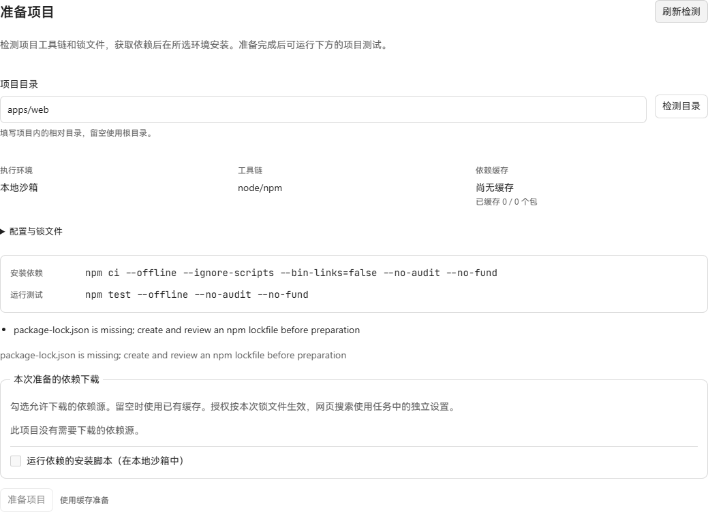

# npm workspace 项目准备验收

日期：2026-10-20。实现从 main `2bbdab93ec244426b431cbc2f0595917e802931e` 开始。

本批让 npm workspace 共享根锁文件和安装目录，绑定根配置、全部成员清单及内部链接；
所选成员的测试继续在成员目录运行。下载、安装脚本授权和命令运行时沿用已有机制。
支持 package-lock v2/v3，成员模式支持相对路径及 `*`、`**`、`?` 和排除模式；
超出这些模式的配置会明确拒绝。内部链接必须精确指向已声明、已绑定的成员。

## 已验证

- `go test ./internal/projectprep ./internal/dependencycache -count=1` 通过。
- `go vet ./internal/projectprep ./internal/dependencycache` 通过。
- 命令定向测试验证共享根安装、成员测试目录、断网与空凭据保持不变，以及排除的兄弟成员不可进入准备范围。
- Windows 原生 Node `24.14.0` / npm `11.9.0` 实际执行离线 `npm ci`，
  外部包 `is-number@7.0.0`、内部 `shared` 包及其命令均可从成员测试中使用。
  根入口和成员入口均通过；含中文、空格的路径通过；新工作目录复用校验缓存。
  根和成员的 postinstall 没有运行，原清单、锁文件、测试和源码保持原样。
- 原生验证先确认未授权来源时下载字节数为 0。随后使用从 npm registry 取得、
  经锁定 SHA-512 复核的 tarball 预置缓存，由产品 broker 再校验和准备私有缓存。
  npm 与测试进程使用网络拒绝预加载器执行。
- 改前截图来自本批独立 SQLite、生产 API 和构建后的生产 UI。已按正常流程
  确认自有验收项目来源、配置 Local 沙箱并进入 Deliver，截图显示成员目录缺失独立锁文件。
  浏览器未替换网络响应或修改 DOM。



## 尚待完成

数据库迁移 219 依赖同批迁移 218；首次实现提交尚未整合 218，
SQLite 迁移、应用服务测试和改后真实 API 流程将于后续提交验证。

本机 Docker daemon 无法连接（`dockerDesktopLinuxEngine` named pipe 不存在），
未执行真实 Docker 容器安装。产品 broker 的真实远程下载本次返回 `request dependency artifact: EOF`；
原生离线成功结果不代表该远程下载已通过。

## 原生复现

```powershell
$env:TRAVERSE_NPM_TEST_NODE = '<absolute-node-path>'
$env:TRAVERSE_NPM_TEST_CLI = '<absolute-npm-cli.js-path>'
# 可选：使用与锁文件完整性一致的 is-number 7.0.0 tarball，验证离线缓存路径。
$env:TRAVERSE_NPM_TEST_TARBALL = '<absolute-is-number-7.0.0.tgz-path>'
go test ./internal/dependencycache -run 'TestNPMNativeWorkspace|TestFinalizeNPMWorkspace' -v -count=1
```

CI 为 dependencycache 检查准备 Node/npm 和 SHA-512 锁定的同一 tarball，
原生测试使用产品检测器、broker、安装/测试命令构造器和安装收尾逻辑。
