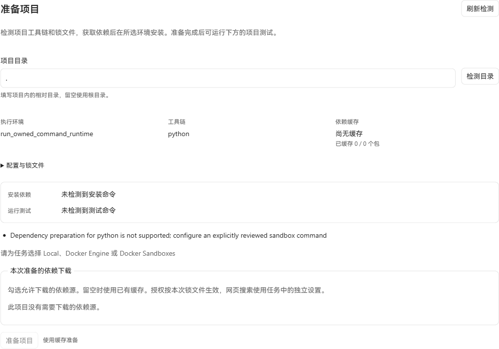
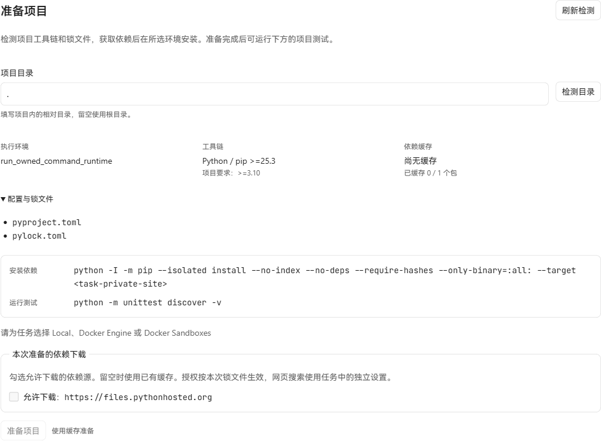

# Python wheel preparation — 2026-10-20

Python projects can prepare a default-only `pylock.toml` 1.0 wheel set through the existing source consent, verified cache, preparation operation and command Job workflow. Installation uses pip >=25.3 with exact local wheel files, SHA-256 hashes, `--no-index`, `--no-deps`, `--only-binary=:all:` and a task-private `--target`. It does not install into the interpreter's system environment.

## Real browser captures

Windows Chromium, the unchanged production renderer, a real Go API and an isolated SQLite database. The fixture is a Python project requiring six 1.17.0, with its exact PyPI wheel URL and SHA-256 in `pylock.toml`. Both captures use the real project inspection endpoint; no browser routes or displayed text were replaced.

| Before | After |
| --- | --- |
|  |  |

The before API was built from `ad595870`; the after API was built from product commit `f71fe5a4`. Both use the same production renderer built from the unchanged frontend sources and a 1440×1100 viewport. Screenshots capture the actual preparation region. The after capture expands the existing configuration details to show both files.

These captures prove detection and its existing UI. The task has not started an owned sandbox, and Docker Engine was unavailable, so the disabled preparation button is retained. A successful container install is not represented by these screenshots.

## Actual offline installation

`TestPythonNativeOfflinePreparation` uses the product detector, dependency broker, fixed installer and fixed test bootstrap. The opt-in test receives a pre-downloaded six 1.17.0 wheel with SHA-256 `4721f391ed90541fddacab5acf947aa0d3dc7d27b2e1e8eda2be8970586c3274`. It first places those verified bytes in a private cache, then prepares with no allowed origins and confirms zero downloads.

The real pip process installs into a disposable `.traverse-preparation/.../python-site/...` directory. The original unittest imports six, asserts version 1.17.0 and asserts that `six.__file__` points into that task directory. A second install reuses the matching environment. The test sets an unusable index URL and `PIP_NO_INDEX=1`; the product pip command independently uses `--isolated --no-index` and local file requirements.

Passed on Windows with Python 3.13.12 and pip 25.3. Actual cases include selected and unselected markers, a synthetic default group, Python requirements at lock and package level, incompatible lock environments, invalid markers, incompatible wheel tags, ambiguous package entries, declared size mismatch, changed wheel bytes and changed lock contents. The successful install and declared-size rejection also passed on Linux with Python 3.13.16 and pip 26.2.1, using a Windows-cross-compiled Go test binary. Linux temporary files were restricted to the mounted Windows directory.

Example Windows invocation after obtaining that exact wheel separately:

```powershell
$env:TRAVERSE_PYTHON_TEST_EXECUTABLE = 'C:/path/to/python.exe'
$env:TRAVERSE_PYTHON_TEST_WHEEL = 'C:/path/to/six-1.17.0-py2.py3-none-any.whl'
go test ./internal/dependencycache -run '^TestPythonNativeOfflinePreparation$' -count=1 -v
```

## Focused checks and scope

- Project detector and broker tests passed, including exact source confirmation, cache reuse, private seed staging, SHA-256 enforcement and changed artifact rejection.
- Application tests passed for Docker argv normalization, the Standard Code command contract, unsupported adapter rejection, configured unittest/pytest selection, unchanged commands without a lock, and invalid-lock rejection.
- A production Docker adapter test with controlled Docker transports and real Git/SQLite completed a detected Python Job, read it back and replayed it after lock deletion without a second dispatch. This verifies routing and receipts; it does not establish container execution or isolation.
- The production Go API binary built successfully. The frontend source and API schema are unchanged.

### CI regression follow-up

The [Go checks job for `fcf32923`](https://github.com/CWNU-Open-Source-Community/Universal-Code/actions/runs/39368078729/job/118449875919) failed only in the `test.python` and `test.pytest` cases of `TestNativeLanguageProjectTestsUseSelectedToolchainAndPinnedConfiguration`. Its fixture selected a `tests` subdirectory without creating it. Python lock inspection correctly rejected the absent target directory. The fixture now creates that directory and retains the existing executable, arguments, pinned configuration, excluded-path and escaping-path assertions.

The original failure was reproduced locally before the fixture change. The following focused checks then passed on Windows with Go 1.26.9:

```text
go test ./internal/application -run '^(TestNativeLanguageProjectTests|TestProjectPreparationPythonCommandBoundary|TestProjectActionsDetectedPythonJobReadAndColdReplay)' -count=1 -v
```

This includes the native toolchain cases, missing-toolchain behavior, Python command boundaries, and the detected Python Job read/cold replay. The original CI run also passed `internal/dependencycache`, `internal/projectprep`, protocol registry and Surface registry checks.

Container execution and the pinned image's actual pip version remain unverified here: `docker version` reported that `dockerDesktopLinuxEngine` was absent. The installer explicitly rejects pip versions below 25.3. Python preparation currently selects Docker Engine; Local and SBX installation are rejected. It retains the selected image's existing workspace write limits. Source builds, local/VCS/editable packages and selectable extras/groups are outside the supported lock subset.

The task-private environment key binds the reviewed seed and the selected interpreter build, marker environment and complete compatible wheel tags. Installation evaluates conditions and checks wheel identity, size and digest before publishing that directory. Test actions verify the same seed and current manifest/lock contents before using it. No new database migration or parallel preparation receipt is introduced.

Format reference: [PyPA pylock.toml specification](https://packaging.python.org/en/latest/specifications/pylock-toml/).
