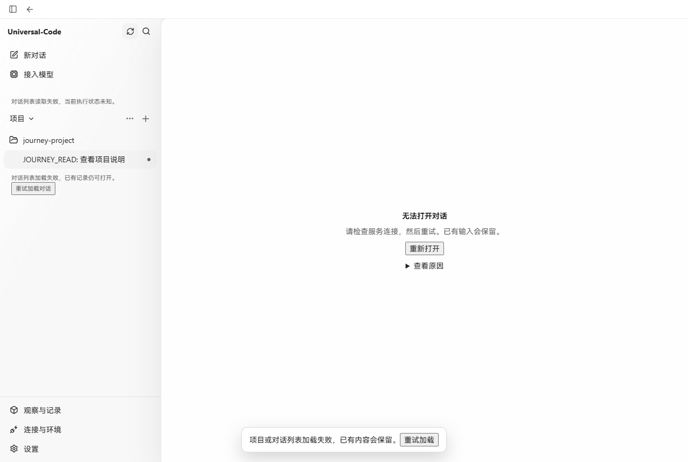
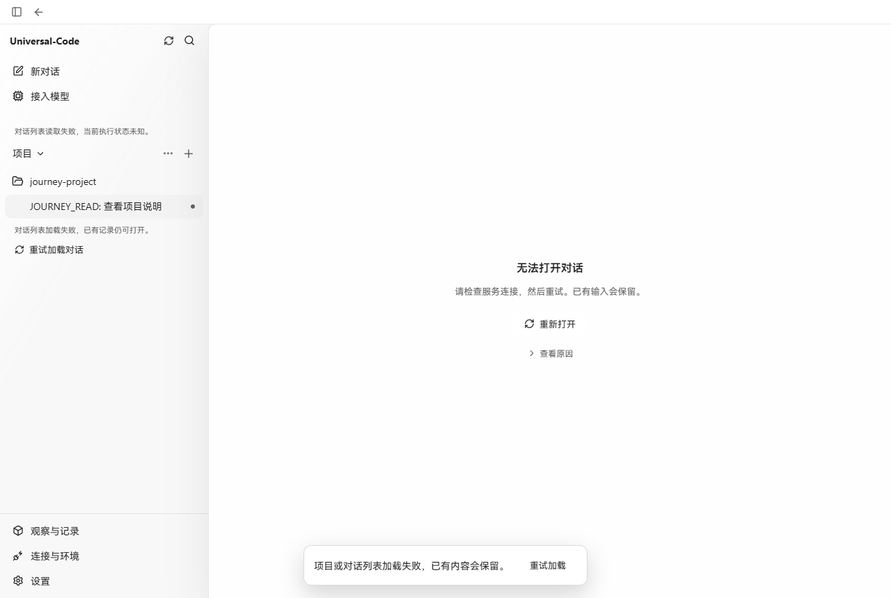
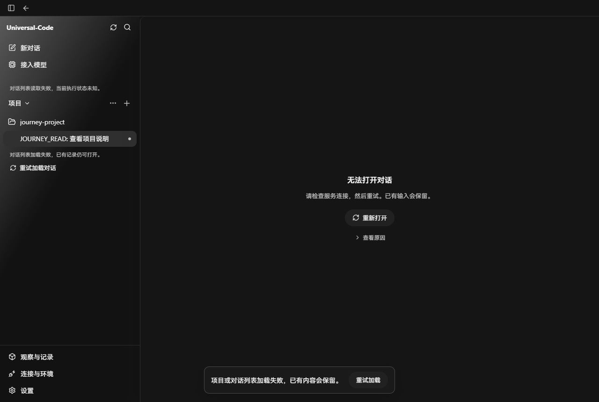
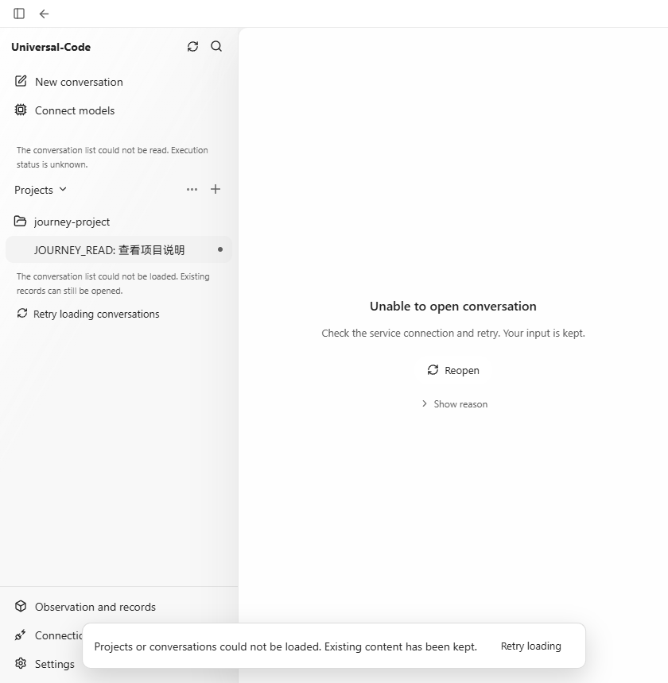
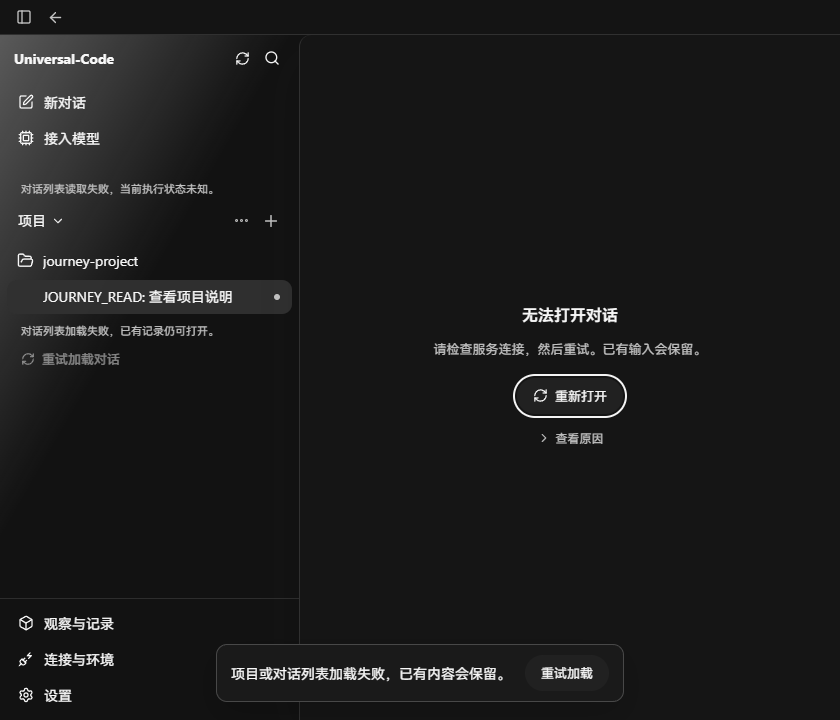

# 对话加载失败时的重试按钮

日期：2026-10-20。改动前为 `c56cf2d9`，改动后为本 PR 的生产前端。两次均使用真实 Go API、SQLite 和同样内容的临时项目/对话，通过 Chrome 中止列表和详情请求来复现连接失败；未替换 API 响应或编辑页面 DOM。

## 前后对照

1280 × 860，浅色主题。原有的无样式按钮落到浏览器默认矩形控件；现在主区域采用圆角轻量动作，侧栏采用无边框刷新图标和文字。底部同一错误的重试动作同步调整。

| 改动前 | 改动后 |
| --- | --- |
|  |  |

## 其他实际页面

## 验证

- 取消请求拦截后，分别点击“重试加载对话”和“重新打开”，列表及原对话恢复；“查看原因”保留真实的 `Failed to fetch` 并可展开、收起。
- 已查看浅色、深色、840px 窄窗口和英文截图；键盘焦点保持可见并沿按钮圆角绘制。
- 前端类型检查和生产构建通过；已有 sidebar、conversation、app 三个测试文件的 125 项测试通过。
- 本次只调整错误态动作与排版，文案继续使用现有中英翻译。
