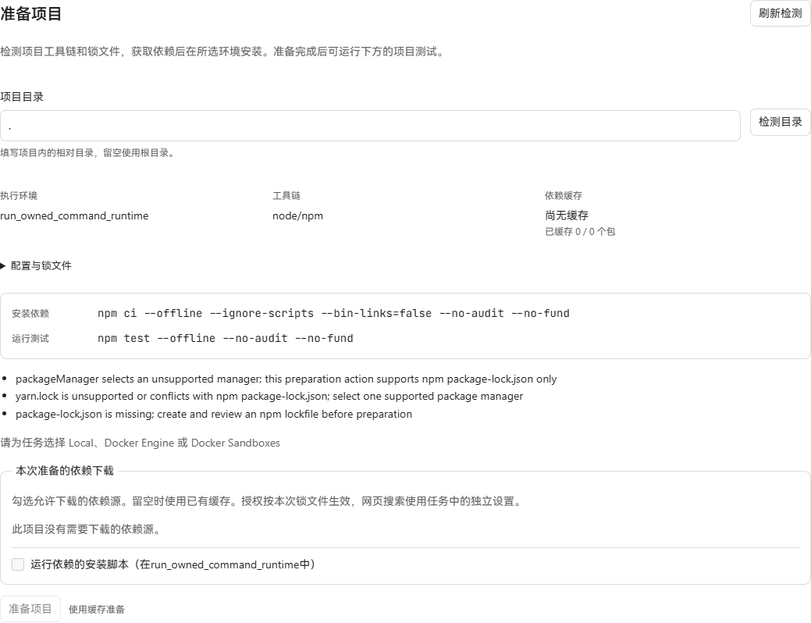
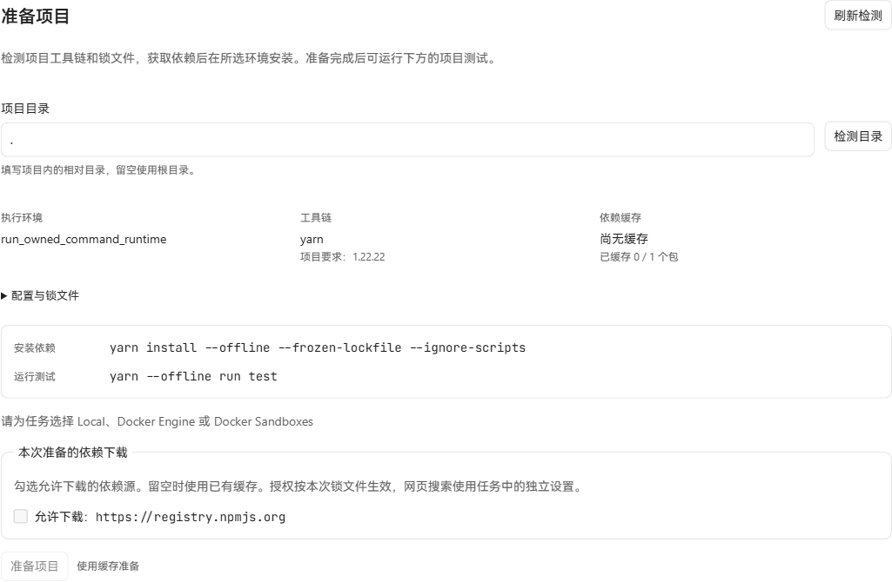

# Yarn Classic 依赖准备

日期：2026-10-20。页面来自真实生产前端、Go API 和 SQLite，使用相同的 Yarn 项目内容、中文界面、1280 × 1100 视口。没有替换 API 响应或修改页面 DOM。

改动前基线 `97f840d5`：`yarn.lock` 被当作 npm 冲突，项目无法准备。

改动后：识别 Yarn 1.22.22、锁定的依赖数量、安装和测试命令，并列出本次需要授权的具体包来源。当前验收进程没有可用的 Docker 环境，所以按钮保持禁用；这张图不代表容器安装成功。

## 已运行的验证

- Windows Node 24 + 官方 Yarn 1.22.22，实际调用新的检测器和 broker，在两个全新中文/空格路径中完成冻结锁文件的离线安装、依赖导入、包内可执行文件运行及缓存复用。第二次准备下载 0 字节。
- Yarn 网络调用由测试进程拦截，记录为零次；根包及依赖包的安装脚本未执行，仓库指定的替代 Yarn 程序未执行，`package.json`、`yarn.lock`、`.yarnrc` 保持原样。
- 项目检测、broker、应用层准备/测试/幂等读回及 Docker 固定命令与镜像版本检查通过。应用层测试使用实际 Job/授权存储和 Docker transport 测试替身，不能当作真实容器运行。
- 固定镜像 runner 测试通过。Docker daemon 本机不可用，未构建或运行新增 Yarn 镜像。

支持范围为 `packageManager: yarn@1.22.22` 的独立 Classic 项目、公开 HTTPS registry tarball 和 SHA-256/SHA-512 SRI。现代 Yarn、Yarn workspaces、Git/file 来源及旧版工具链不在本批支持范围内；安装脚本默认关闭且没有额外开启选项。

原生验证可复现：指定 `TRAVERSE_YARN_TEST_NODE` 和 `TRAVERSE_YARN_TEST_CLI` 的绝对路径，运行 `go test ./internal/dependencycache -run TestYarnNativeOfflineMirror -count=1 -v`。
