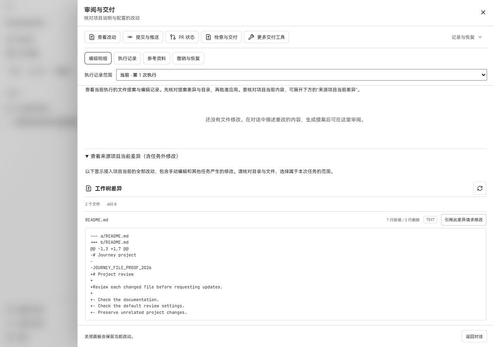
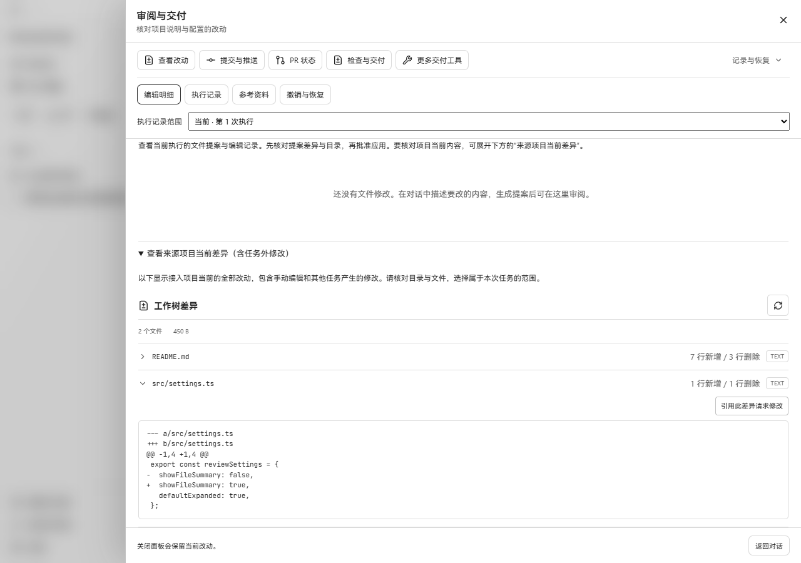
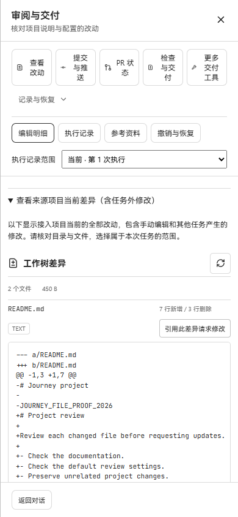
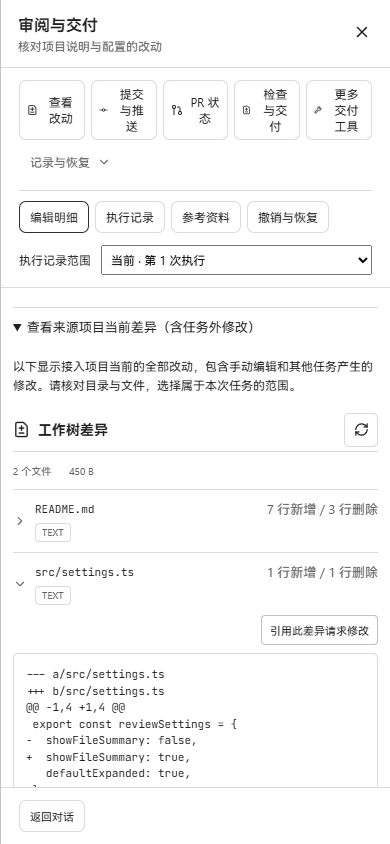

# Repository diff file disclosure — 2026-10-22

Source project diffs now let each file expand or collapse independently. Files
start expanded. Their paths, line counts, and content/redaction badges stay
visible when collapsed. The request-change button is inside the expanded
content, outside the disclosure heading.

## Real browser evidence

Windows Edge rendered the production bundle against the existing
`workbenchjourney` Go API and its disposable Git project. The project was
imported and a thread created through the production HTTP API. Two tracked
files were modified on disk: `README.md` and `src/settings.ts`. No browser
routes or UI elements were mocked.

The before build is `fc0935d6fc03ca7abccbd148ce52d26c2bc154f8`. Both builds use
the same running API, thread, base commit (`13bd4f75757a`), and 450-byte patch
projection. A second API read after verification matched the complete original
repository-diff response. The after build is served by Vite preview with `/api`
proxied to that API; the production API continues serving the before bundle.

Each pair uses the same viewport and review-body scroll offset: 1280 × 900 at
60 pixels, and 390 × 844 at 220 pixels. After screenshots show `README.md`
collapsed while `src/settings.ts` remains expanded.

| Viewport | Before | After |
| --- | --- | --- |
| Desktop |  |  |
| Narrow |  |  |

Browser checks observed:

- Both files initially expanded; Space and Enter independently collapse and
  reopen the focused file.
- Refreshing repository diff preserves the collapsed first file.
- Requesting a change from the second file opens the conversation draft with
  `项目当前差异：src/settings.ts` and `基准提交：13bd4f75757a`.
- The 390-pixel viewport has a 390-pixel document width.

The adjacent pixel metrics compare each full-size pair with zero tolerance and
no masks. They report `passed: false` because the changed disclosure and hidden
patch deliberately change the image. They document the visual change rather
than asserting screenshot equality. All four captures were visually inspected.

## Focused verification

Commands ran through `scripts/ui-test.ps1` in this D-drive worktree.

- Vitest: `repository-diff-panel.test.tsx` and `task-review.test.tsx` — 10 tests
  passed. Coverage includes default expansion, independent toggles, omitted
  patch status, refresh preservation, and file/base identity in change requests.
- TypeScript: `tsc -b web --pretty false` passed.
- Production Vite build passed.
- Wails adapter tests: `go test -count=1 -tags desktop,wv2runtime.error
  ./cmd/cyberagent-desktop ./web` passed with Go 1.26.10.
- Windows executable build with `desktop,wv2runtime.error` passed.
- `git diff --check` passed.

Executable builds do not represent a native-window visual check. The captures
above exercise the real browser and Go API. Temporary credentials, databases,
logs, and executables remain outside the committed evidence.
