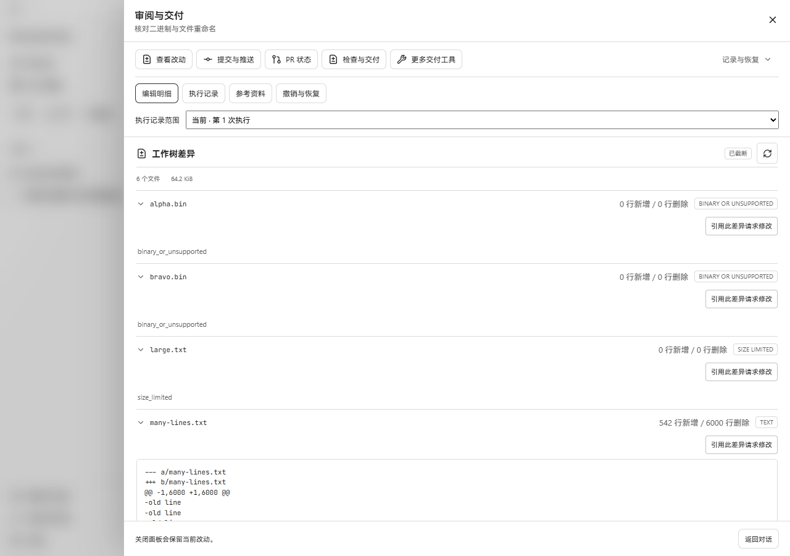
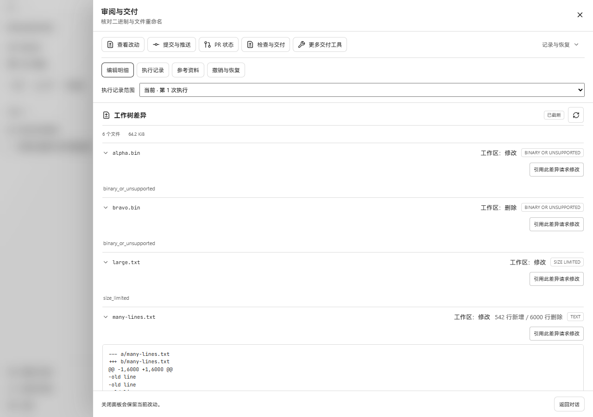
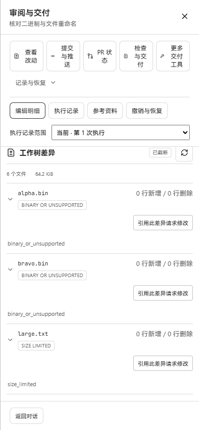

# Repository diff operation labels

The source-project diff now shows the existing index and working-tree operation for each file. A modified binary and a deleted binary are distinguishable, and files whose patch content is unavailable no longer display misleading `0 added / 0 deleted` statistics. Text statistics, the projection truncation badge, and the patch truncation marker are preserved.

This change is stacked on the per-file collapse work in PR #447, commit `fbe76c55c706f1f7a99a1c19519f21a3bcc16e66`. Operation labels use the existing neutral text style. Untracked status is shown once, and all existing operation types have English and Chinese labels.

## Real-page screenshots

These are unmodified Playwright screenshots of the production frontend connected to the same running `workbenchjourney` backend. The before frontend was built from the parent commit; the after frontend was built from this change. Both used the same imported Git repository, thread, API response, locale, open file sections, and scroll positions. The complete repository-diff response was compared after capture and remained identical.

| Viewport | Before | After |
| --- | --- | --- |
| 1280 × 900; review-body scroll 300 |  |  |
| 390 × 844; review-body scroll 350 |  |  |

The fixture is an actual temporary Git repository imported through the workspace API:

- `alpha.bin`: four binary bytes, with the last byte modified in the working tree.
- `bravo.bin`: a tracked binary deleted from the working tree.
- `large.txt`: 65,537 bytes with one byte changed; the backend reports `size_limited`.
- `many-lines.txt`: 6,000 old lines replaced with new lines; the bounded patch contains 542 added and 6,000 deleted lines and retains the truncation marker.
- `old-name.ts` moved to `new-name.ts` with `git mv`; the existing API reports staged deletion and staged addition, each with a one-line text patch.

The real UI shows `工作区：修改` for `alpha.bin`, `工作区：删除` for `bravo.bin`, and `暂存区：新增` / `暂存区：删除` for the moved text paths. At 390px, document width remains 390px. Requesting a change for the deleted binary inserts `bravo.bin` and the same repository base commit into the conversation draft.

## Verification

- `repository-diff-panel.test.tsx` and `task-review.test.tsx`: 13 tests passed. Coverage includes both locales, simultaneous index/working-tree changes, copied/renamed/conflicted operations, untracked deduplication, non-text statistics, retained text statistics/truncation, collapse, and request-change references.
- TypeScript project build passed.
- Vite production build passed, with the existing large-chunk warning.
- Real browser inspection at the two viewports above passed; backend data remained unchanged.

Commands ran through `scripts/ui-test.ps1 -Action command` with process-local test/cache directories under this worktree. Browser state, API tokens, runtime data, and server logs remain in ignored output directories.
