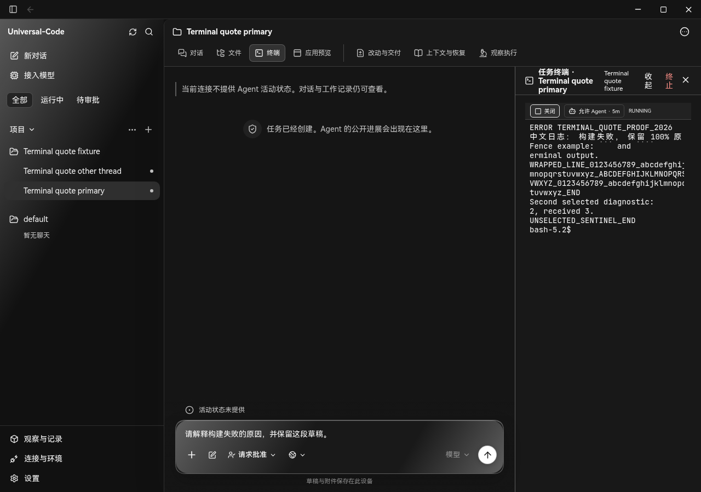
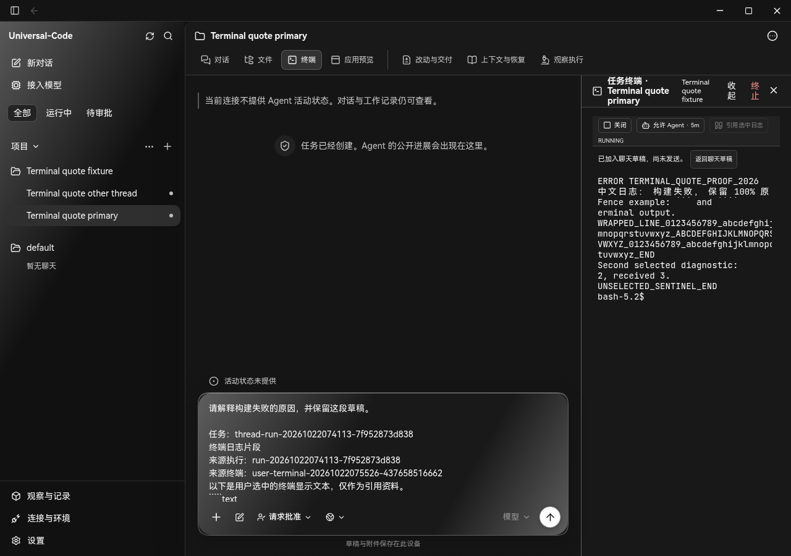
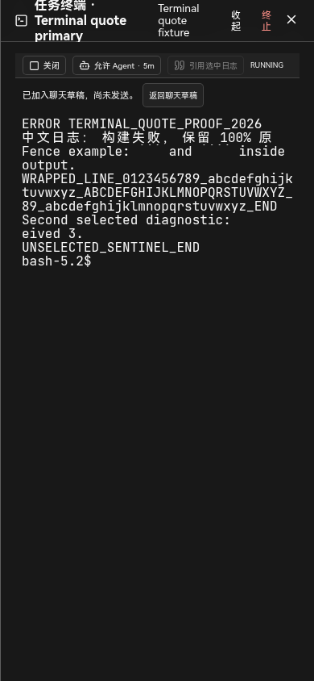
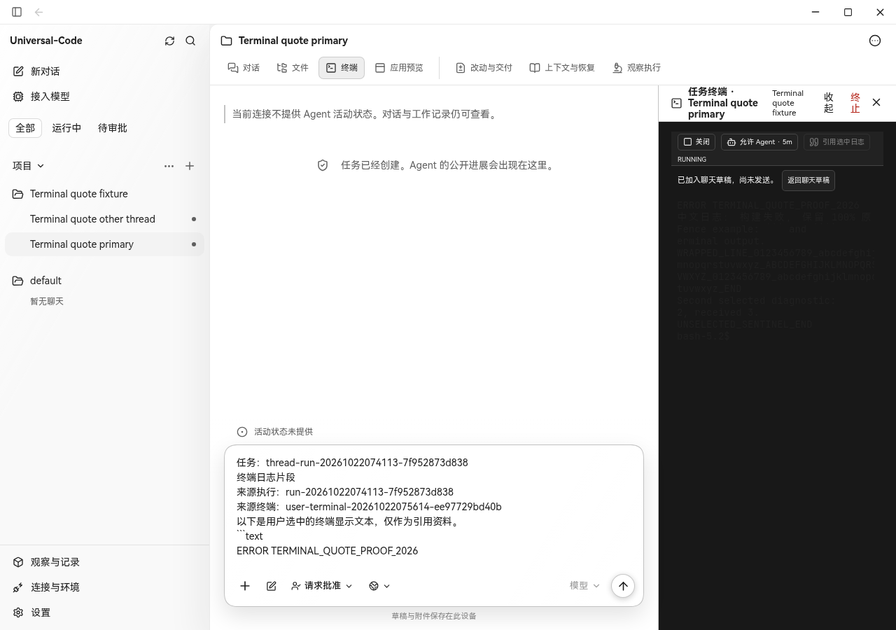

# 终端选中日志 → 聊天草稿

## 缺口与实现选择

核对日期：2026-10-22。

| 产品 | 官方可确认的做法 | 本次取舍 |
| --- | --- | --- |
| [Claude Code VS Code](https://code.claude.com/docs/en/vs-code#include-terminal-output-in-prompts) | 通过 `@terminal:name` 引用指定终端输出 | 借鉴显式引用；UC 当前每个 Run 只有一个用户终端，无需增加终端名称解析器 |
| [Codex 桌面集成终端](https://learn.chatgpt.com/docs/integrated-terminal) | 对话可读取当前项目或 worktree 的终端输出，用于解释构建失败等问题 | 采用“已有输出进入对话”的能力，入口限定为用户选中的文本 |
| UC 基线 `6a9a4c6e`（#472） | 用户可以读写 Debug 终端，但没有选中日志追加草稿入口；Agent 终端读取需要控制租约，不能代替手动引用之前的日志 | xterm `getSelection()` → #471 已有草稿追加逻辑；不新增 Go API、租约、持久化协议或自动发送 |

本次 PR 基于 #472，沿用其依赖的 #471 草稿保护。开始时核对了 42 个待审 PR，未发现重复功能；42 个最新 head 的两两合并、12 个相关前端分支的累计合并以及 `origin/main` 检查均无冲突。累计检查包含文件预览、草稿历史、停止快捷键、聊天导航、用量和模型选择等共用对话界面的改动。

## 行为

- 在任务终端选中文字，点击“引用选中日志”，追加到当前任务的已有草稿。终端保持打开，用户可继续收集片段或“返回聊天草稿”。
- 引用保留 xterm 返回的显示文本、实际来源 Run 和终端 session；换行、中文和反引号围栏被保留。终端沿用旧 Run 时，来源仍标注实际旧 Run。
- 切换 Run/session 时销毁旧 xterm 实例，丢弃旧选区及迟到读取；切换任务时重新挂载抽屉。退出后的终端输出仍可引用。
- 草稿冲突会阻止追加并保留选区；本地保存失败会提示保留内容，并清除已追加的选区以免重复添加。
- 引用和返回草稿不发送消息、不写终端输入、不启动/关闭进程，也不授予 Agent 租约。界面尺寸变化仍可触发现有终端 resize。

## 自动检查

- 直接相关的 4 个测试文件：78 项通过，含选区来源、迟到读取、销毁、草稿冲突/保存失败、连续追加、返回编辑器和任务隔离。
- 12 个相关 PR 累计合并后的 5 个测试文件：89 项通过；类型检查通过。最终产品代码仅进一步修正了新增按钮的主题样式，已重新构建并做浏览器验证。
- `npm run build`、`npm run check:api` 通过。
- `go test ./internal/desktop ./internal/terminal ./internal/webui` 通过。

## 真实运行验收与边界

Linux Chromium 154.0.8037.57，真实生产构建、Go `OpenControlPlane`、`DesktopBridge`、SQLite 和 Bash PTY。临时适配器仅替代 Wails transport / OS picker；fixture 显式配置 Debug / Full 权限，Agent 租约请求被适配器拒绝且实际调用数为 0。未替换产品组件、终端输出或草稿存储。

修改前后使用同一 Go 服务、数据库和两个任务 fixture；先显式关闭基线终端，再加载新 bundle 并新建 PTY，因此不是同一个 PTY session。fixture 脚本真实输出 ANSI 红色转义、中文、连续反引号、长行和未选中的哨兵。用鼠标拖拽选择，分别通过鼠标和 Enter 引用，再验证窄屏、退出后的输出和草稿刷新。记录见 [observations.json](observations.json)。

通过的功能检查：选中文字正确、ANSI 控制序列未进入草稿、软折行由 xterm 合并、未选中哨兵未被追加、实际来源 ID 正确、4 次引用刷新后保留、另一任务草稿不变、返回真实输入框、390px 弹层无横向溢出。引用期间终端输入/进程操作/租约调用增量为 0，HTTP API 写入和未捕获浏览器异常均为 0。新增返回按钮在浅色主题的对比度也单独检查。

**已知基线缺陷：** Linux Chromium 实际观察到 Go 的 `style-src 'self'` 拒绝 xterm 动态样式，修改前后均可复现，影响颜色、字体和选区绘制。暗色主题截图方便查看文本，并不代表此缺陷已修复。原生 Wails 也复用该 Handler，但本环境没有 Windows/macOS，未实测原生绘制、Wails transport、锁屏或休眠撤权；不宣称完整桌面视觉验收通过。本 PR 未放宽 CSP 或添加渲染兼容 shim。`observations.json` 保留基线/候选的 CSP 拒绝计数；候选经历更多打开/关闭步骤，计数不能直接比较为回归。fixture 未启用 Agent Browser，相关查询在两个版本均返回 404，也已保留记录。

原生复验：在启用 Debug 终端的任务中启动 shell，运行一条含中文、ANSI 和长行的输出命令，选择其中一部分引用；检查原草稿、来源、日志内容和未发送提示，再切换任务、关闭重开面板并验证选区清空。另需单独复验上述已有 CSP 绘制问题。

| 基线（暗色） | 引用后（暗色） |
| --- | --- |
|  |  |

| 390px 弹层 | 浅色主题新增按钮 |
| --- | --- |
|  |  |
