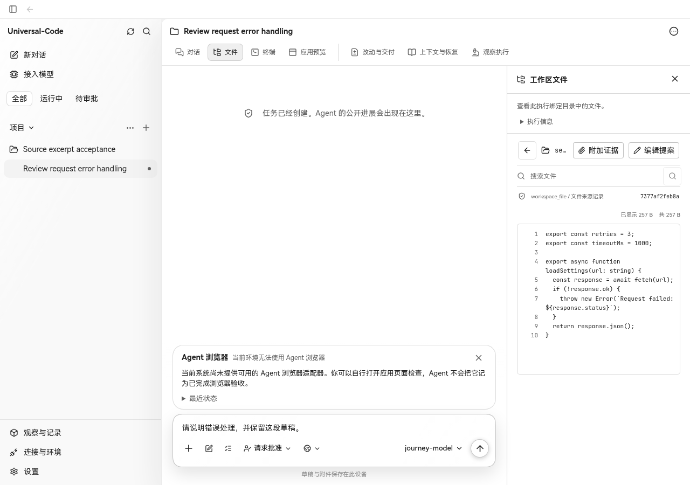
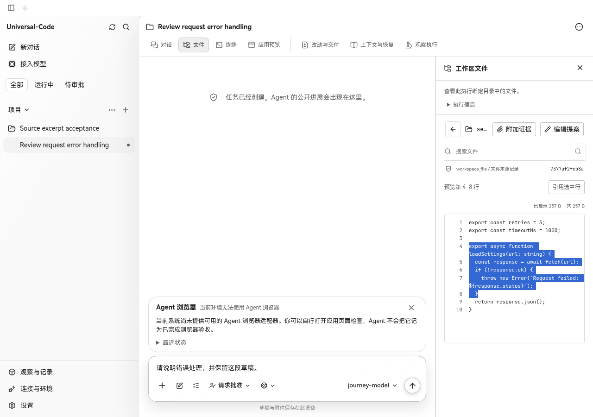
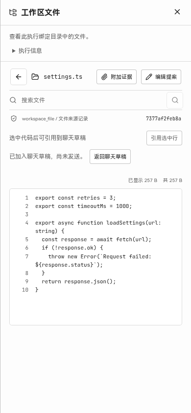

# 工作区源码选区引用验收

## 真实缺口与实现选择

UC 的工作区预览原来只能引用整份文件或附加证据。用户想就几行代码提问时，需要复制文字、回到聊天，再手工补路径和位置。待审 #442/#448/#463 分别处理搜索定位、Markdown 预览和搜索重试，#465 处理文件路径补全，#471 处理 Diff 审阅意见，均未提供源码选区引用。

- [Claude Code 的 VS Code 扩展](https://code.claude.com/docs/en/vs-code#reference-files-and-folders)自动提供选区上下文，并支持用 Option/Alt+K 插入带路径、行号的引用。
- [Codex IDE 扩展](https://learn.chatgpt.com/docs/ide/commands)提供 `chatgpt.addToThread`，把选中的文字范围加入当前聊天上下文。

这些证据来自两者的编辑器扩展，不表示 Claude Desktop 的文件面板提供相同的选区操作。本次把相同的用户需求放在 UC 已有的文件预览里：使用浏览器原生选区，明确引用完整的选中行，加入可编辑草稿，再由用户发送。不引入编辑器集成、自动上下文读取、额外存储或 API。

引用包含文件路径、预览行范围、实际来源 workspace/Run、显示快照 SHA-256 和代码。Go 已经对预览内容进行脱敏和截断；哈希对应显示快照，且多行脱敏可能改变行号，因此始终标为“预览第 N–M 行”，不声称它是磁盘原文件的精确行号。

## PR 关系

基于 #471 的 `2ce3c07702d033d29765c9c68211083e368a25d3`，复用它的草稿追加和保存失败处理。Go、OpenAPI、DTO、草稿协议均不变。工作区预览只新增可选回调，不改变原有整文件引用、证据附加和编辑提案接口。

对当时 41 个待审 PR 分别进行 `git merge-tree --write-tree` 检查，全部无文本冲突；与 main 试合并也通过。额外按 #442、#448、#463、#437、#454、#458、#465、#440、#461、#467、#469、#470 顺序合成临时集成提交，验证源码/Markdown 切换后的旧选区不能继续引用，同时运行相关测试和类型检查。此结果不表示所有待审 PR 彼此兼容。

## 实际页面验证

使用 `workbenchjourney` 启动真实 Go HTTP API 与临时 SQLite。通过 API 导入临时 Git 工作区、建立 Thread/Run，再在 UI 操作。前后版本使用同一后端数据；仅切换静态 UI 包，没有 mock HTTP 响应，也未调用付费模型。

1. 基线中打开 `settings.ts`，确认没有“引用选中行”。
2. 更新后在 1280×900 Chromium 中，用鼠标拖选实际源码第 4–8 行并引用；面板保持打开，原草稿保留。
3. 反向选择第 1–2 行，聚焦按钮后按 Enter，第二段来源与内容仍准确。
4. 关闭面板后在 390×844 窄窗口重新打开，以模态面板再添加一段，确认控件不超出视口。
5. 返回聊天，确认焦点恢复；重新连接后，三段引用及原草稿仍在。
6. 选择代码后导航至父目录再打开文件，确认旧选区失效。整段 UI 流程无 API 写入和未捕获浏览器错误。

原始观察值见 [observations.json](observations.json)。

| 基线 | 更新后 |
| --- | --- |
|  |  |

## 自动验证与边界

- 相关测试覆盖完整行和空行、下一行零偏移边界、跨容器选择、文件/Run/快照切换、保存失败和冲突、连续追加、实际工作区归属，以及 conversation/inspector 返回草稿。
- `npm run build`、`npm run check:api`、`go test -count=1 -tags desktop ./web ./internal/webui` 通过。
- 本次页面验证为 Linux Chromium 154.0.8037.57。Windows/macOS 原生壳及系统辅助技术未实测；窄窗口验证的是直接打开模态面板，不覆盖现有停靠面板在窗口缩窄时的切换行为。
