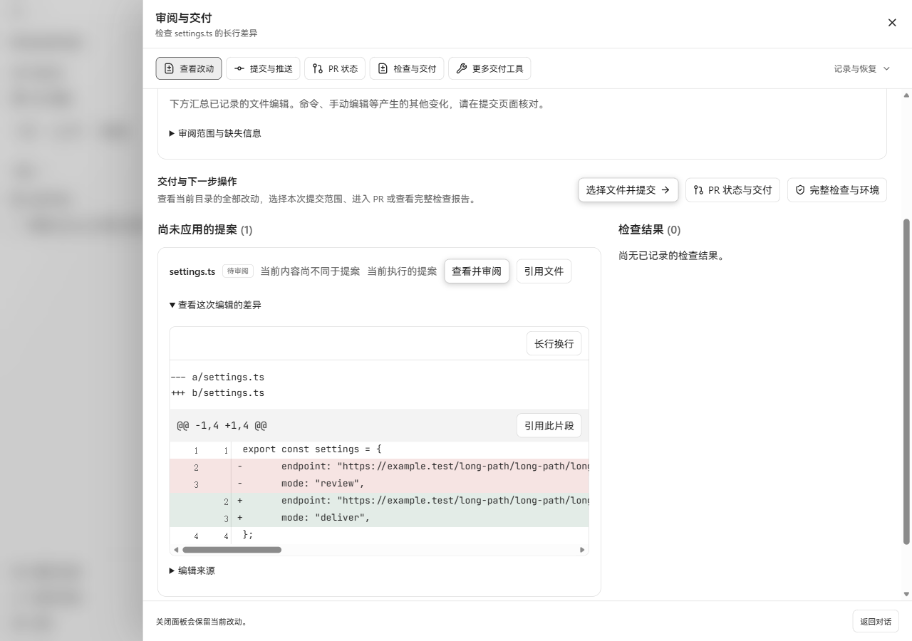
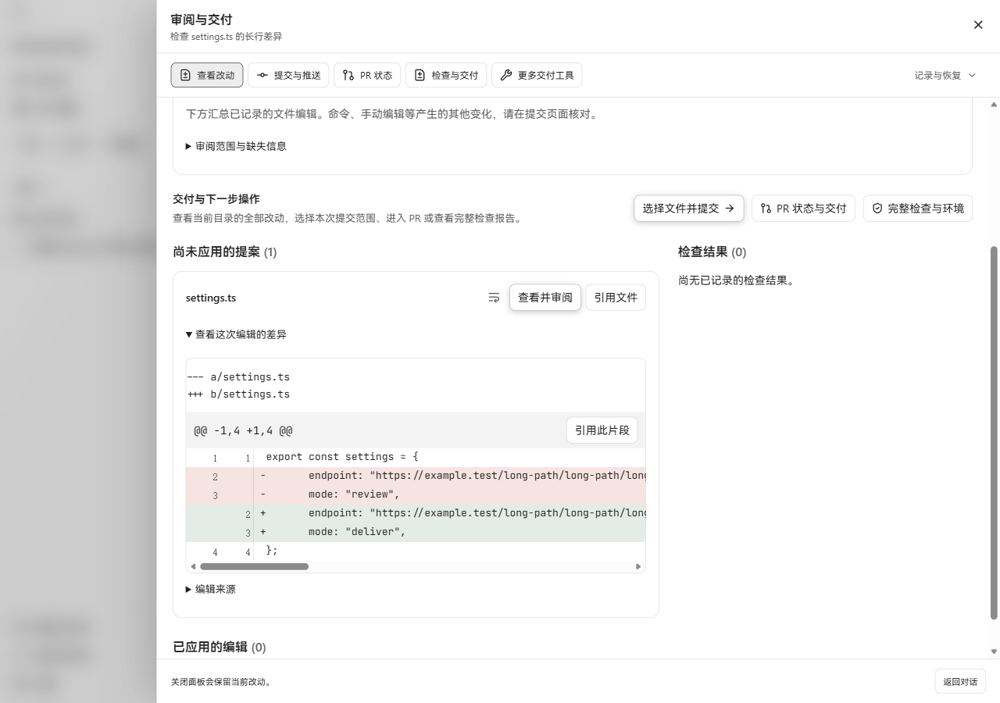
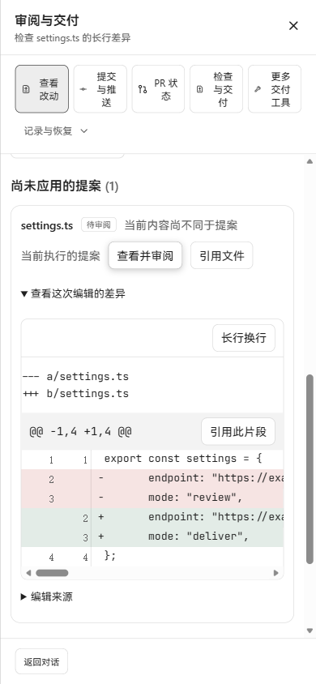
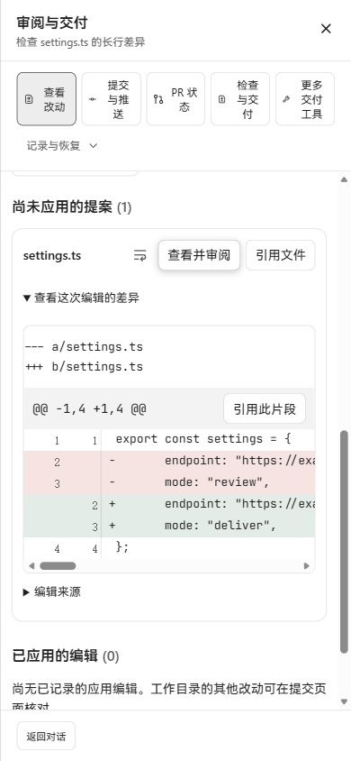

# Compact review Diff controls

Verified on Windows in Microsoft Edge on 2026-10-26 (Asia/Hong_Kong).
Baseline: `ed87d1dbdf3bc04c7935ca9c7b4fabfb67524e0e` (the previous #445 head).

The task review file header now contains the filename, an icon-only **Wrap long
lines** toggle, **View and review**, and **Quote file**. The repeated status badge,
content-match description and current/past-run description were removed from that
row. Applied edits and unapplied proposals retain their separate sections.
The review action and quotations retain their exact Run, Workspace, edit and
revision bindings.

The separate wrap toolbar was removed. A file's toggle controls only that file's
Diff. The shared Git preview viewer places its toggle beside the existing hunk
action. Both start with wrapping off and keep `overflow-x: auto`.

## Real page comparison

Built the baseline production bundle before editing source, then built the
candidate. Both were served at the same preview origin, proxying the production
Go API from `cmd/workbenchjourney`, against the same disposable SQLite store,
project, pending `settings.ts` proposal and raw patch. The project import, Thread
creation, Run start and file proposal used the real HTTP APIs. No API responses
or rendered components were mocked. This flow did not request model inference.

The paired desktop captures use 1280 × 900 and a 260 px review-body scroll offset;
the paired narrow captures use 390 × 844 and a 650 px scroll offset. Both pairs
show the default, unwrapped mode, including its horizontal scrollbar.

| Viewport | Before | After |
| --- | --- | --- |
| 1280 × 900 |  |  |
| 390 × 844 |  |  |

Observed behavior:

- The original 46.7 px toolbar row is gone. The file header contains the three
  actions without the previous secondary labels.
- Unwrapped desktop Diff: viewport width 588 px, content width 2337 px. A real
  horizontal wheel event moved `scrollLeft` to 600 px and back to zero.
- Space enabled the focused toggle; the wrapped desktop content width became
  588 px. Enter disabled it; the content width returned to 2337 px and retained
  `overflow-x: auto`.
- The raw text of every Diff line, including the tab and trailing spaces in the
  endpoint, was identical before and after wrapping.
- At 390 px, the Chinese file header and all three actions fit on one line.
  Wrapped Diff content and viewport were both 323 px; document width was 390 px.
- Changed the language through Settings to English. At 390 px the file header
  remained within its 325 px width; the three actions stayed on one row and the
  rightmost edge was 350 px. The document remained 390 px wide.
- Quoted the wrapped new line 2 through the real review UI into the plain-text
  conversation draft. Its exact original text and `New file, line 2` reference
  were retained.

Additional captures:

- [Wrapping enabled, desktop](after-wrapped-desktop.png), review-body offset 340 px.
- [Wrapping enabled, narrow](after-wrapped-narrow.png), review-body offset 650 px.
- [English file actions, narrow](after-english-narrow.png), review-body offset 650 px.

The long wrapped endpoint extends below the narrow viewport and remains vertically
scrollable. The preamble's `---` and `+++` are the original old/new file markers.

## Checks

- 45 tests passed in `review-diff.test.tsx`, `task-overview.test.tsx` and
  `task-git.test.tsx`. Coverage includes keyboard toggling, per-file state,
  original line/quote contents, and reviewing a historical proposal with its
  original Run/Workspace/edit identities.
- `npm run build` passed, including TypeScript checking. Vite retained its
  existing large-chunk warning.
- `git diff --check` passed.
- Git preview behavior was covered by the component tests; this browser harness
  does not enable the task Git API. Browser acceptance used the production API
  and bundles, rather than a packaged native window.

The browser session and test data used the isolated D-drive runtime with the
already-installed Go 1.26.10 toolchain.
