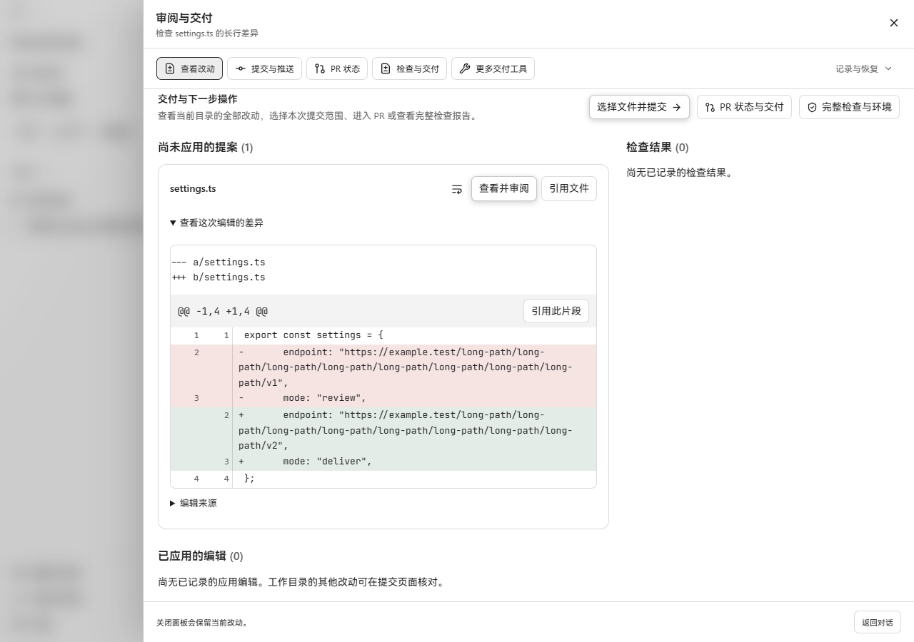
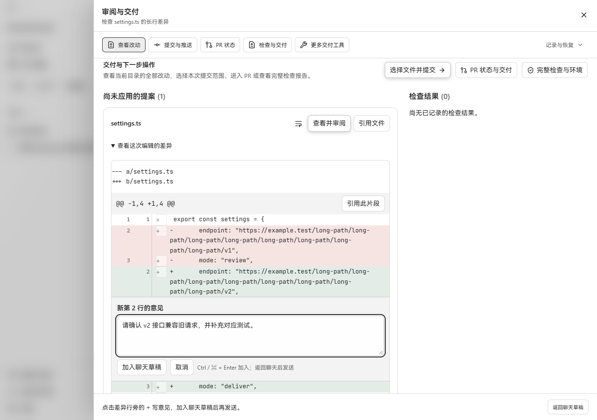
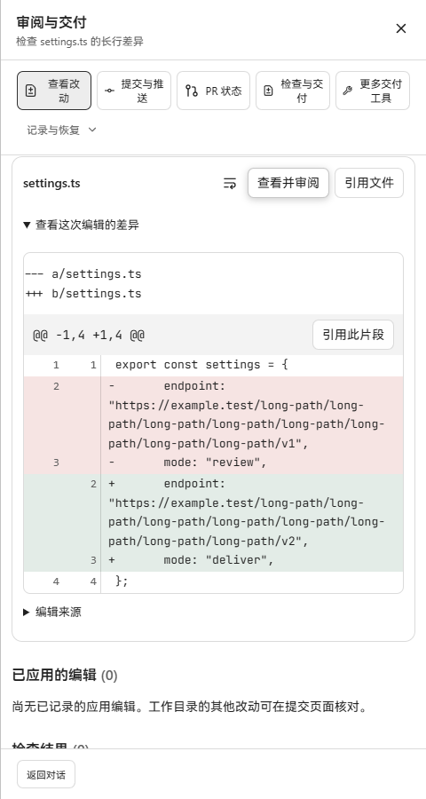
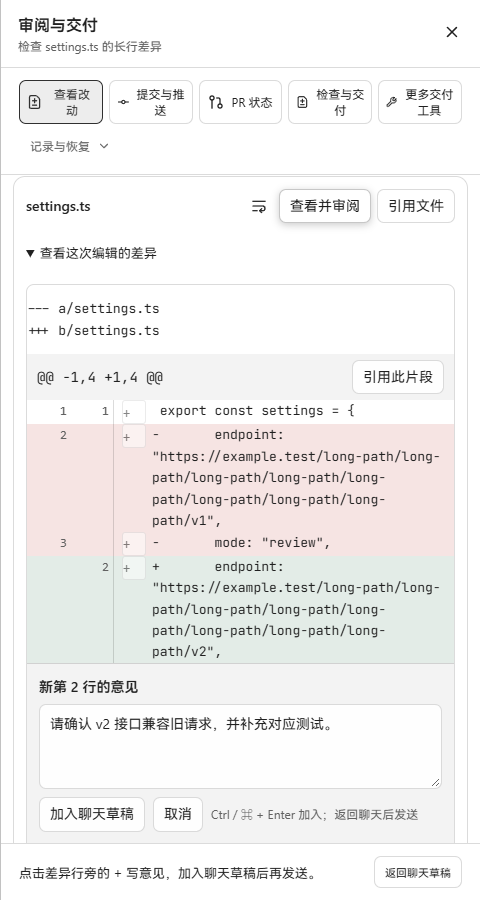

# #471：同步 #445 后的真实页面对比

2026-10-27 在 Windows / Microsoft Edge 156 中重新拍摄。此次对比替代 PR 正文里
2026-10-22 的旧截图；旧记录保留为历史验收资料。

- 变更前：`02ff2bcf4703e948e53c5eced24bec00bc2ea986`，已合入 #445 的 main。
- 变更后：`803ac30f2c835e74c660cbbc9e03d1cb1a5eef1b`，#471 同步 #445 后的代码。
- #471 当前目标分支为 `main`。两边都有 #445 的文件名旁紧凑换行按钮；
  #471 在此基础上增加行旁评论与“返回聊天草稿”，没有恢复旧版独立换行工具栏。

## 截图

| 视口 | 变更前：#445 已合入 | 变更后：#471 行内评论 |
| --- | --- | --- |
| 1280 × 900 |  |  |
| 480 × 900 |  |  |

两组都开启长行换行，展示同一个 `settings.ts` 提案。桌面审阅正文滚动位置为
377 px，窄屏为 562 px；同一视口下文件工具栏的位置一致。变更后截图的评论
仍在行内输入框内，点击“加入聊天草稿”或 Ctrl+Enter 后才加入草稿。

## 实际运行方式

分别从以上两个提交执行 `npm run build`，使用各自的生产前端包。后端从
`803ac30f` 以 `go build -tags workbenchjourney ./cmd/workbenchjourney` 构建，
运行真实 Go API、SQLite 和一次性项目；通过工作区导入、创建任务、启动 Run、
创建文件提案 API 准备数据。Vite preview 在同一个地址依次提供两个生产包并
转发到同一个后端进程，提案和原始文件始终相同。没有替换接口响应或单独渲染
组件。使用仓库离线 journey provider，没有调用外部模型。

本次验证：

- 两个版本的 TypeScript 检查和生产构建通过；保留已有 Vite 大包警告。
- 480 px 下，来回切换换行，尚未加入草稿的评论内容不丢失，Diff 原始代码文本不变。
- 评论输入框横向范围为 x=39 到 442 px，页面实际宽度与文档宽度均为 480 px。
  截图中输入框和加入草稿按钮均可见、可操作。
- 第一条意见通过 Ctrl+Enter 加入，第二条通过按钮加入；添加后审阅面板保持打开。
- 返回聊天时保留原有草稿和两条意见，分别绑定新文件第 2、3 行及同一个正确的编辑记录；
  焦点回到草稿。重新加载并连接后，这份草稿仍在。
- 同一代码实现此前合流时的 `review-diff`、`task-overview`、`review-comment-draft`
  三个测试文件共 26 项通过；修改后的 `task-overview` 6 项随后单独复跑通过。
  本次仅追加截图与记录，没有变更应用代码。

这是 Windows Edge 浏览器中的生产页面验收。此轮没有运行打包后的原生桌面窗口，
也没有重测 Git 预览及真实中文输入法；这些截图不作为完整桌面发行验收。
切换生产包时重启了预览代理，其间出现的连接重置属于这次对比的服务切换过程。
