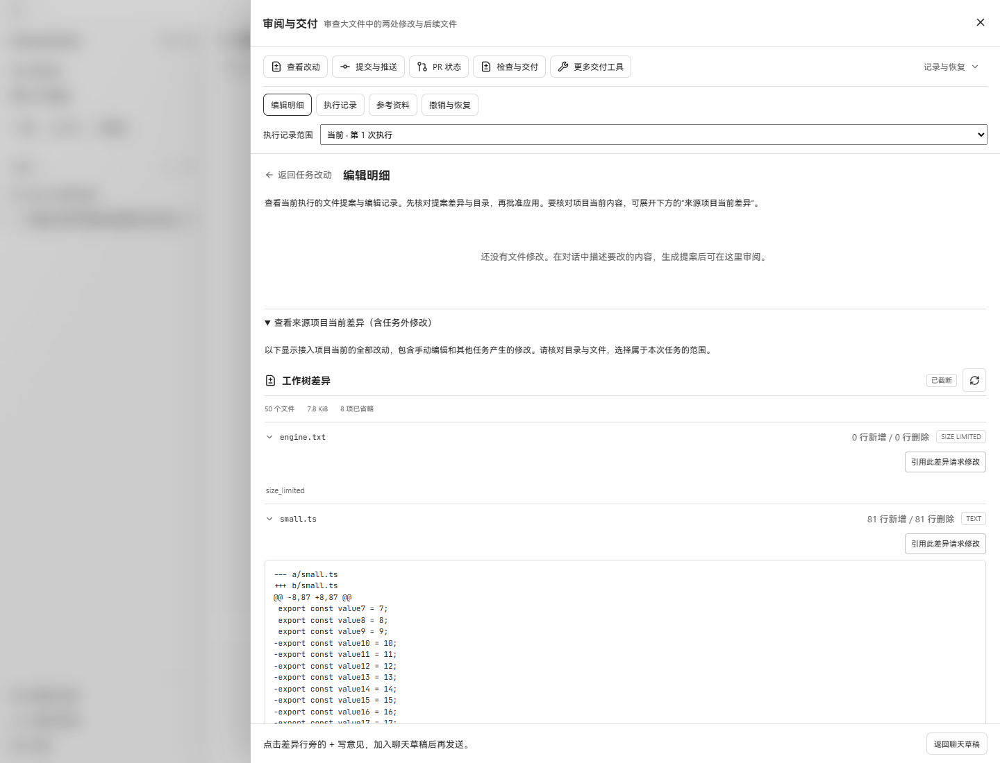
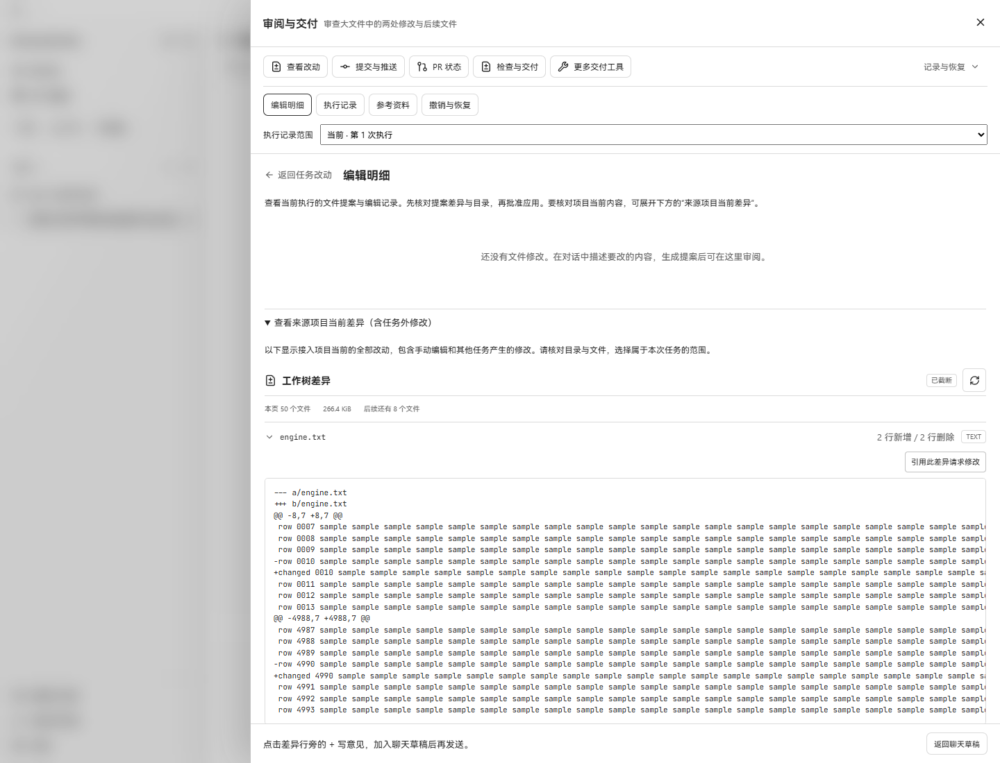
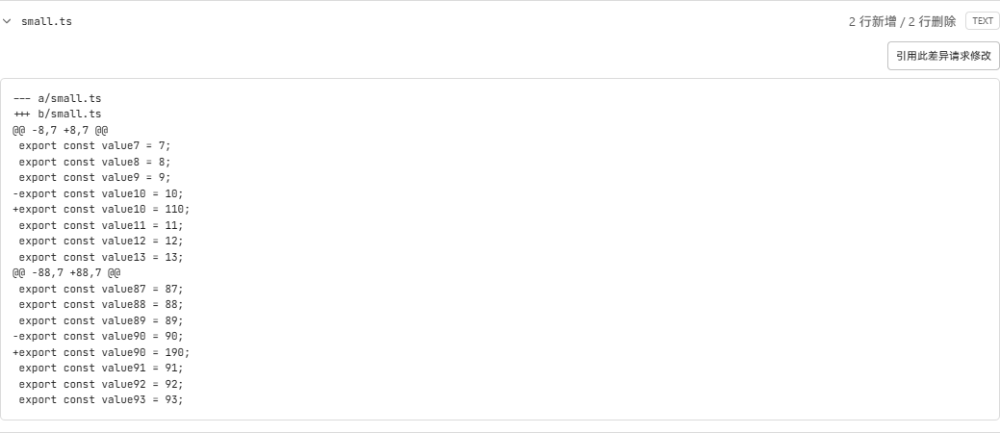
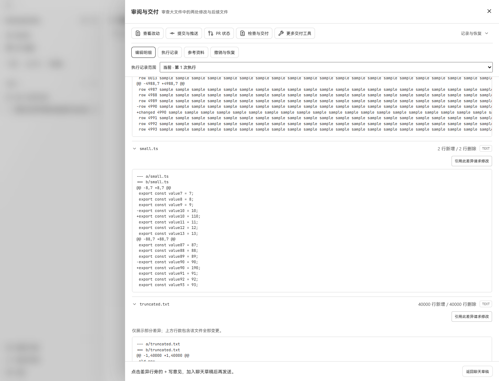
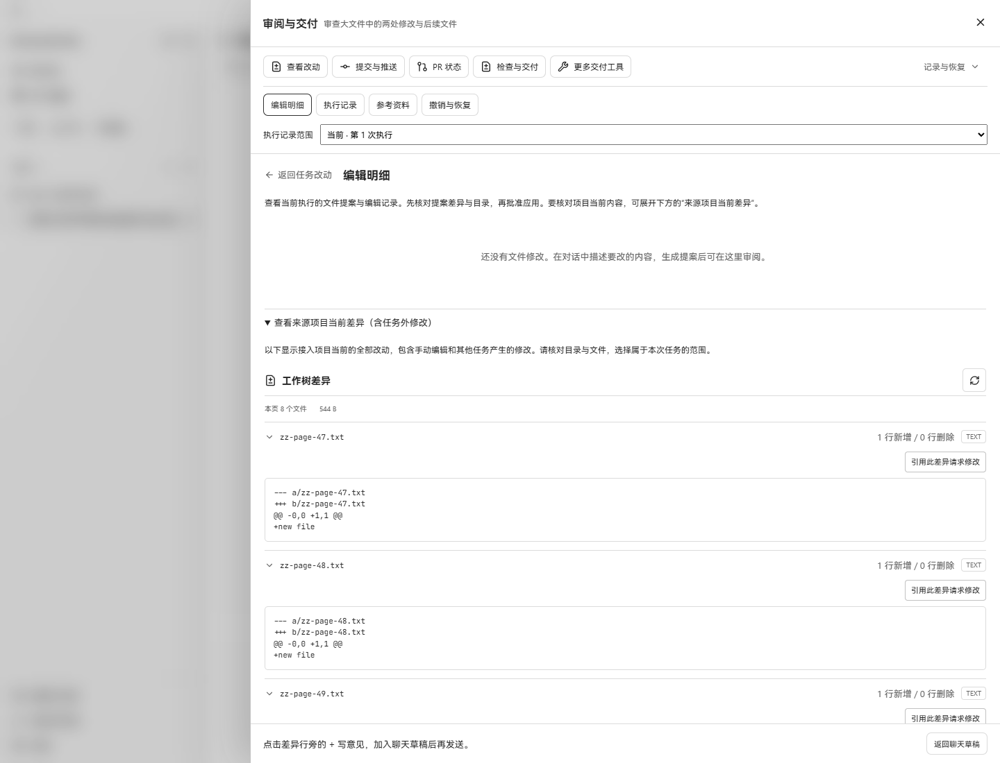
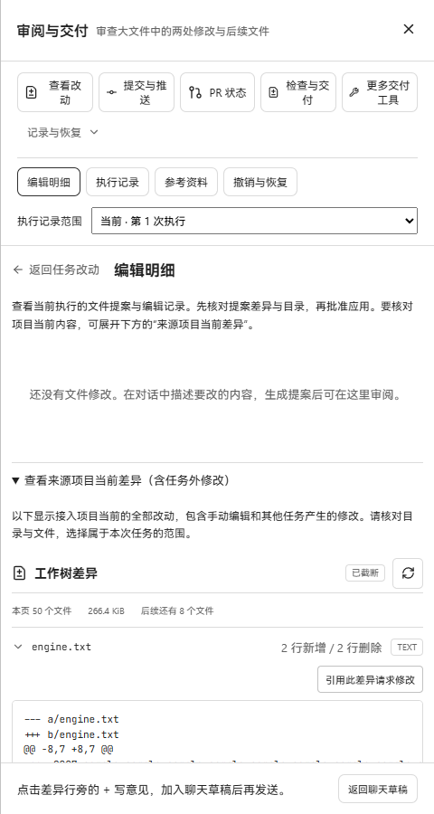

# Repository diff: real before/after acceptance

Date: 2026-10-27. Windows 11, Microsoft Edge, Go 1.26.10, Intel Core Ultra 9 275HX.

Baseline: `7a16e94d855bba38c31ced621b2b1a798cc4eb99` (main when this branch started).
Candidate: this PR's source. Each side runs its own compiled Go `workbenchjourney`
API, SQLite state and production Vite bundle. The harness uses an offline model
provider, but these checks make no model request. Diff data comes from real Git
repositories and real modified files, not mocked HTTP responses or replacement UI.
No native Wails window was used; these are the shared product UI in Edge.

## Before and after

The two runs receive identical input files: `engine.txt` is 2,150,000 bytes with two
distant changes; `small.ts` is 100 lines with only lines 11 and 91 changed;
`truncated.txt` replaces 40,000 lines; 55 additional new files exercise pagination.

| main | candidate |
| --- | --- |
|  |  |

- Before: `engine.txt` is `size_limited`; `small.ts` reports +81/-81; eight files
  beyond the first 50 cannot be reached.
- After: both edited files report +2/-2 in two separate hunks. The large replacement
  is preview-limited but retains +40000/-40000. The second page exposes the final
  eight files and disables Next. Returning to the first page reloads its content.
- 480px viewport: document scroll width equals viewport width (480px). Patch content
  scrolls inside its own preview. Browser console: zero warnings/errors in the final
  candidate session. This checks the changed diff panel; the existing outer review
  toolbar still wraps its labels at this width.

Raw bounded results: [before](before-observations.json), [after](after-observations.json).
The recorded first-page API calls took about 97 ms before and 764 ms after. They do
different work: the candidate computes two formerly skipped files, including the
40,000-line replacement, so these are observations rather than a speed comparison.

## Checks run

- `go test ./internal/repository ./internal/workspace -count=1` passed; focused
  tests were rerun after the final bounds, path-reader and patch-format changes.
- Focused HTTP explorer/repository tests passed, including `after` validation and
  exhausted-page behavior. OpenAPI and TypeScript definitions regenerated.
- `go vet ./internal/repository ./internal/workspace ./internal/httpapi` passed.
- 276 frontend test files / 2,709 tests passed with `--maxWorkers=4`; typecheck and
  production build passed. The initial default-concurrency run timed out on one
  unrelated provider-settings test at its existing 5s limit. That file passed alone,
  then the entire suite passed at lower concurrency without changing timeouts.
- Patch tests include an independent small LCS oracle over 500 deterministic cases,
  reconstruction of both inputs, Git apply checks, >200-file pagination, aggregate
  preview budget, bounded computation, secret redaction and linked-path rejection.
- Sparse 2 MiB line-diff microbenchmark: 3 iterations, about 8.5 ms/op, 20.3 MB
  allocated/op, 309 allocations/op on the machine above. It measures edit-script
  generation plus patch formatting, excluding Git status, file IO and redaction.

## Reproduction

1. Archive the baseline source into `.tmp/before` and build its `web/` production
   bundle. Build the candidate `web/` bundle separately. Do not share generated
   `dist` directories between versions.
2. Build `./cmd/workbenchjourney` with `-tags workbenchjourney` from each source tree,
   saving executables as `output/playwright/diff-scale/before.exe` and `after.exe`.
3. Copy [serve.cjs](serve.cjs) into `output/playwright/diff-scale/serve.cjs`. Run it
   through `scripts/ui-test.ps1 -Action command -Executable node -ArgumentList
   @('output/playwright/diff-scale/serve.cjs')`. The script creates a disposable Git
   fixture, imports it through the real API and starts a task. Enter `after` to run
   the candidate, or pass `after` as a Node argument to start it directly.
4. Use the generated **private** metadata locally to connect the browser. Open
   审阅改动 → 记录与恢复 → 编辑明细 → 查看来源项目当前差异. Capture each version at
   1440×1100, then inspect the candidate's second page and 480×900 layout.
5. Enter `stop` when done. Do not publish the generated private metadata, access
   tokens, databases, executables, or private logs.

Limits remain intentional: files above 4 MiB, over 100,000 lines or beyond the
bounded edit search get explicit unavailable statistics. Pages are live worktree
reads, so refresh from the first page after concurrent file additions or renames.
