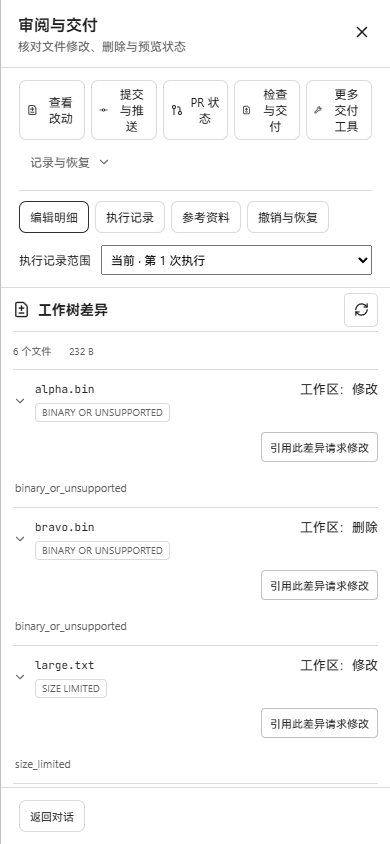
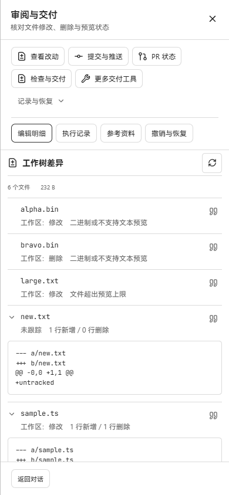

# Review layout cleanup — PR #451

The review navigation now wraps whole buttons on narrow screens. A single execution no longer needs a selector; multiple executions retain a compact, themed native select. Repository diff rows show the operation and one readable preview reason. Files without a patch have no empty disclosure, and the quote action sits beside the filename instead of occupying a separate row. Text patches retain independent collapse, statistics, redaction and truncation indicators.

## Real screenshots

Before is the production frontend at `44fb47ca5ab60bf07c9a7049129d4d41b78cf6e0`; after is the production build containing this change. Both connect to the same running Go `workbenchjourney` backend, SQLite database, thread and temporary Git repository. These are unmodified Windows Edge screenshots, without mocked browser API responses. The complete repository-diff response remained identical after the captures.

| 390 × 844 | Before | After |
| --- | --- | --- |
| Navigation, single execution and file rows |  |  |

[480px layout](after-480.png) · [Two executions, historical execution selected](after-multiple-runs.png)

The temporary repository contains six real changes: a modified binary, a deleted binary, a text file exceeding the existing 64 KiB preview limit, an untracked text file, a working-tree text change, and a staged text change. Its base is `1755705c7344`, with 232 bytes of returned patch content. This change only alters presentation; the backend preview limits are unchanged.

## Verification

- The two affected component test files passed: 13 tests covering operation labels in both languages, patch collapse, non-text rows, reference callbacks, and execution switching.
- TypeScript checking and Vite production build passed. Vite retains the existing large-chunk warning.
- At 390px, the page has no horizontal overflow and each primary button label stays on one line. Buttons wrap as units.
- Quoting `bravo.bin` inserted the deleted file path and base `1755705c7344` into the conversation draft.
- After the paired screenshots, a second real execution was created in the same thread. Switching to the historical execution worked; the selector uses the theme, a 7px corner radius and the native keyboard interaction.

Private connection tokens, browser state, temporary database, scripts and logs are kept in ignored local output folders. Only screenshots and this record are committed.
