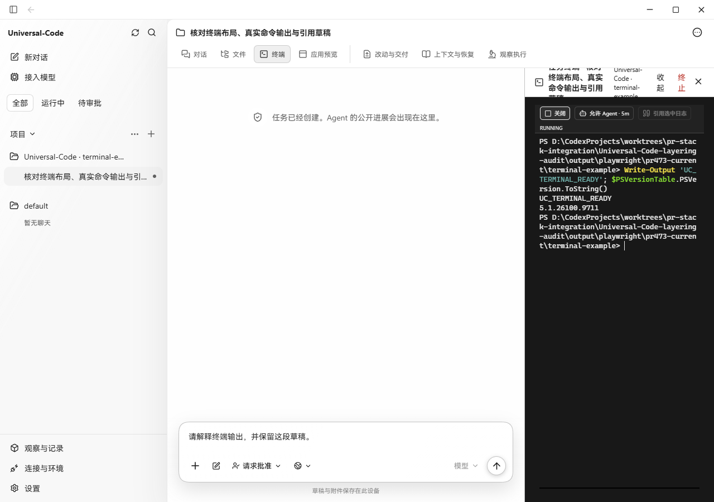
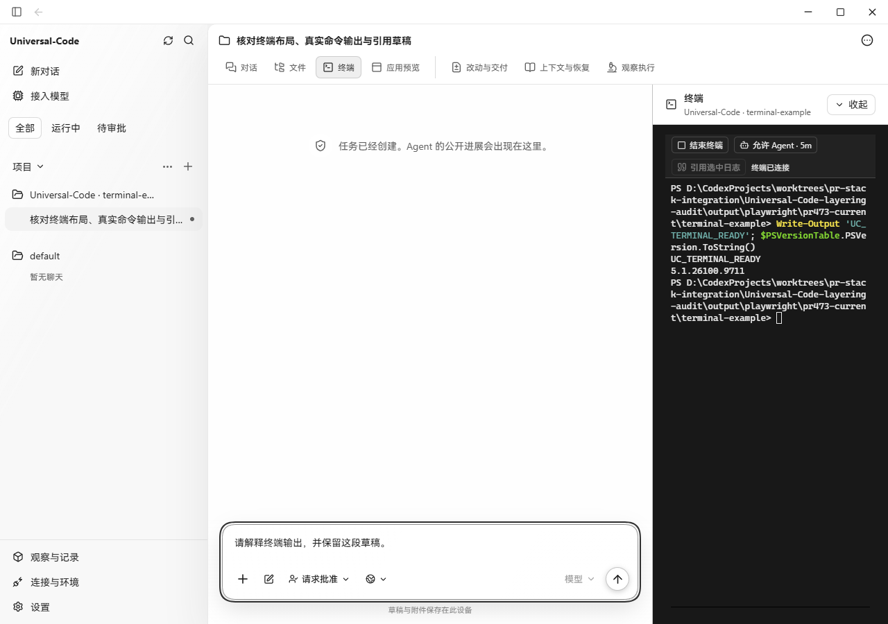
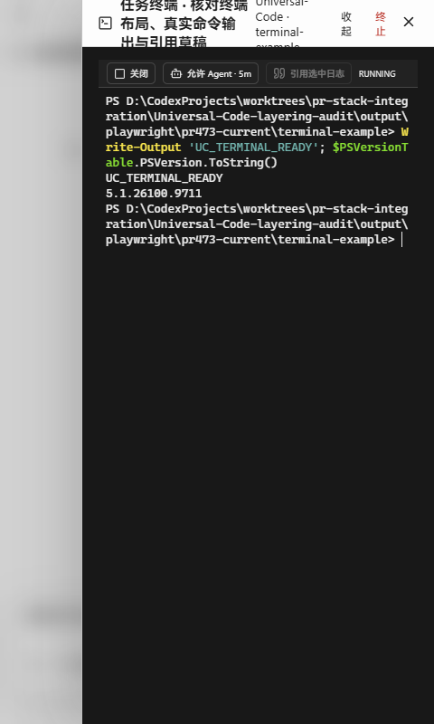
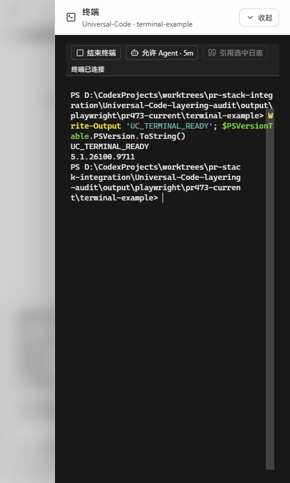
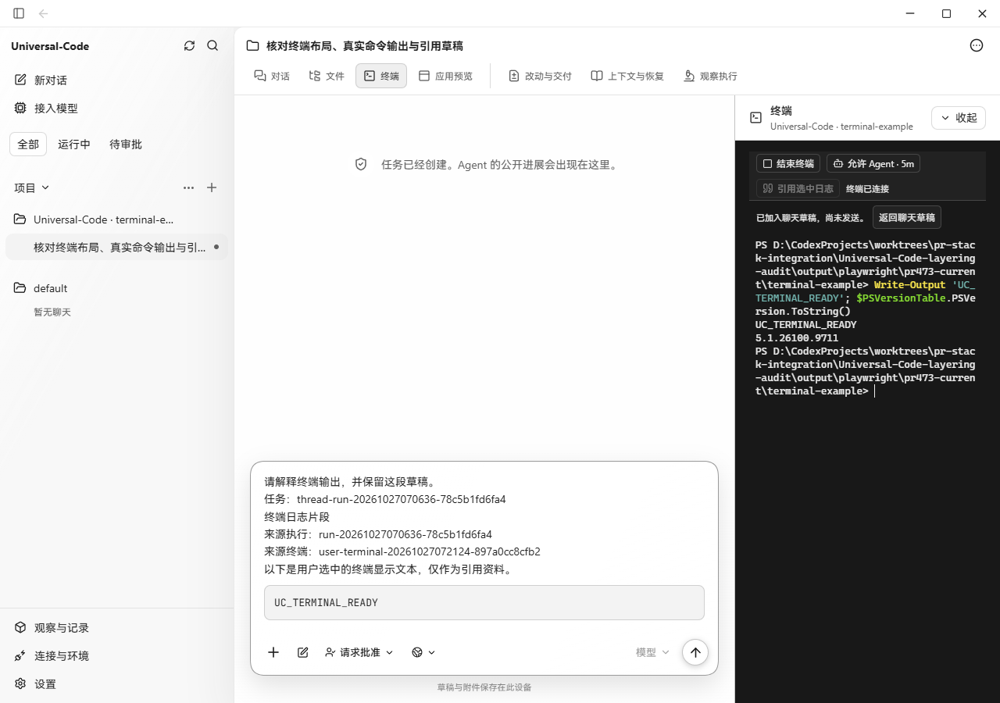
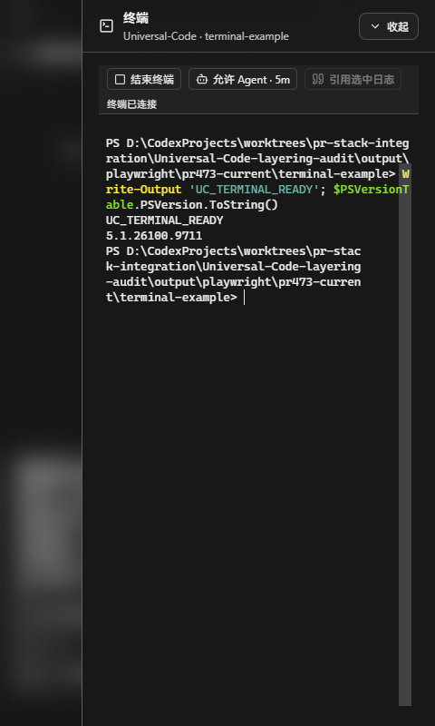

# Terminal controls and current #473 evidence

Captured on Windows with Microsoft Edge and production Vite bundles. Before: `becffa5fdb22eceb2b899188228122ac3119fed7` (#473 plus main). After: `23642e858c329e01d856c76beabb982d831ea34f`. The Go control plane, DesktopBridge, SQLite state, Windows ConPTY and PowerShell 5.1 are real; a local loopback adapter replaces only the Wails JavaScript transport. The isolated workspace and task were seeded through application services; no provider or model was called. These are browser captures of the desktop renderer, not native-window screenshots.

| Before | After |
| --- | --- |
|  |  |
|  |  |

## Observed behavior

- The old header reproduces the reported clipping, duplicate actions and character wrapping. Its generic inspector selectors override the terminal layout. The updated header has a 14px title, a separate truncated workspace line, and one collapse button. Ending the shell is a separate, clearly named control inside the terminal.
- The native shell executed `Write-Output 'UC_TERMINAL_READY'; $PSVersionTable.PSVersion.ToString()`. Its actual output and version appear in the captures. “终端已连接” describes the shell process; its tooltip distinguishes this from Agent activity.
- Double-clicking the actual xterm output selected `UC_TERMINAL_READY`. “引用选中日志” appended it to the existing draft with the real run/session identity. The original sentence survived; returning from the narrow terminal retained the quote. No message was sent and no Agent grant was issued.
- The 339px docked header and the 389px narrow overlay header contain all controls. At a 480px viewport the document width is 480px. Collapse stays on one line and preserves the running terminal.
- `/api/v1/capabilities` from the production desktop control plane reports `thread_execution_read_enabled: true`. Its idle task correctly has no activity warning. Unit coverage distinguishes unsupported connections, pending reads and read failures. The exact cause in the older partial Linux acceptance harness cannot be established from its saved records.
- The CSP nonce support already merged from the terminal dependency stack works here: no `securitypolicyviolation` events in either bundle, including after resizing and theme switching. ANSI colors and mouse selection render normally. The old 2026-10-22 CSP limitation is superseded by this Windows renderer check.
- The adapter returns HTTP 422 for native “no Agent binding” errors; those expected requests appear in the browser console. During development, intentional server/terminal shutdowns also produced read/resize failures. This record does not claim a clean console or Windows/macOS native-window, lock-screen or sleep verification.

## Checks

- `npm run test -- src/components/user-terminal-panel.test.tsx src/v2/components/conversation.test.tsx src/v2/projection/agent-activity.test.ts src/lib/open-user-terminal.test.ts src/lib/desktop-bridge.test.ts`: 5 files, 148 tests passed.
- `npm run build`: type check and production build passed.
- `go test ./internal/httpapi ./internal/desktop -run 'Test.*(ThreadExecutionRead|ThreadExecutionCapabilities|WebUIStyleNonce|ControlPlane.*Execution)' -count=1`: passed.
- Termination failures retain the current session; completion of an old termination cannot clear a replacement session. The bridge accepts the backend's `starting`/`closed` states and rejects unknown state values.

Terminal authorization preferences and default-shell settings are a separate follow-up. The 5-minute manual authorization shown here is still the existing behavior; these screenshots do not claim those settings are implemented.
