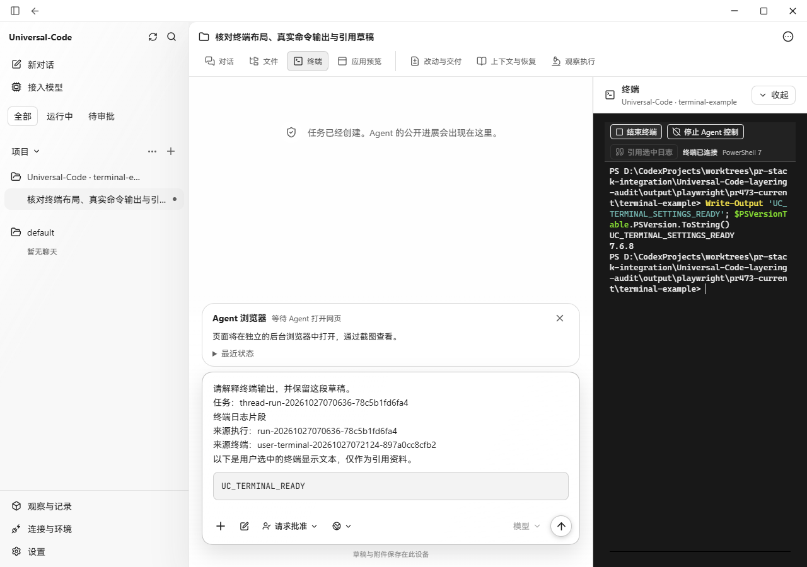
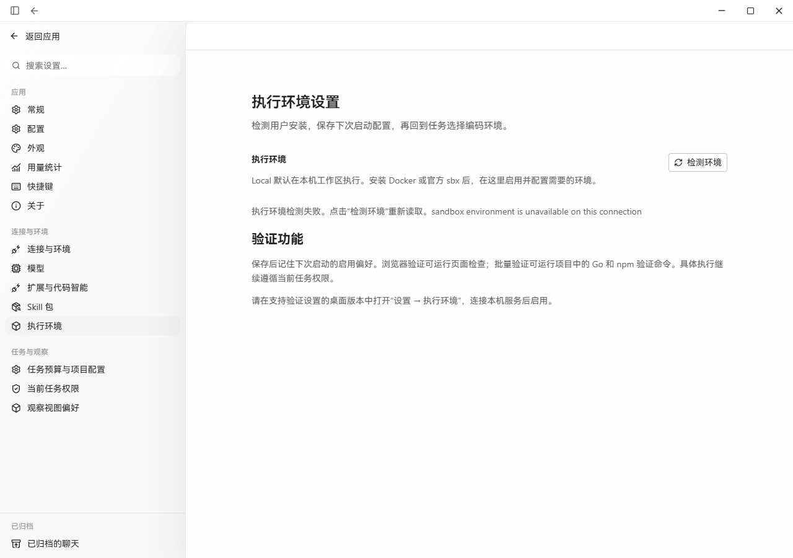
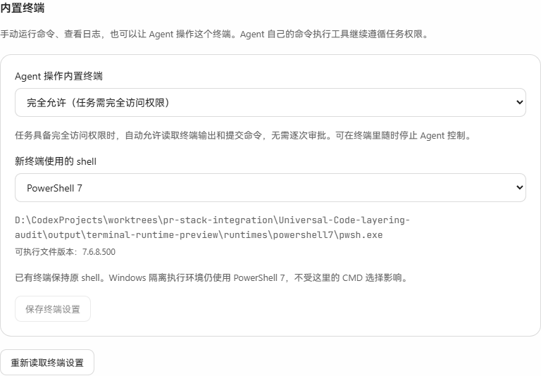
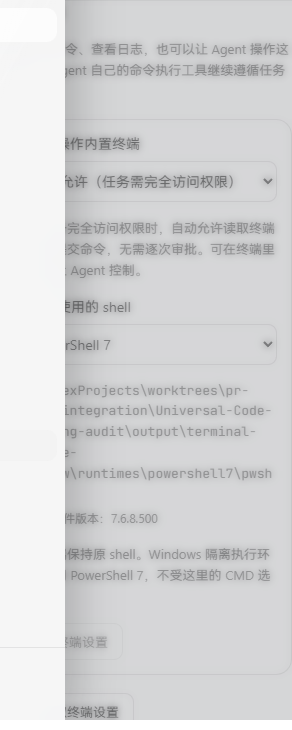
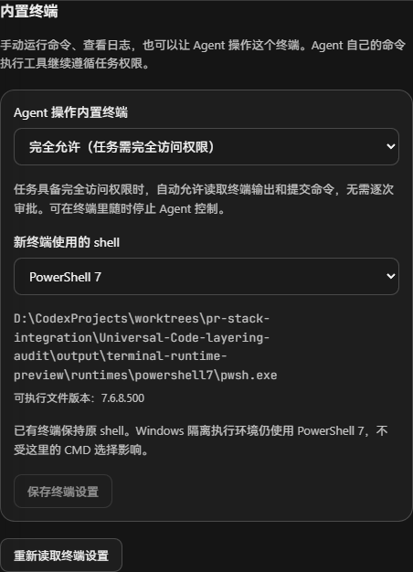
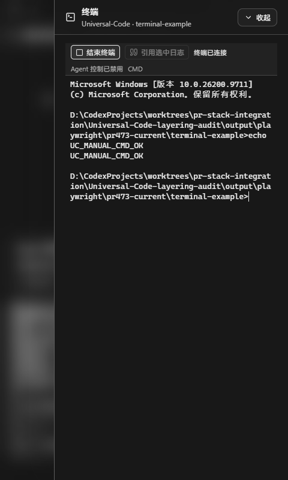

# 内置终端设置：真实操作与截图

日期：2026-10-27。平台：Windows 11、Microsoft Edge、Windows ConPTY。

- 修改前：`542dac6832fe43314f8726ff6b39e5645c0d2a6f`（#473 UI 修复）。`before-terminal.png` 复用该版本已有的真实终端截图；`before-settings.png` 使用该提交的生产前端重新打开执行环境页。
- 修改后源码：`d2a9395d114c4533097dc3843ecb99a396af4694`。截图来自本提交生产前端及相同 Go 后端源码，截图文件在后续文档提交保存。
- 原生服务由生产 `OpenControlPlane`、`DesktopBridge`、SQLite 和 ConPTY 组成，使用隔离的合成任务与项目。Edge 中仅以 loopback 适配器替代 Wails JavaScript transport；保存时的原生确认回调由验收适配器返回同意。没有伪造 shell 输出、授权服务或持久化服务。原生保存/取消边界另有单元测试；这些截图不是 Wails 原生窗口和 OS 对话框实测。

## 前后比较

| 修改前 | 修改后 |
| --- | --- |
|  |  |
|  |  |

设置截图裁切到实际新增区域；原页面的沙箱模块在该最小验收服务中显示未装配，这与终端能力无关，未作为通过项。

| 窄窗设置 | 深色设置 | 禁止 Agent 后手动 CMD |
| --- | --- | --- |
|  |  |  |

## 已实际执行

1. 在设置中保存“完全允许 / PowerShell 7”，刷新页面后回读仍为相同设置。
2. 在既有 Full 任务中新建终端，无第二次授权弹窗即可出现“停止 Agent 控制”。手动执行 `Write-Output 'UC_TERMINAL_SETTINGS_READY'; $PSVersionTable.PSVersion.ToString()`，输出版本为 `7.6.8`。停止控制后出现恢复入口。
3. 保存“禁止 / CMD”，新建真实 CMD，手动执行 `echo UC_MANUAL_CMD_OK` 得到输出；没有 Agent 授权按钮。
4. 同一任务中把默认 shell 改为 PowerShell 7，返回终端，CMD 和此前输出仍存在。结束该 CMD 后新建终端才切换为 PowerShell 7。此前该操作暴露的 ConPTY 关闭卡住问题已修复并重复验证。
5. 1280px 和 480px、明暗主题；480px 下 document.scrollWidth 等于 480。上述终端操作没有 CSP violation。

## 自动验证

- 7 个相关前端文件、136 项测试通过；TypeScript 检查和生产构建通过。
- Go 终端、桌面桥接测试通过；授权设置、存储重试、原生确认取消和冲突、Full 权限降级、禁用、撤销及自动续期测试通过。
- `go test -race ./internal/application -run TestTerminalPreferences` 通过。
- 开启 `CYBERAGENT_TEST_WINDOWS_CONPTY=1`，CMD / Windows PowerShell / PowerShell 7 的真实输入、退出与主动关闭测试重复两次通过；整个 terminal 包 `-race` 通过。
- Windows 命令运行器受信任 PowerShell 选择及拒绝降级相关测试通过。
- desktop build tags 下配置相关测试通过；surfacecheck、protocolregistry 检查通过。

OCR delegate 使用 `542dac68..d2a9395d` 的实际变更选择文件和规则，由当前 agent 完成审阅：total_files=28、reviewed_files=28、skipped_files=0、coverage_rate=100%。逐文件记录见 [review-coverage.json](review-coverage.json)。审阅和实测中修正了细粒度启动的默认设置读取、授权完成后迟到状态覆盖、真实 ConPTY 关闭卡住；未留下已确认阻断问题。测试及 Markdown 文件属于 OCR 默认排除项，相关测试另外执行。

## 运行时及验证范围

应用旁的 PowerShell 来自 [Microsoft 官方 7.6.8 发布](https://github.com/PowerShell/PowerShell/releases/tag/v7.6.8)。准备脚本实际执行成功：下载 ZIP SHA-256 为 `b9f074f923c499b51ec99d313da8e9ae90d17a9f3adf00c73d6189f34d908528`，pwsh.exe Microsoft Authenticode 有效；程序版本输出 7.6.8，设置中的文件资源版本为 7.6.8.500。

`-BundlePowerShell7` 提供 Windows x64 完整构建目录，EXE 与 runtimes 目录必须共同分发；本 PR 没有修改正式 Release 或 MSIX 打包流程。未进行 Windows 10、macOS 原生窗口验收。本机没有 Claude Code CLI，因此没有运行其 TUI、登录或模型请求。管理员终端按本次范围暂不实现。
