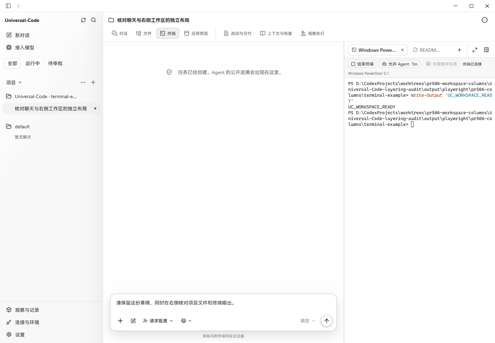
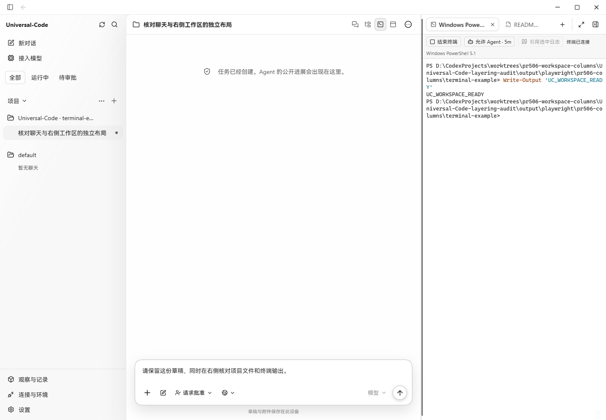
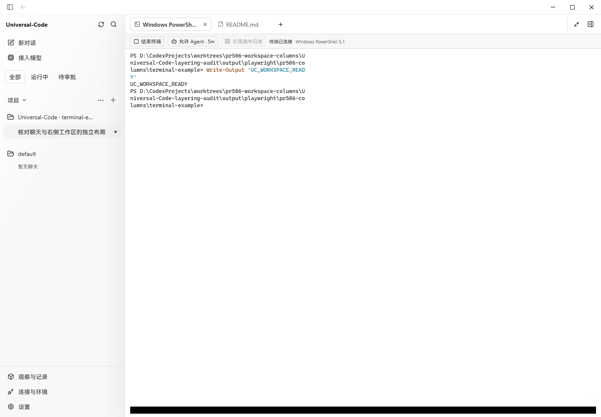
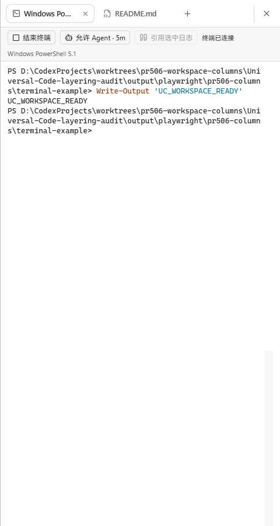

# PR #506：聊天与右侧工作区独立分栏

修复前为 #506 的 `3f673b3d5c03ffde7851927631eafaf1408584c5`；修复后为本目录随附的代码。两组截图使用同一聊天、草稿、文件标签和真实 Windows PowerShell 会话。

聊天标题及任务导航现在只占中间聊天列，右侧标签栏从相同顶部开始，竖向分隔线贯穿工作区。进入完整视图会同时收起聊天标题、消息与输入框；退出或收起工作区后恢复聊天列及键盘焦点。聊天工具栏按自身列宽收缩。

| 修复前：右栏位于聊天工具栏下方 | 修复后：两列各有顶部栏 |
| --- | --- |
|  |  |

| 完整视图 | 480px 窄窗抽屉 |
| --- | --- |
|  |  |

## 实际验证

- Windows Edge，1440×1000 与 480×900 CSS 像素，生产前端构建。后端使用本分支真实 Go DesktopBridge、SQLite 与 ConPTY；本地 HTTP 适配器承载 Wails 方法调用，没有替换终端输出或页面组件。这是浏览器承载桌面桥的布局验证，未重新打包 Wails 安装程序。
- 1440px 下，修复前聊天标题宽 1140px，右栏从 y=122 开始；修复后聊天标题宽 700px，右栏宽 440px，两者均从 y=35 开始，右栏底部为 y=1000。35px 为独立窗口控制栏。
- 完整视图隐藏整个聊天列，刷新后保持完整视图；收起后焦点回到“终端”入口。重新打开并退出完整视图，恢复分栏宽度。
- 调整右栏宽度后刷新保留设置；在 README.md 与终端标签间切换，草稿与 `UC_WORKSPACE_READY` 真实命令输出保留。
- 480px 时右栏自动收起，主动打开为 480×900 抽屉；关闭抽屉后恢复聊天。桌面和窄窗均无横向页面溢出。
- 相关测试通过：`conversation.test.tsx`、`conversation-inspector-feedback.test.tsx`、`workspace-tabs.test.ts`，共 79 项。新增回归覆盖标题归属、完整视图隐藏导航、关闭完整视图后的焦点恢复。
- `npm run build` 通过，包含 TypeScript 检查。

本地桥将“尚无 Debug 终端 Agent 输入授权”的原生查询错误映射为 HTTP 422，基线与修复版均出现；手动终端连接和命令输出正常。本次未改变终端授权行为。
