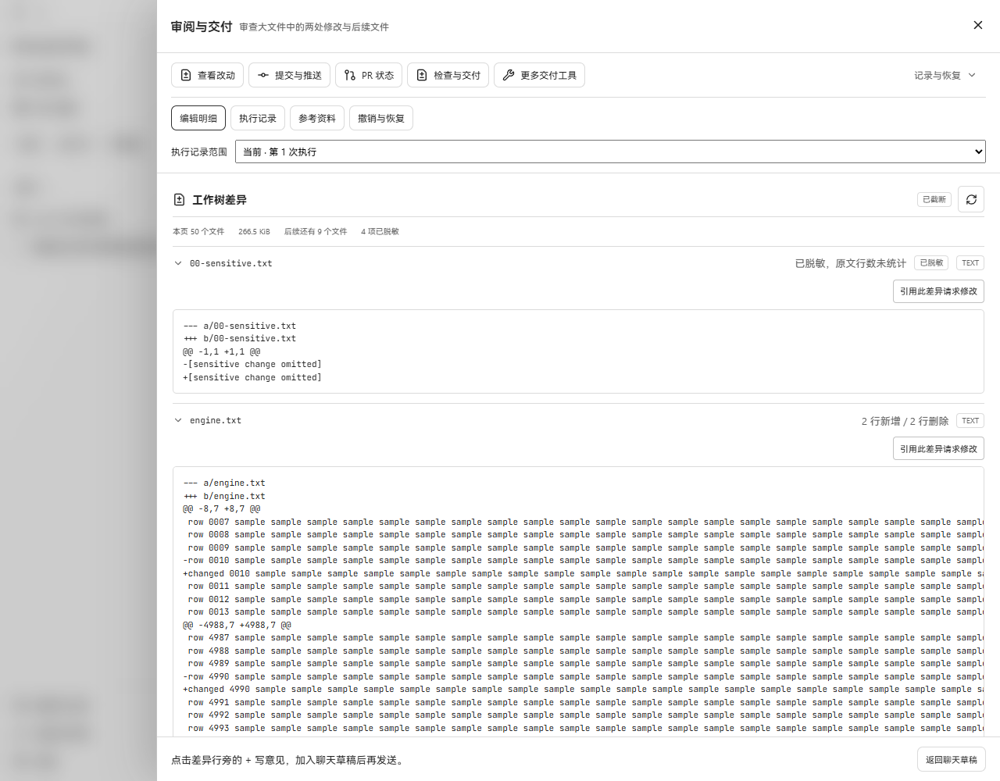
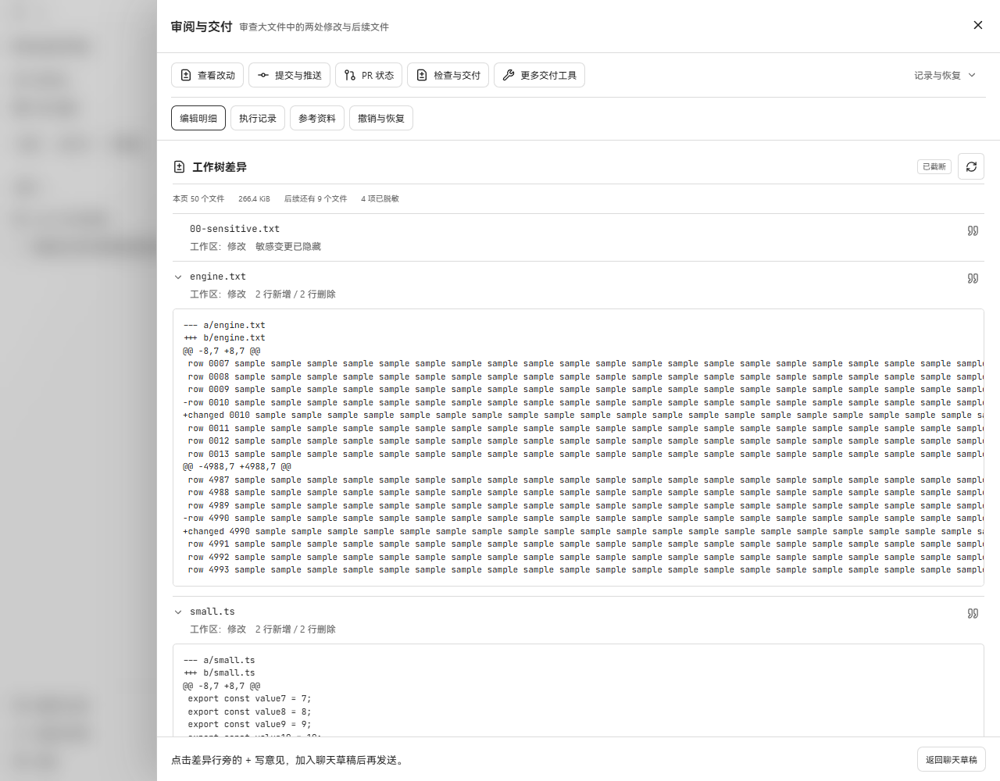

# PR #505 review follow-up

The read-failure and concurrent-change findings are valid. Ordinary read failures
now produce `unavailable`; an absent path is treated as a deletion only when the
status scan also saw a deletion. Detected replacements and metadata changes during
the bounded read are rejected without a patch or complete statistics. Files with
identical redacted projections return no artificial hunk: the UI says “敏感变更已隐藏”.

Main at `c5b7d339` is integrated. The conflict resolution retains #451's compact
file rows, operation labels and quote icons alongside #505's pagination, complete
statistics and preview-limit indication. Refresh has a tooltip explaining that
working-tree changes require restarting from page one.

## Actual application screenshots

Before runs the original #505 build (`9b594d3e`); after runs this follow-up. Each
uses its own real Go API, SQLite database, production frontend and temporary Git
repository with identical initial file content. Screenshots are unmodified Windows
Edge captures at 1280 × 1000, without mocked HTTP responses or a replacement UI.
The fixture extends the earlier acceptance harness with a dummy secret-only edit.

| Before | After |
| --- | --- |
|  |  |

The earlier fake `@@ -1,1 +1,1 @@` is gone. The sensitive change has one readable
message and no empty disclosure. The 2.15 MB file still has two real hunks and +2/-2.

After the paired screenshots, a file sorting before the current cursor was added.
It was correctly absent from page two and appeared when Refresh returned to page
one. [Refresh result](after-refresh.png). The [480px layout](after-480.png) has a
480px document width; patch content scrolls within its preview.

## Validation

- `go test ./internal/repository ./internal/workspace -count=1`: passed.
- `go vet ./internal/repository ./internal/workspace`: passed.
- Related component tests: 17 passed; TypeScript and production build passed.
- Deterministic tests cover deletion, rename, directory replacement and reappearance
  between status inspection and reading; regular-file replacement and in-place
  rewrite after path validation; insertion before/after a cursor, deletion and rename
  between pages; refresh recovery; redacted projections without manufactured lines.
- Real UI checks confirm the hidden-sensitive-change row, retained +2/-2 counts,
  second-page navigation, first-page refresh and narrow-screen containment.

OCR delegate workspace review selected 10 production files: 4 reviewed (repository
diff, bounded review reader, Diff panel and its CSS); 6 skipped because they are
unchanged imports from main (store threads, project header/sidebar, and task-review
component/styles). Coverage: 4/10 selected, all 4 locally changed production files
reviewed. Test files were examined separately. No additional blocking finding was
identified in this follow-up.

The worktree remains live. These checks detect specific races; they do not provide
an immutable snapshot or guarantee detection of every concurrent write. Private
tokens, databases, browser state and logs stay in ignored local directories.
