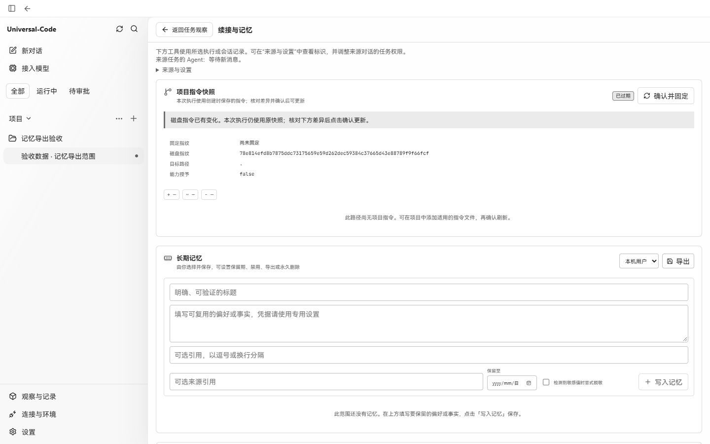

# 记忆导出范围验收

2026-10-28 在 Windows 的 Microsoft Edge 中，使用同一隔离测试项目、真实 Go API 和生产前端构建。修改前为主线 `fb1170fb2947813bd86a141d07a430b522c5f7a4`，修改后为 `9ba21b05978174e4976f104c489d9727c0ac12bf`。

两次都从“当前项目”开始导出；测试暂缓真实接口的响应，切换到“本机用户”后再继续，响应内容未替换。两份实际下载文件的内容均为项目范围，包含同一条隔离测试记忆：

| | 修改前 | 修改后 |
| --- | --- | --- |
| 浏览器给出的下载文件名 | `prayu-user-memory-2026-10-28.json` | `prayu-project-memory-2026-10-28.json` |
| 文件中的范围 | `project` | `project` |

下图是切换范围后的真实应用页面。此修复改变下载文件名，页面本身不显示该名称；文件名由浏览器下载事件和实际保存文件核对。

| 修改前 | 修改后 |
| --- | --- |
|  |  |
