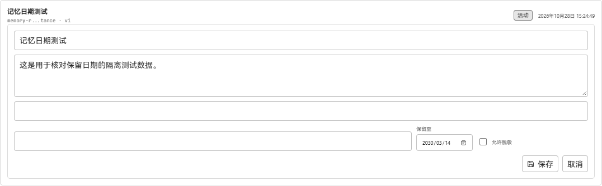

# 记忆保留日期验收

2026-10-28 使用香港时区的 Microsoft Edge，在隔离数据目录中运行真实 Go API 和两个生产前端构建。修改前为主线 `fb1170fb2947813bd86a141d07a430b522c5f7a4`，修改后为 PR 代码 `a148abac9e4d03a233b54e45e9e12bb0ed1a43e0` 合入该主线后的构建。两次使用同一测试记忆，未替换 API 响应或页面内容；截图为实际页面中的记忆编辑区域。

测试记忆的原始到期时间为 `2030-03-14T16:30:00Z`，即香港时间 2030 年 3 月 15 日 00:30。列表显示 3 月 15 日，修改前编辑框却回填 3 月 14 日；修改后回填 3 月 15 日。

| 修改前 | 修改后 |
| --- | --- |
|  |  |

通过实际页面保存该编辑后，接口返回 `2030-03-15T15:59:59.999Z`，即香港时间 3 月 15 日日终。通过页面新建并选择 2030 年 2 月 28 日后，接口返回 `2030-02-28T15:59:59.999Z`。编辑框只有日期精度，保存时会将到期时间调整为所选本地日期的日终；已有记忆不会自动迁移。
