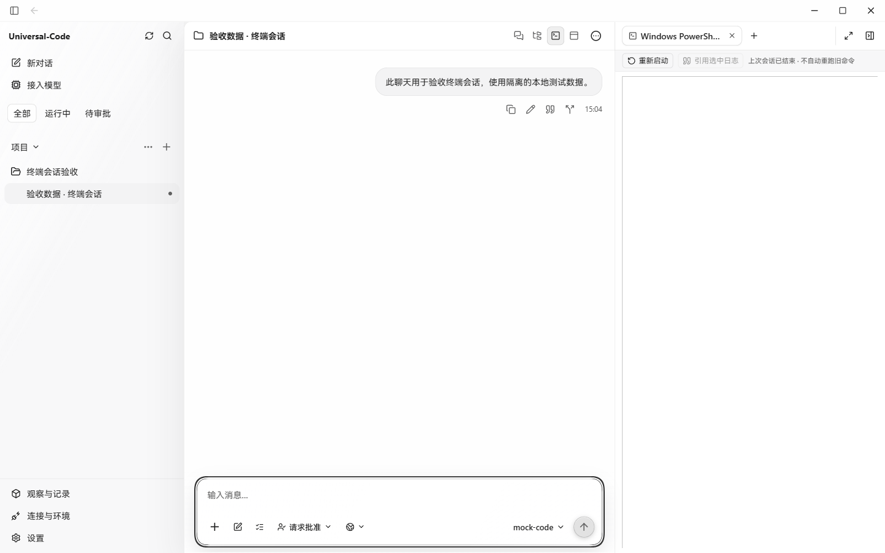
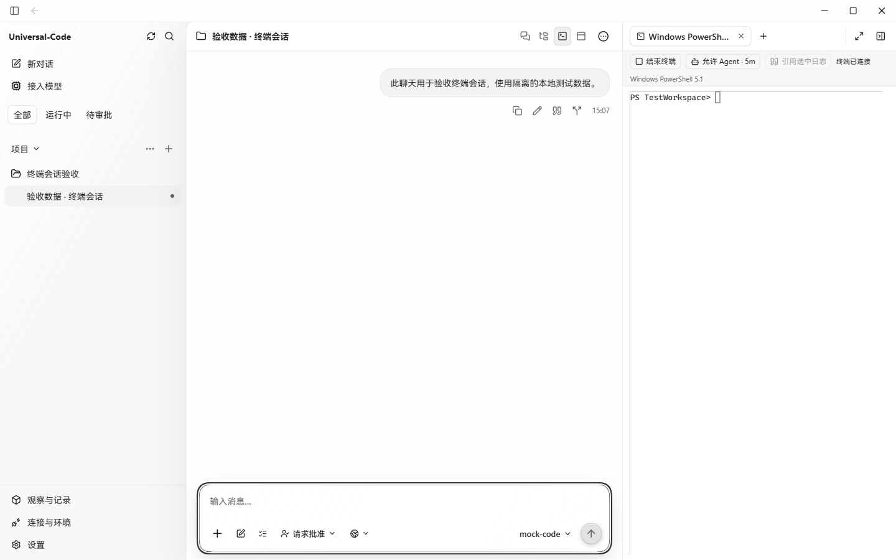

# 终端关闭响应迟到验收

2026-10-28 在 Windows 桌面上使用隔离的聊天、工作目录和真实终端进程，分别运行主线 `fb1170fb2947813bd86a141d07a430b522c5f7a4` 和本 PR 代码 `71f00593ddf4576579e15ad7c000033cd6303a77` 构建的 Wails 应用。两个构建均使用 `desktop,production,wv2runtime.error`，并在临时依赖副本上启用本地调试端口，使用独立实例 ID 和数据目录。截图直接来自应用页面，未修改页面 DOM。

| 修改前 | 修改后 |
| --- | --- |
|  |  |

测试通过桌面桥接控制响应时序：点击“结束终端”，真实关闭旧进程后暂缓返回；通过桥接启动真实的新进程，在释放旧响应时写入新会话 ID 并触发工作区存储更新，使旧回调在面板更新前执行。主线错误地清空了绑定，页面显示“上次会话已结束”，但通过桥接查询到新进程仍在运行；修复后保存的新会话 ID 与运行中的进程一致，页面显示“终端已连接”。完成截图后关闭了测试终端。

该复现为受控时序，尚未证明普通桌面操作可以稳定触发。正常关闭当前终端和组件卸载时序另由自动化测试覆盖。
