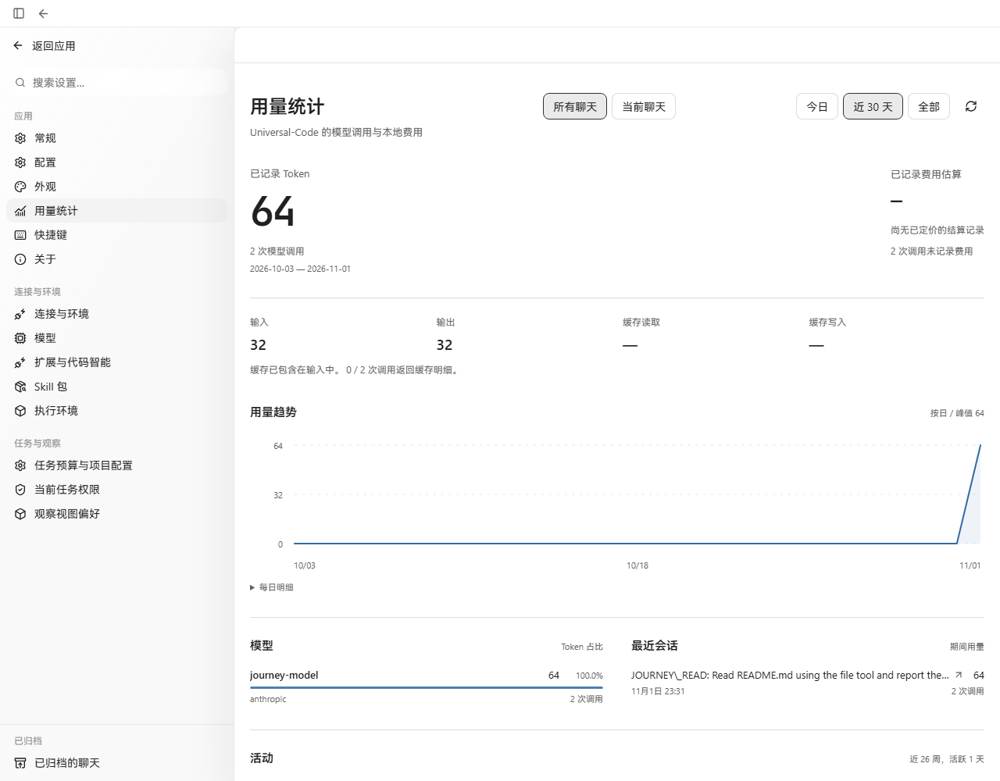
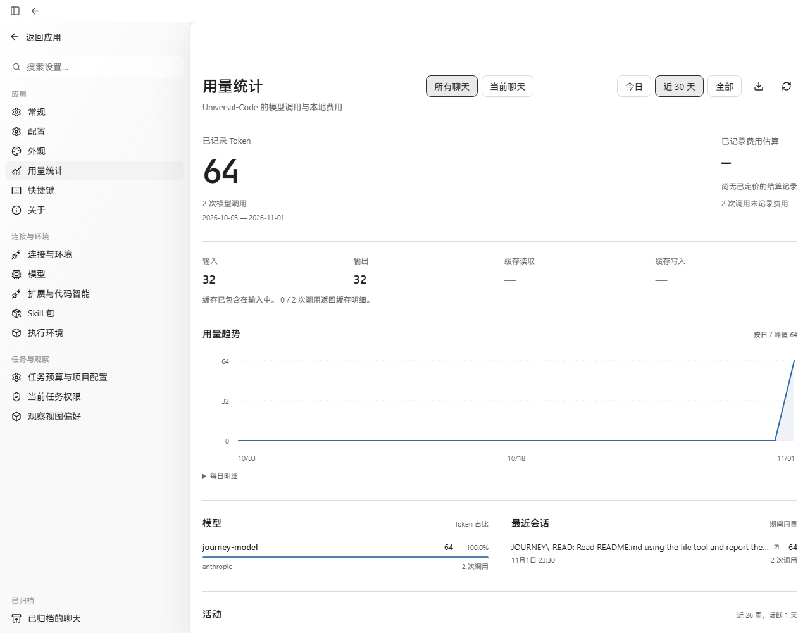

# Usage CSV Export — Acceptance Record (2026-11-01)

## Scope

Settings → Usage adds an "Export CSV" action next to the refresh button. The export
mirrors the currently loaded `GET /api/v1/usage` projection (totals, per-day, per-model,
and recent-session rows plus the global cost ledger) into one BOM-prefixed UTF-8 CSV.
No API, protocol, or Surface changes; the export is frontend-only over data the page
already loads.

## Before / After

Left: `main` baseline. Right: this change. Both sides ran the same real Go API
(`workbenchjourney`), the production web bundle, and headless Chromium on
Windows; the usage numbers come from one real journey conversation settled
through the bundled offline provider (64 tokens / 2 model calls in both runs).

| Before | After |
| --- | --- |
|  |  |

The only visible difference is the export (download) button beside the refresh
button in the period controls. Disabled states (no data, empty period) are covered
by unit tests instead of screenshots.

## Environment

- Windows 11, Go 1.26 (workbenchjourney harness), Node 24, production `vite build`.
- Headless Chromium 1228 via Playwright, 1280×1000, zh-CN locale.
- Usage ledger content is the journey provider's real settlement (input 32 /
  output 32, no cache details, unpriced cost), identical on both sides.

**Local-harness note:** capturing these screenshots required a temporary local-only
tweak to `workbenchjourney`'s offline provider: the composer now ships underscores
Markdown-escaped, so the journey trigger `JOURNEY_READ` reaches the provider as
`JOURNEY\_READ` and the bundled journey state machine no longer recognizes it on
`main` (the e2e journey fails the same way without the tweak). The temporary tweak
is not part of this PR; the recorded usage, the pages, and the export behavior are
real runs.

## Validation

- `npm run typecheck` — pass.
- `npm test` — 2877/2877 pass (includes 4 new export cases: full CSV layout by
  column index, RFC4180 escaping of comma/quote/CRLF titles, disabled without
  loaded data, disabled on an empty period).
- `npm run build` — pass.
- Manual: real download produced `universal-code-usage-30d-<start>_<end>.csv`
  opening cleanly in a spreadsheet with 20 aligned columns.

## Follow-up on review (2026-11-02)

Review found two defects in the exported file, both fixed in the follow-up commit;
the screenshots above are unaffected because the button and panel did not change.

- Cells that begin with `=`, `+`, `-`, or `@` — optionally behind whitespace or a
  control character — are evaluated by spreadsheet software on open, so a session
  titled `=HYPERLINK(...)` executed rather than displayed. `csvField` now prefixes
  such cells with the text-forcing apostrophe before RFC4180 quoting applies.
  Quoting alone was never a mitigation: it governs parsing, not evaluation.
- `cache_usage_reported_calls` was in the loaded projection and in the panel's
  coverage note but missing from the export, which left `cache_read_tokens` and
  `cache_creation_tokens` unexplainable (provider silent vs. provider reported
  zero). The header is now 21 columns and every row fills the coverage cell.

Trade-off stated plainly: the apostrophe is what Excel and Google Sheets honour on
import, and a spreadsheet's own re-save drops it; a byte-exact reader such as
pandas sees the prefix as part of the value. That is the cost of exporting one file
for both audiences, and titles beginning with `-` or `+` innocuously take it too.
The pre-existing manual observation above ("20 aligned columns", opened cleanly)
was made against the pre-fix export; the 21-column layout, the coverage cell, and
the formula neutralization are covered by unit tests, and were not re-opened in
Excel, Sheets, or LibreOffice on this host.
