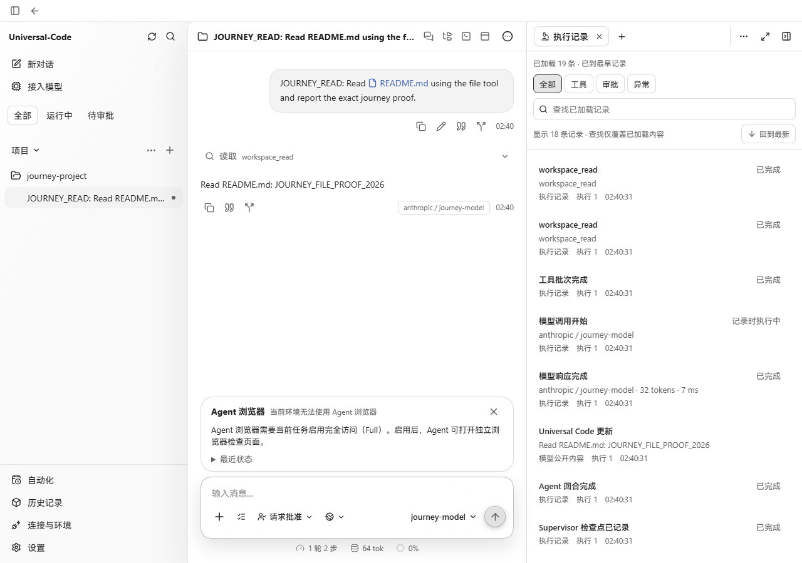
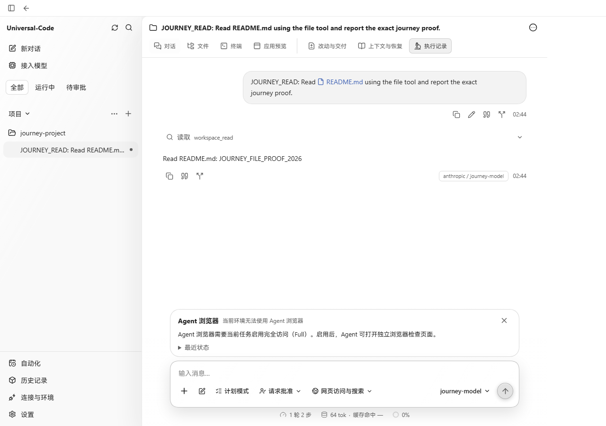

# Return navigation — 2026-11-07

Base: `cfeee05a8724a23c673b0ed9971f2ef6e8de9674`.

Opening a Run from a conversation's records and returning could leave two
identical records entries in browser history. The next browser Back changed the
history index but left the same URL and page visible. Conversation settings,
automation and records returns had the same replacement behavior.

Returns now reuse the existing parent entry when the previous hash proves it is
that parent. A direct link or unrelated predecessor still uses the explicit
destination. The existing leave guard and invalid-link handling remain active.

## Real browser reproduction

The real Go journey API serves a production bundle and a deterministic local
model reads the temporary workspace README. Chromium opens execution records,
opens and returns from Run details twice, then presses browser Back once.
Selecting the records tab initially does not change the URL; the first return
establishes its explicit records route. The second return exposed the duplicate.

Before, the final URL remained `/records` and the test failed after 19.5 seconds.
After, one Back reaches the original conversation and its visible reply; the
journey passed in 8.0 seconds. Screenshots are unmodified 1280×900 captures of the
state after that same Back action. The browser notice is removed separately by
PR #546.

| Before | After |
| --- | --- |
|  |  |

Five new hook cases first reproduced the duplicate entries for Run, Session,
records, settings and automation. The navigation, accepted-leave and resource
navigation suites pass (61 tests), as do TypeScript and the production build.
OCR Delegate rules were applied to the single production file; its full source,
changed hook tests and the browser journey were read. No legacy route or alias
was added.
