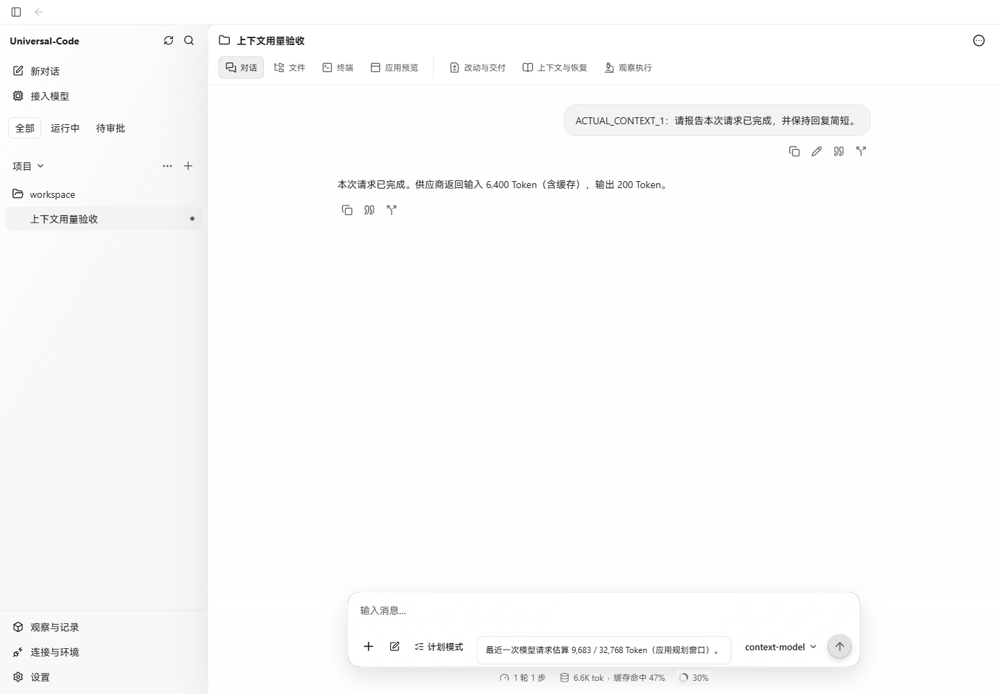
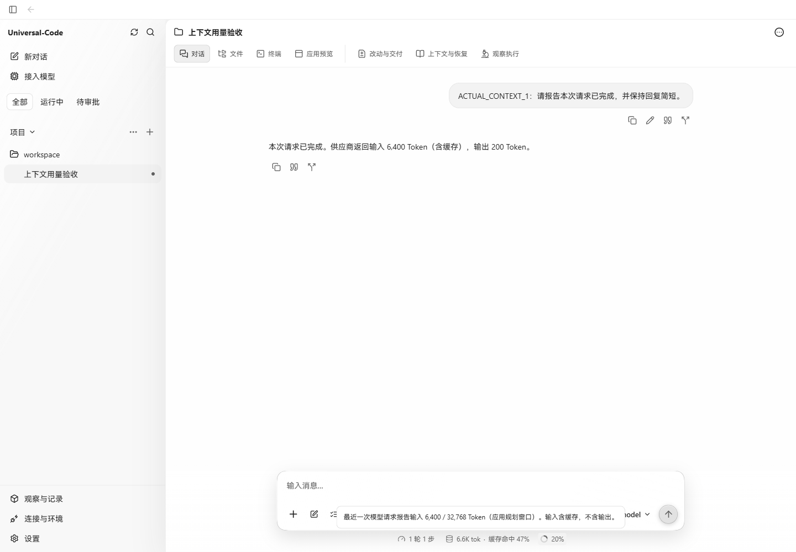
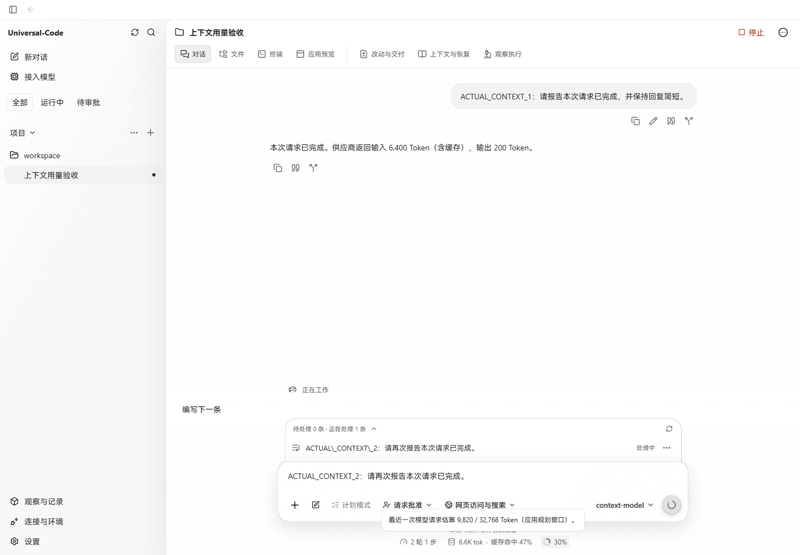
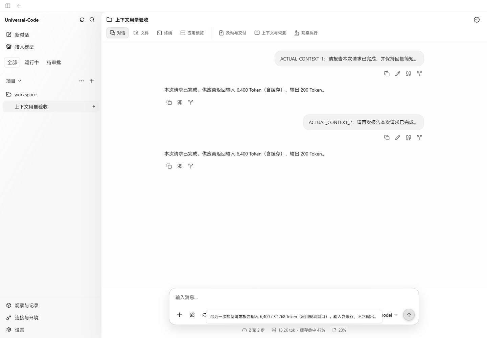

# Reported context usage acceptance

Verified on Windows with Chrome at 1440 × 1000 on 2026-10-22 (UTC+08:00).

The context indicator now uses the latest root model request's reported input
tokens after its successful completion. While a request is running, or its input
usage is unavailable, it shows the saved estimate. The denominator remains the
application's planning window. Reported input includes cache reads and writes;
output tokens are excluded.

## Real API workflow

The before image uses the production Go API and frontend built from
`19bce52d0b81cdf9ce079440da69d45126ba970f`. The after images use this change's
production builds, restarted with the same API address and SQLite home.

A local Anthropic-compatible HTTP provider returned deterministic replies through
the production model client. Each response reported 2,400 uncached input tokens,
3,000 cache-read tokens, 1,000 cache-creation tokens and 200 output tokens.
UC normalized these to 6,400 total input and 6,600 total tokens and saved the
ordinary model completion receipts. Application API responses, DOM content and
database records were not mocked or edited.

The chat was `thread-run-20261021213013-17ad49b6064b`. Its application context
window was 32,768 tokens, with source `conservative_default`.

| Observation | Context input | Estimated | Indicator | Cumulative input |
| --- | ---: | --- | ---: | ---: |
| Baseline, first reply completed | 9,683 | true | 30% | 6,400 |
| Updated API, same saved reply | 6,400 | false | 20% | 6,400 |
| Updated UI, second request awaiting provider | 9,820 | true | 30% | 6,400 |
| Second reply completed | 6,400 | false | 20% | 12,800 |

The second message was submitted in the real browser. The local provider held its
response until the pending-state screenshot was captured, then returned the real
HTTP response. The already-open context explanation updated to reported input
without a page reload. The first reply's reported usage did not carry into the
second request's estimate, and cache tokens were not added twice.

## Screenshots

Before: completed request still displays its original estimate.

After: the same saved request displays reported input.

Next request: awaiting the provider, showing the new request's estimate.

After completion: the open explanation updates to reported input.

## Focused checks

- The existing aggregation regression was first changed to expect the saved
  actual input. It failed against the baseline with `InputTokens:64000` and
  `Estimated:true`, despite that call's 30-token input receipt.
- `go test ./internal/store -run '^TestThreadStatistics' -count=1` passed.
  Coverage includes actual supervisor start/completion writes, root aggregation,
  read-only queries, cross-Run ordering, a late older transport completion,
  canonical cache accounting, auxiliary/not-sent exclusions, unavailable window
  metadata, missing/zero/partial/explicitly unknown usage and failed calls.
- `go test ./internal/httpapi -run '^TestThreadHTTPContractContinuesTerminalRunAndPreservesLifecycleHistory$' -count=1` passed.
- `npm test -- src/v2/components/composer-stats.test.tsx` passed (7 tests),
  including the open explanation's estimate → reported input → next estimate
  transition and the application-window label.
- `npm run build` passed. Vite reported the existing large-chunk warning.
- `git diff --check` passed. The API shape and generated schemas are unchanged.

The screenshot workflow covers one chat's two successful requests. Late-event,
cross-Run, missing-usage and auxiliary-call behavior is covered by the Go tests.
