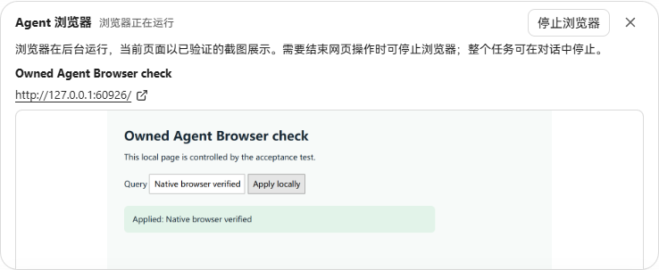
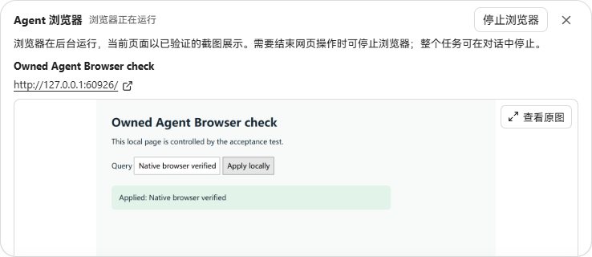
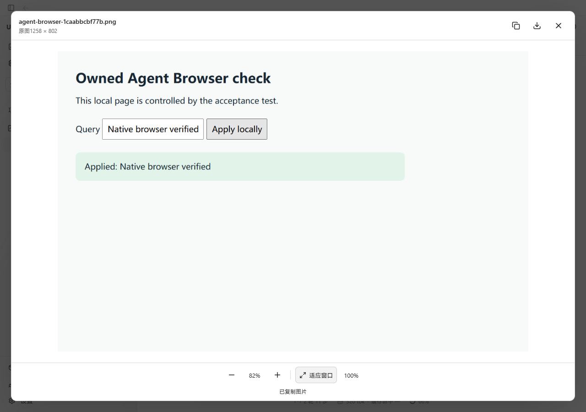
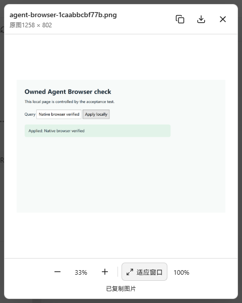
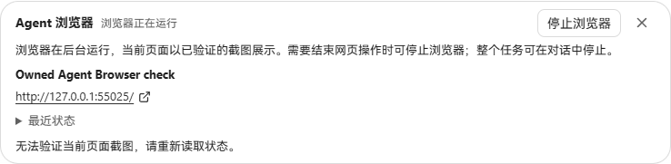
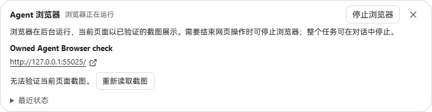

# Agent Browser screenshot viewer

Clicking an Agent Browser screenshot now opens the existing original-image viewer: fit or 100% size, zoom, copy PNG, download the original, and Escape to return focus. An updated screenshot, browser session, or Run closes the previous preview. Verification or image-decoding failures do not enable a preview.

## Real UI comparison

Captured in Microsoft Edge on Windows. Both versions use the same production Go API (`cmd/workbenchjourney`) and the same screenshot produced by the native Chrome browser tool against its owned local test page. The offline provider supplies deterministic tool calls. The baseline is `fc0935d6fc03ca7abccbd148ce52d26c2bc154f8`; the updated view is the production Vite build from this change.

The API keeps its startup bundle in memory, so the updated production bundle was served with Vite preview proxying the same API. The card comparisons are direct Playwright element screenshots at a 1280 × 900 viewport. The viewer screenshots use 1280 × 900 and 480 × 600 viewports.

| Before: thumbnail only | After: open original |
| --- | --- |
|  |  |

## Verification

- Agent Browser component: 21 tests passed; existing image-viewer suite: 8 tests passed. Covers verified bytes, original dimensions, copy/download, focus restoration, screenshot/session/Run changes, rejected/undecodable images, and recovery after a failed screenshot download.
- TypeScript and production build passed.
- Actual browser clicks opened the screenshot, switched to 100%, downloaded the original, copied PNG to the clipboard, fitted the view, and closed with Escape. Clipboard image dimensions remained 1258 × 802; focus returned to the screenshot button. The 480 × 600 dialog stayed inside the viewport.
- Downloaded file SHA-256 matched the server screenshot: `1caabbcbf77b317544d9040675eb72da092e7163b769ec64f6e218622f2562b8` (36,058 bytes).

The approach keeps UC's existing verified-screenshot model and reuses its image viewer. Browser inspection is an established workflow in [Codex](https://learn.chatgpt.com/docs/browser?surface=app) and [Claude Code Desktop](https://code.claude.com/docs/en/desktop); this change improves inspection of UC's captured pages.

## Recovering a failed screenshot request

A follow-up review reproduced a missing recovery action: if the first screenshot download failed, the card asked the user to refresh the status but provided no reload button. An unchanged screenshot identity also prevented subsequent status reads from retrying the image. The card now offers **Reload screenshot** after a failed read; it repeats the verified image GET for the same captured page.

These additional screenshots use the production Go API, an actual native browser capture, and Edge at 1280 × 900. In each frontend, Playwright interrupted only the first screenshot request with `connectionreset`; no response bodies or DOM content were replaced. Before is commit `2358e46d4f80535858f10f0dba7a0976421992ad`; after is the production build containing the retry action. Both use the same browser session and image.

| Before: no recovery action | After: explicit retry |
| --- | --- |
|  |  |

The retry returned a verified 1258 × 802 image, cleared the error and allowed the original viewer to open. No API mutation was issued during retry or preview. The browser was then stopped through the existing control. The new regression test failed on the previous implementation and passed with the fix.
