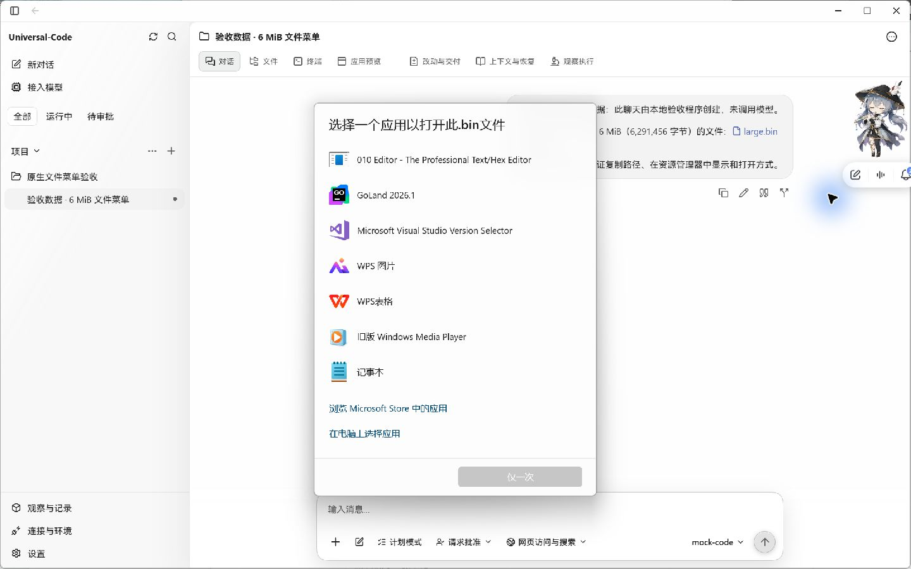
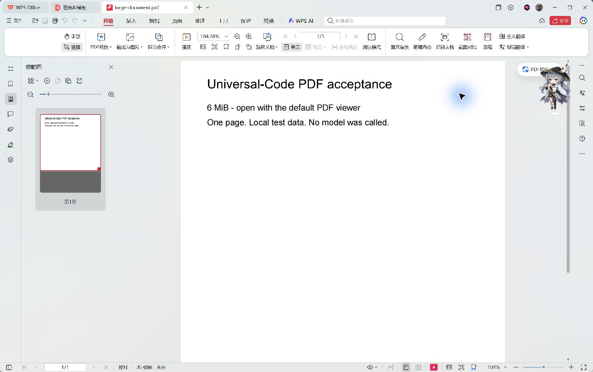

# 大文件路径操作与系统打开：Windows 原生验收

2026-10-23，在 Windows 上编译并运行修改前、修改后两个真实桌面 EXE，使用同一份独立验收数据和同一个 6,291,456 字节（6 MiB）的 `large.bin`。

## 变更前后

| 修改前：复制路径失败 | 修改后：复制路径成功 |
| --- | --- |
|  |  |

旧实现先读取整个文件，因此路径操作也被 5 MiB 上限阻止。回归测试确认旧实现的三项路径操作均返回 `File actions support files up to 5 MiB`，且没有调用原生文件操作。旧版界面将这个结构化错误显示为 `[object Object]`，截图保留了实际表现。

新实现对“复制路径”“在资源管理器中显示”“打开方式”和系统默认打开解析并校验工作区文件路径。前三项实际验收结果：

- 右键 `large.bin`，选择“复制路径”：出现“已复制路径”；读取系统剪贴板并与真实文件绝对路径比较，结果完全一致。
- 选择“在资源管理器中显示”：Windows 资源管理器打开验收目录并选中 `large.bin`，大小显示为 6,144 KB。验收后关闭本次打开的窗口。
- 选择“打开方式”：出现 Windows 的 `.bin` 应用选择对话框，如下图；随后按 Escape 取消，未选择应用或修改默认关联。
- 选择“复制文件内容”：仍被大小限制拒绝，系统剪贴板保持原路径。当前错误显示为 `[object Object]` 的既有问题另行处理。

## 大 PDF 直接打开

使用另一个独立验收聊天和有效的单页 `large-document.pdf`，实际大小同为 6,291,456 字节。PDF 内容是本地验收说明，正文流包含填充注释以超过预览读取上限。

| 修改前：点击 PDF 后报错 | 修改后：系统默认阅读器显示 PDF |
| --- | --- |
|  |  |

- 修改前，点击链接会先读取文件正文，尚未调用系统打开就被 5 MiB 限制拒绝；真实 EXE 显示 `[object Object]`。
- 修改后，直接点击链接成功启动本机默认 PDF 阅读器 WPS，显示完整的单页验收说明。关闭该阅读器后，再从右键菜单选择“打开文件”，再次成功打开同一份 PDF。
- 前端把既有的 PDF、Office、ZIP / 7z 系统打开分流放在预览读取之前；原生桥接沿用已验证的工作区路径。内置文本、图片和未知类型预览继续读取受限内容。
- PDF SHA-256：`da59d7a9e5046b2c03e6b8c791e66dc4df0f98a1c7d02a07c0bcaabe0918b885`。

## 截图与构建来源

- 复制路径和打开方式截图：基线为 `main` 提交 `513c9510ef0618e508cfccdccd55457f1735f46c`，修改后为本 PR 首轮提交 `8dd07e60667aafb6ab159338631cc4f22df44ef9`。这两个 EXE 使用同一份生产前端构建；修改前 Go 构建用 `-overlay` 恢复基线的 `internal/desktop/chat_resources.go`。
- PDF 截图：修改前使用上述首轮 EXE（仍会先读取 PDF），修改后重新构建本 PR 的生产前端和 Go 原生 EXE。两个版本读取同一份 PDF 验收数据。候选 EXE SHA-256 为 `dfa91261cac4bc6f7c88a3964ade71d1627c28915ffb46686d8d1fc48ab63e55`。
- 构建标签：`desktop,production,wv2runtime.error`。产物只用于本地验收。
- 验收程序通过正式 Store 和 Application 接口建立独立的聊天记录，并用真实 loopback HTTP 接口确认聊天及消息可读取。消息明确标注为本地验收数据，未调用模型。
- 截图为 Computer Use 捕获的原生窗口原图，未替换 DOM、伪造原生桥接或后期修改；窗口中的鼠标光晕和桌面宠物来自现场环境。

## 自动检查

- `go test ./internal/desktop -run 'TestChatResource|TestChatExternal|TestDesktopBridgeBindsOnlyReviewedMethods' -count=1 -v`：通过。
- 旧代码下新增的 6 MiB 路径操作回归失败；修复后复制路径、显示位置、打开方式均将正确路径交给原生 host，且 `Data` 为 nil。
- 补充 PDF 打开修复：旧实现的 6 个新增前端用例失败，6 MiB Go `open` 用例在调用原生 host 前失败；修改后 `resource-link.test.tsx` 的 19 项和全部 `TestChatResource` 通过，类型检查与生产构建通过。
- 正文读取、复制文件、复制内容和另存为仍受原大小限制；附件继续使用已保存字节。工作区系统默认打开不再读取正文。
- 相对/绝对路径、历史运行绑定目录、跨工作区拒绝、目录/缺失文件/路径越界校验通过。Windows 本机不能创建符号链接，该项明确跳过，保留测试供支持符号链接的 CI 环境执行。
- 前端生产构建和两个原生 EXE 编译通过；相关桌面包编译与桥接检查通过。公开的桌面桥接方法列表未变化。
- OCR delegate 首轮检查 1 个生产源文件，补充 PDF 打开时检查全部 2 个生产源文件，均无发现；测试与文档另行核对。

原生 UI 验收覆盖 Windows。本 PR 不增加 macOS/Linux 的“打开方式”实现。
