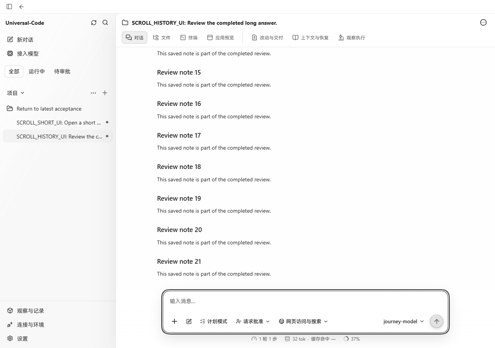
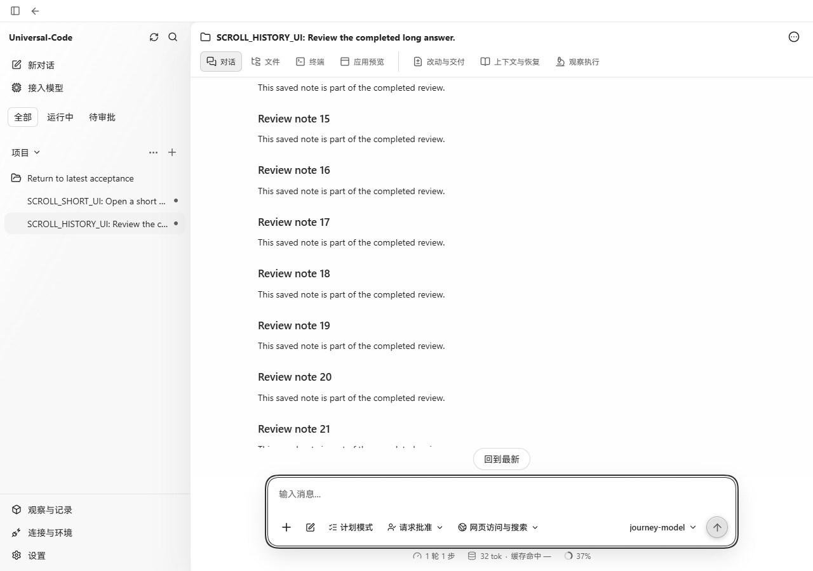
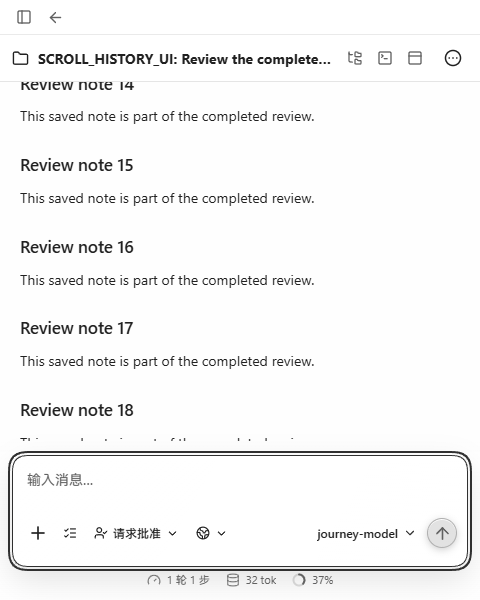
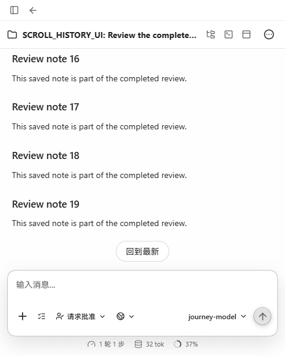
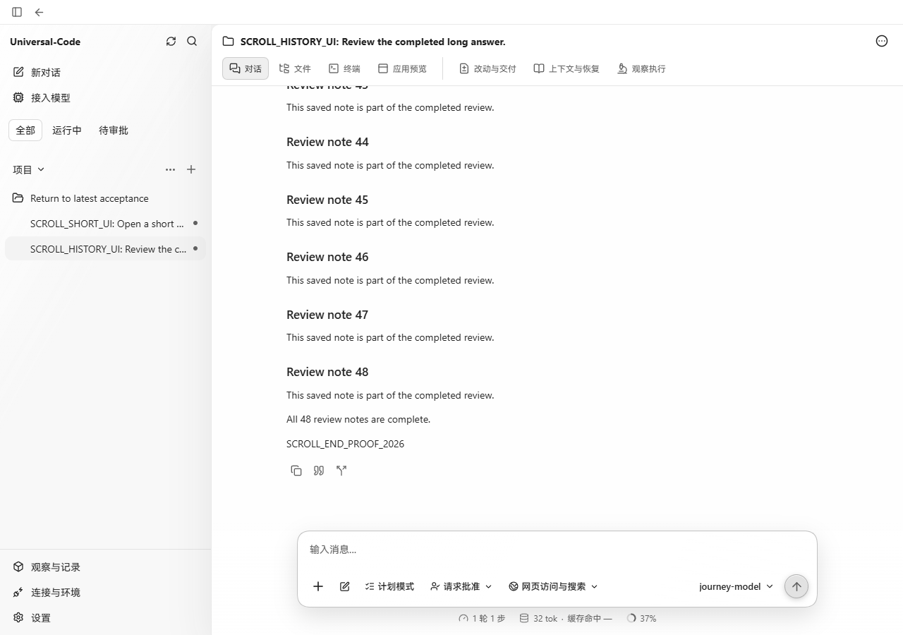

# 长对话返回最新位置验收

任务结束后向上翻看长回复，原页面没有回到底部的入口，只有新内容到达后才显示按钮。现在离开底部时即可使用「回到最新」，有新内容时继续使用原来的提示。搜索定位仍由原来的「返回最新消息」退出历史范围。

## 真实页面

- 前：`a07575e9ee863f94cf65d5add5623d27b7358d69`，PR #454 的前端基线。
- 后：本 PR 的 `conversation.tsx` 更新。
- Windows / Microsoft Edge，1280×900 与 480×600；均为实际生产前端包。
- 同一生产 Go API、隔离工作区、同一持久化对话。通过正常项目导入、创建对话和发送消息，由离线测试模型返回已完成的 48 段回复。没有直接改数据库、接口响应或 DOM。
- 长对话：`thread-run-20261021202227-f4bbfb342eaa`；回复 `evt-20261021202227-73a5553bb0de`。
- 短对话：`thread-run-20261021202227-0d3fe6eef297`。
- API 确认两条回复均已保存，`durable=true`、`provisional=false`，且对应 Agent 回合完成。

基线向上滚动后没有返回按钮。候选页面向上滚动后显示按钮，且未标成有新内容。切换到短对话时按钮消失；切回长对话，阅读位置仍为 1395px，草稿仍在。鼠标点击或窄窗口下聚焦后按 Enter，均回到真实底部（`scrollHeight - clientHeight - scrollTop = 0`），按钮随之隐藏。

截图前将验收草稿清空并关闭无关的浏览器提示，便于比较同一回复位置。

| 场景 | 修改前 | 修改后 |
| --- | --- | --- |
| 桌面翻看已完成回复 |  |  |
| 480×600 |  |  |

实际点击后回到末尾：

## 检查

- 新回归测试在原代码上因找不到「回到最新」失败，修改后通过。
- `npx vitest run src/v2/components/conversation.test.tsx src/v2/use-reply-reading.test.tsx`：67 项通过，包含流式更新不抢走阅读位置、旧记录分页、读取状态检查。
- `npm run build`（含 TypeScript 检查）、`git diff --check` 通过。
- OCR delegate 选出的 1 个产品文件已全部审阅，同时核对测试及 `useV2ReplyReading` 调用，未发现需要修复的问题。
