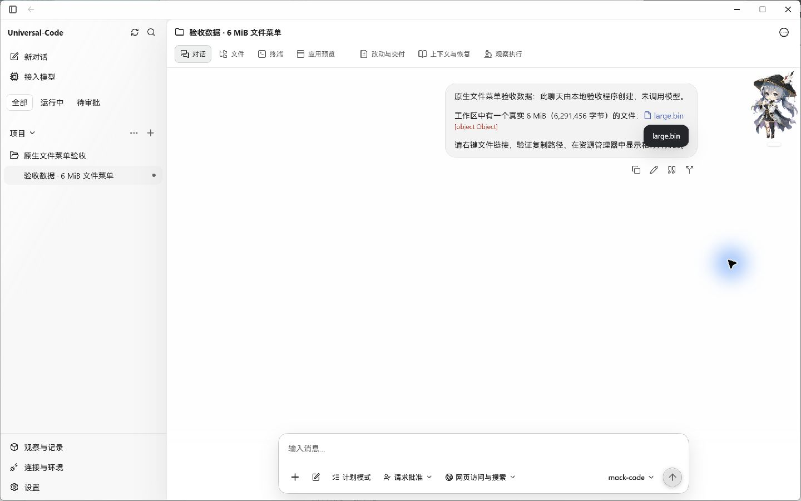
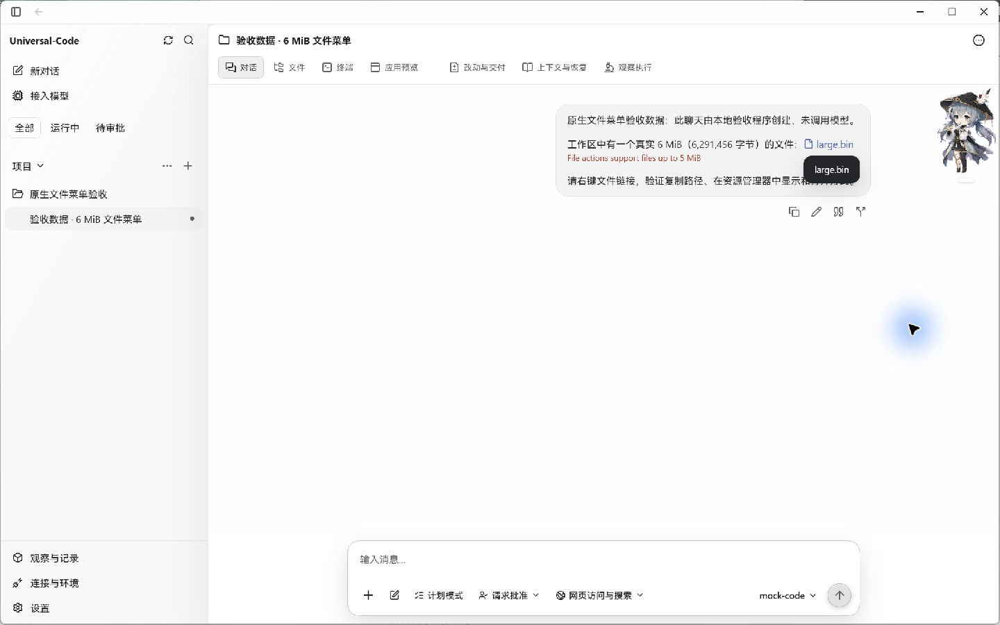

# 桌面错误消息：真实 EXE 前后对比

2026-10-23，Windows 原生桌面验收。对同一聊天中的同一个 6 MiB 工作区文件执行“复制文件内容”，触发现有的 5 MiB 内容读取限制。

| 修改前 | 修改后 |
| --- | --- |
|  |  |

修改前显示 `[object Object]`；修改后显示后端原有消息 `File actions support files up to 5 MiB`。两次操作均实际失败，没有显示复制成功，系统剪贴板保持操作前的文件路径。

## 原因和修复

Wails v2.14.0 的桌面回调用 `new Error(message.error)` 构造 JavaScript 错误。此前 Go 的 `ErrorFormatter` 返回 `{code, message}` 对象，进入回调后已经变成 `[object Object]`，前端无法再恢复原消息。

现在 formatter 返回原有 `apperror.Normalize` 流程得到的 `Message` 字符串。对带包装的应用错误使用其明确的消息，不回退到包装文本或 Cause；没有消息时返回 `Desktop operation failed`。普通错误继续采用原有 Normalize 规则。本次没有修改 HTTP API 的错误结构、文件大小限制或权限判断。

## 实拍来源

- 基线为 main `513c9510ef0618e508cfccdccd55457f1735f46c`，修改后为本目录同提交的 formatter 实现。
- 两个 EXE 使用相同的生产前端资产，编译标签为 `desktop,production,wv2runtime.error`。基线 EXE 使用 Go overlay 恢复基线资源读取源文件；其余生产源码与基线一致。修改后的 EXE 从本 PR 独立工作树编译。
- 使用独立 `CYBERAGENT_HOME` 和实际 6,291,456 字节文件；聊天消息由正式 Store/Application 接口写入，并明确注明为本地验收数据，未调用模型。
- 通过 Computer Use 操作实际文件菜单和 Wails 桥接，保存原生窗口原图；未替换 DOM、桥接或错误返回值，未后期修改截图。截图中的鼠标光晕与桌面宠物来自现场环境。
- 现场确认修改后警报显示完整原因，未出现成功提示；失败复制未更改系统剪贴板。验收后关闭两个测试 EXE。

## 自动验证

- Go 的回调 JSON 回归先失败后通过，覆盖普通原生错误、应用错误、带包装/原因的应用错误、空应用消息和空普通错误。
- `go test -tags desktop,wv2runtime.error ./cmd/cyberagent-desktop -run '^TestDesktopBindingErrorsEncodeReadableMessages$' -count=1 -v`：通过。
- 用安装依赖中真实的 Wails `Callback` 实现执行对比：对象产生 `[object Object]`，消息字符串保留原文。
- `npm test -- src/lib/desktop-bridge.test.ts src/v2/components/resource-link.test.tsx`：2 个文件、60 项测试通过。覆盖菜单显示失败原因、不显示成功提示，以及未知对象不被序列化到页面。
- `npm run typecheck`、生产原生 EXE 编译、`git diff --check`：通过。
- OCR delegate 审阅全部 1 个变更生产源文件，无发现；3 个测试文件另行人工核对。

原生 UI 实拍覆盖 Windows；其他平台的桌面检查由 PR CI 验证。
