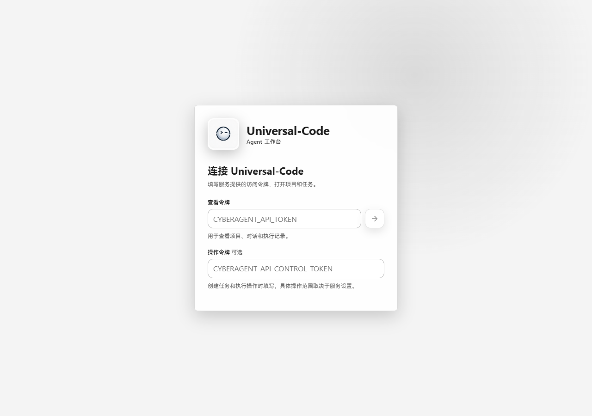
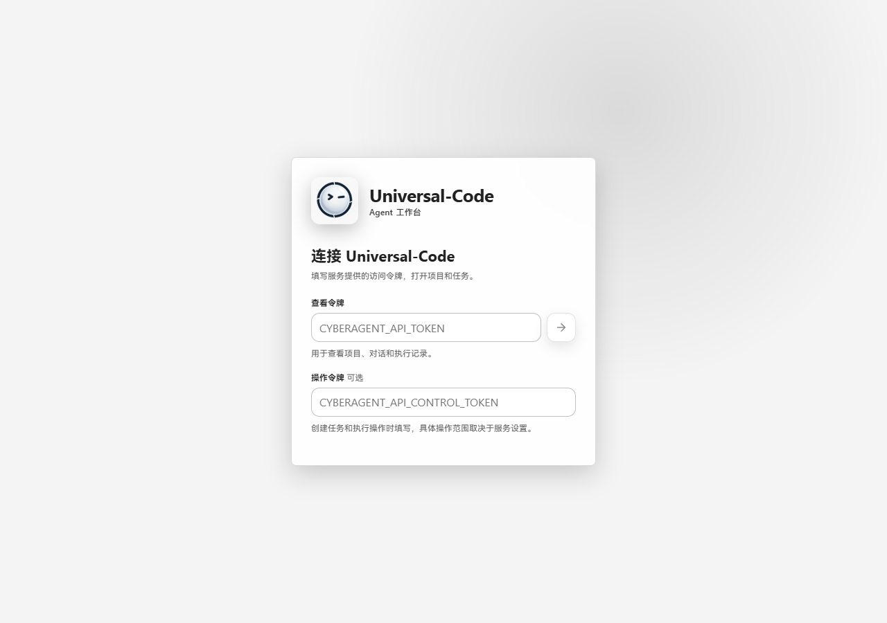
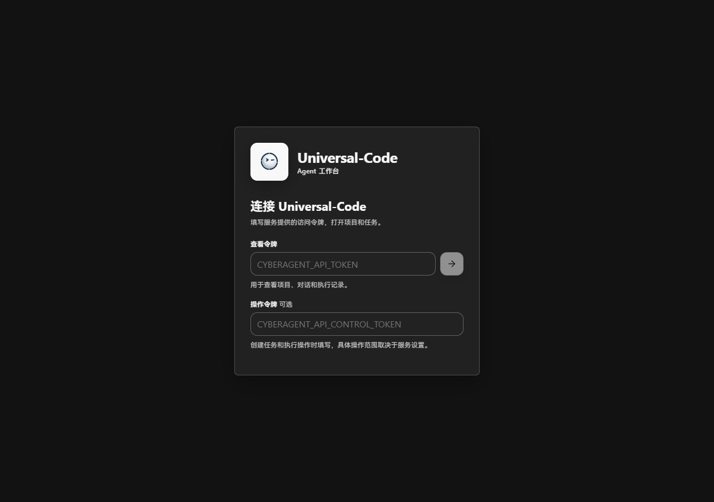
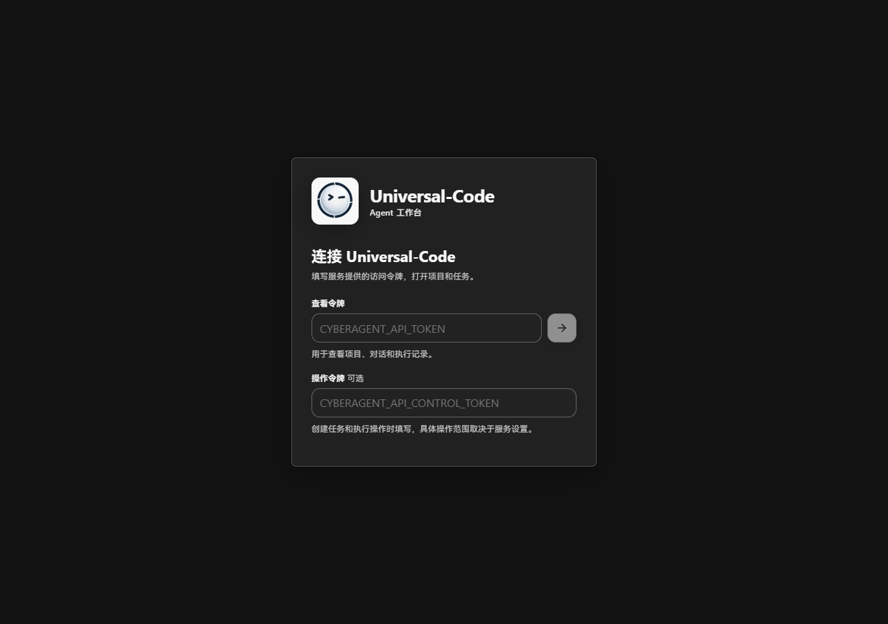

# 平台图标主体大小验证

原图中的展示留白被整体缩入图标，32px 图标的深色主体只有 14×14px。
生成脚本现在使用母版中心的 60% 区域，32px 图标主体为 24×23px，
16px 图标主体为 12×11px。母版、终端图形和圆角透明遮罩保持原样。
尺寸按不透明深蓝像素的边界计算，抗锯齿会使横纵边界相差一个像素。

## 真实页面前后截图

- 前：主线提交 `e578c225f517fa381f1321919330da8db5881856` 的原始资产。
- 后：同一份代码，应用本次生成脚本及其派生资产。
- 两者均使用锁文件安装依赖并执行 `npm --prefix web run build`，
  通过 Vite preview 打开实际连接页面；Chromium，1280×900 CSS px，2026-10-21。
- 深色截图使用应用已有的 `prayu.theme=dark` 偏好。未替换页面 DOM 或绘制模拟界面。

| 浅色：修改前 | 浅色：修改后 |
| --- | --- |
|  |  |

| 深色：修改前 | 深色：修改后 |
| --- | --- |
|  |  |

## 已运行验证

- 新的小图标主体占比回归测试在旧资产上失败，在新资产上通过。
- `go test -count=1 ./internal/releasegate` 通过，包含母版与派生件同步、
  ICO/COFF 一致性、ICNS Retina 尺寸槽及 PNG 尺寸/透明度检查。
- `go test -count=1 -tags 'desktop,wv2runtime.error' ./cmd/cyberagent-desktop -run TestDesktopWindowsResourcesPreserveDPIAndIcons`
  通过，确认 EXE 资源保留 PerMonitorV2、asInvoker 及正确图标。
- Windows 视觉资产清单校验通过，53 个 PNG 满足尺寸、格式和文件大小要求。
- 前端品牌组件 3 项测试、类型检查与生产构建通过。
- 本机使用 `desktop,production,wv2runtime.error` 编译 Windows EXE 成功；
  从 EXE 提取的 32px 图标与生成的 PNG 逐像素一致。
- 母版 SHA-256 仍为 `a97e71e5f373d5d48ce24e39360cd390be2beabfe731037ac114ec38f12407d6`。

本次截图覆盖 Web 连接页面；macOS ICNS 已检查容器和尺寸，尚未在 macOS Dock 中目视验证。
