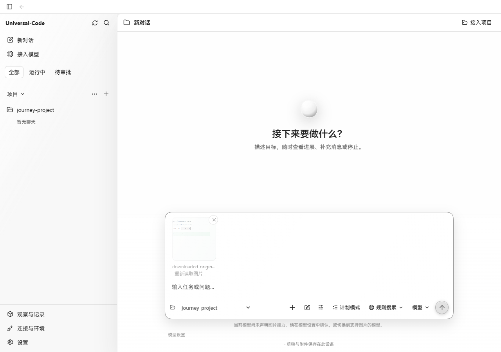
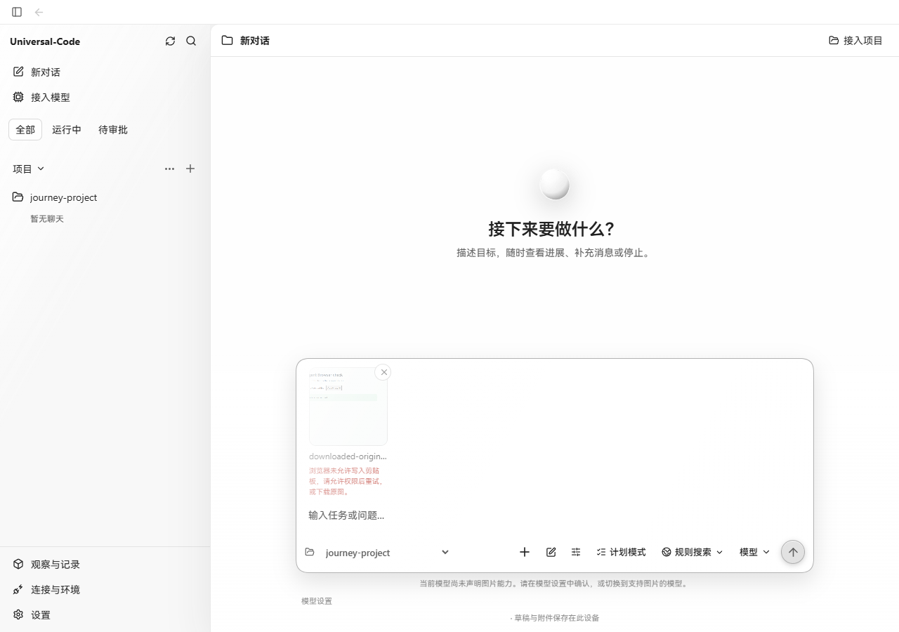
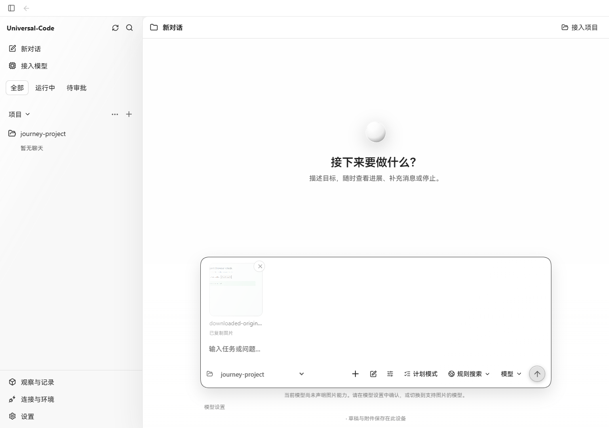

# Image clipboard failure feedback

The image thumbnail's context menu previously stored action failures as image-loading errors. A denied clipboard write therefore offered **Reload image**, concealed the actual reason in the button title, and could leave that error behind after a later successful copy. It now displays an accessible action error while retaining the valid thumbnail. A successful retry replaces the error with **Image copied**. Both the thumbnail menu and original viewer use the same localized clipboard-denial message.

## Real browser comparison

Captured in Microsoft Edge on Windows, 1280 × 900, using the production frontend and production `workbenchjourney` Go API with a temporary project. Before uses `fc0935d6fc03ca7abccbd148ce52d26c2bc154f8`; after uses this change's production build. Each view uploads the same real 1258 × 802 PNG through the file picker.

Playwright configured the test browser's clipboard permission to denied; `navigator.permissions.query` confirmed that state. The API, clipboard methods, responses and DOM were not replaced. Right-click **Copy image** then invoked the browser's real clipboard API.

| Before: misleading reload action | After: reason and next action |
| --- | --- |
|  |  |

After permitting clipboard access in that test browser, the same thumbnail copied successfully and the previous error disappeared:

## Verification

- New regression failed on the previous implementation and passed after the fix. It verifies readable failure feedback, no image-reload action, successful retry clearing the error, one original download and reuse of verified bytes.
- Image input and viewer suites: 25 tests passed. TypeScript and production build passed.
- The real browser's **Save image as…** action remained available while clipboard access was denied. The downloaded file retained SHA-256 `1caabbcbf77b317544d9040675eb72da092e7163b769ec64f6e218622f2562b8`.
- Reading the actual clipboard after recovery returned PNG at the original 1258 × 802 dimensions.
- The test provider does not declare image model support, so the screenshot shows the existing send restriction. No image was sent to a model during this copy/download check.
