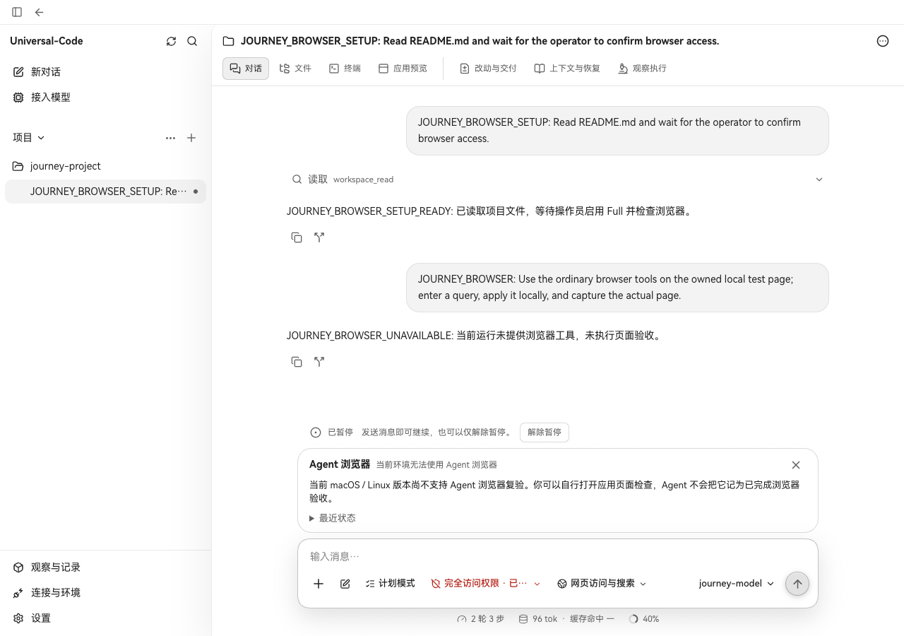
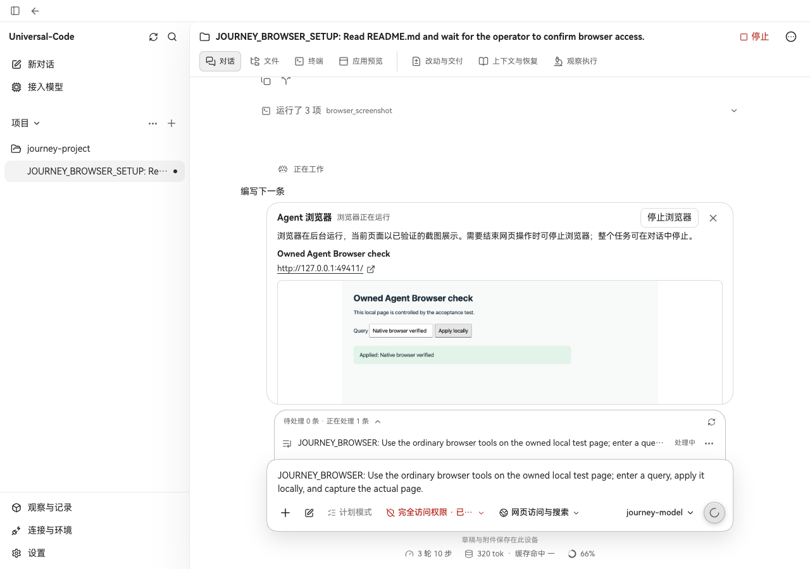

# macOS 普通 Agent Browser 原生验收

macOS 当前任务确认 Full 后，可以通过普通浏览器工具打开独立的稳定版 Google Chrome，导航、读取页面、输入、点击和取得实际 PNG，并从 UC 界面停止浏览器。

## 版本与环境

原始材料来自 [CI run 39367360836 / attempt 2 的 Mac job](https://github.com/CWNU-Open-Source-Community/Universal-Code/actions/runs/39367360836/job/118447734140)。该 Mac job 全部成功，包括浏览器运行时、HTTP 产品流程、各产品入口权限检查、前后两版 UC 页面验收及 Mac 预览打包。本轮只复跑 Mac job，其余检查被主动取消，不能称为全量 CI 成功或正式 Mac 发行。

| 项目 | 实际值 |
| --- | --- |
| 改前生产版本 | `3341c0e3a35b9f84a38b913465c0252e10f95649` |
| 改后生产版本及测试 harness | `9b98f99ec1d8b97f2f0d210246ca5df020e2a255` |
| 原生系统 | macOS 26.6.2 / 25G83 / ARM64 |
| 浏览器 | Google Chrome 155.0.8059.40，固定安装路径 `/Applications/Google Chrome.app` |
| UC 页面视口 | 1280 × 900，zh-CN，同一 Mac job、同一已安装 Chrome |
| 原始 artifact | `12240122177` / `darwin-chrome-native-9b98f99ec1d8b97f2f0d210246ca5df020e2a255` |

两版分别构建各自生产 Go API 和 Vite 前端。基线仅叠加同一 `workbenchjourney` 测试程序和 Playwright 场景；生产实现保持在各自版本。模型由离线受控 Provider 决定工具调用，浏览器进程、CDP 交互、状态接口、截图下载和前端显示均实际执行。Provider 在实际截图工具返回后保持可取消的请求，使真实 Run 继续运行，供页面截图及 UI 停止验收。状态没有通过拦截响应或修改页面制造。

## 真实前后图

改前已从界面确认 Full，实际状态为 `platform_unsupported`，没有执行浏览器验收。



改后实际工具完成导航、快照、输入、再次快照、点击、确认页面结果、截图。UC 显示已验证的实际页面图片，其中包含 `Applied: Native browser verified`。



图片保留 CI 原始 PNG 字节；状态与源版本分别保存在 [改前记录](uc-agent-browser-before.json) 和 [改后记录](uc-agent-browser-after.json)。改后截图之后，通过界面停止浏览器得到以下实际结果：

```json
{
  "state": "closed",
  "tree_reaped": false,
  "process_scope": "darwin_group_and_scoped_children.v1",
  "process_scope_verified": true,
  "profile_removed": true,
  "cleanup_pending": false
}
```

## 已执行的验证

- 原生稳定 Chrome 的固定发布者、挂起启动及动态 CDHash 绑定；错误 CDHash 在恢复执行前被拒绝。
- 恢复执行前撤销 Full、动态 JS、跨域 fetch、WebSocket、Service Worker、视口、目标变化、取消和权限撤销；清理保持 Darwin 作用域，未填入 Windows 进程树证明。
- 对生产共用的 C 包装注入枚举返回值：`0 + errno` 必须传播错误，正常空结果与旧 errno 分开处理。
- 生产 HTTP 流程：敏感操作预览、批准一次、同 checkpoint 继续、重放不重复写入、模型收到实际 PNG、HTTP 图片校验及停止清理。实际记录为 4 次模型请求、1 次本地合成写入，见 [原始报告](agent-browser-http-product.json) 和 [浏览器原图](agent-browser-http-product.png)。
- Desktop、API 与 CLI 执行入口：原生 adapter 可用且当前运行确认 Full 后才提供工具；Ask、冷启动 Full 和权限未启用时仍不提供工具；关闭结果按实际平台的清理作用域核验。
- 上述两版实际 UC 页面场景：界面确认 Full、工具操作、已验证图片显示和界面停止。完整状态及原生系统信息保存在本目录。

同一产品实现还在 Windows 实际 Chrome 上通过浏览器运行时、HTTP 产品流程和 UC 页面验证，Windows 清理仍要求真实 `TreeReaped=true`。

## CI 源文件审计清单修正

[PR CI run 39368598832 的 Go checks](https://github.com/CWNU-Open-Source-Community/Universal-Code/actions/runs/39368598832/job/118451257748) 在 `TestBrowserRuntimeProductionPrimitivesStayInAuditedAdapters` 失败：`agent_browser_platform_darwin.go` 为独占临时 profile 创建固定的 `Data`、`Home`、`Crashpad` 子目录，但测试的 `os.Mkdir` 逐文件允许表遗漏了这个原生适配文件。本次将该文件加入这一项允许表，保留逐文件检查及全部禁止项。

在 Windows / Go 1.26.9 上，以下测试先复现 CI 的相同错误，再于清单修正后通过；此次修正仅涉及审计测试和本验收说明。

```sh
go test -v -count=1 -timeout 3m ./internal/browserruntime -run '^TestBrowserRuntimeProductionPrimitivesStayInAuditedAdapters$'
```

为解除 PR 的实际工作流冲突，分支合入 `main` 的 `bdd92b5b30f4625141d375aad46a372230b13d41`。冲突处保留主线新增的 `python3 --version` 和 `PythonVenv.*` 运行器检查，同时保留上述原生 Chrome、HTTP、产品入口及实际 UC 前后图步骤；合并后复验了对应浏览器审计测试与 `scripts/ci` 的 Python 测试。

## 使用条件与清理合同

首次实现仅接受固定路径的稳定版 Google Chrome。启动同时核验原生 Mach-O、整个 bundle 的签名、固定 Google Team ID `EQHXZ8M8AV` / bundle ID `com.google.Chrome`；挂起子进程通过相同 CDHash 的动态校验及再次 Full 权限检查后才恢复。每个会话使用独占的一次性 profile、私有 HOME/TMPDIR 和 Crashpad 目录，浏览器使用临时 mock Keychain，避免访问个人浏览器资料。

Darwin 监督持有的根进程、进程组、已观察到的后代以及精确归属该 profile 的 Crashpad。每 100 ms 采样；64 个观察到的进程、4 GiB 累计 RSS 是触发终止的观察阈值。终止后核对身份和退出，再回收根进程及删除 profile；观察失败或仍有归属进程时保留 profile，并返回清理待完成。

该作用域覆盖已归属的进程，不提供 Windows Job 的内核硬限额或任意逃逸 fork 的整树证明。强制结束 UC 本身时，Chrome 子进程可能继续存在。本次原生功能验收覆盖 ARM64；Intel 与较旧 macOS 仍需原生功能验收。

正式应用的 Developer ID 签名、公证、staple 及干净机器上的 Finder 启动、数据恢复和 TCC 交互验收仍需完成，并需要 Apple 身份、受保护配置及实际 Mac 交互环境。

## 复现与原始资料

在具有 Go、Node 依赖和上述 Chrome 的 Mac checkout 中，先构建生产前端，再运行：

```sh
(cd web && npm ci && npm run build)
bash scripts/ci/verify-macos-agent-browser-ui.sh 3341c0e3a35b9f84a38b913465c0252e10f95649
```

脚本分别构建前后两版，使用临时项目和数据库，完成后关闭自己启动的服务与浏览器，并清除自己的基线 worktree。CI 原始 artifact 保留 14 天、下载需要登录 GitHub；本目录保留原始图片和公开状态记录。

平台合同依据：[Apple 的挂起启动标志](https://github.com/apple-oss-distributions/xnu/blob/main/bsd/sys/spawn.h)、[动态代码签名检查](https://github.com/apple-oss-distributions/Security/blob/main/OSX/libsecurity_codesigning/lib/SecCode.h)、[libproc 枚举返回值](https://github.com/apple-oss-distributions/xnu/blob/main/libsyscall/wrappers/libproc/libproc.c)。
