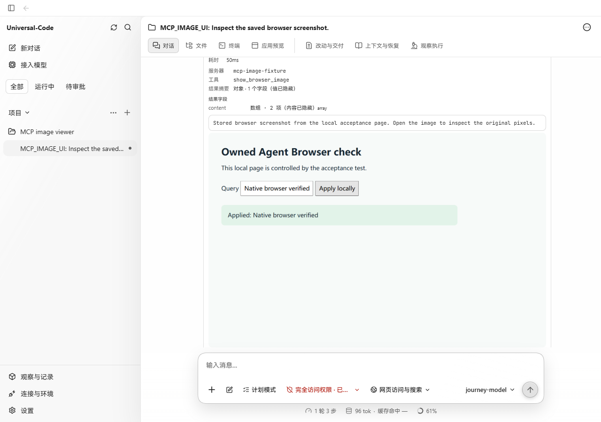
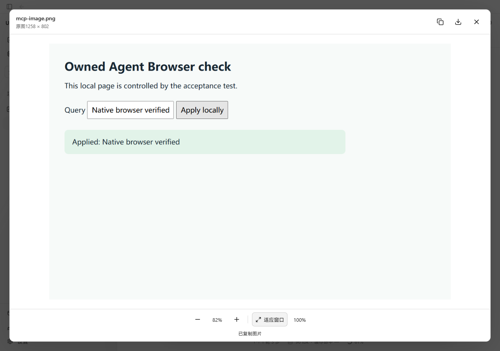
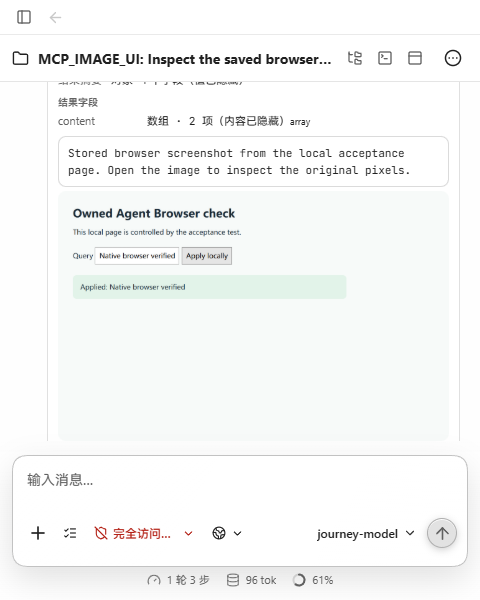
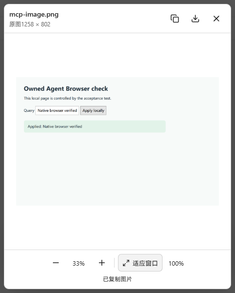
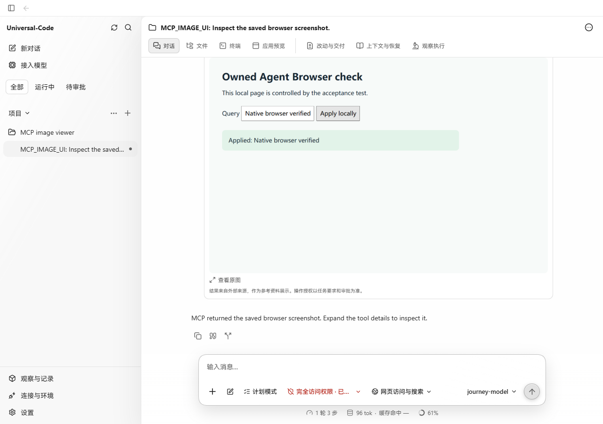

# MCP 图片原图查看验收

MCP 工具返回图片后，原有页面只有行内缩略图，点击不能打开查看器。此次复用已有图片查看器，增加原图查看、缩放、复制及下载入口。

参考：[Claude Code 的 MCP 图片结果说明](https://code.claude.com/docs/en/mcp#images-in-tool-results)明确保留原始图片以便完整分辨率复用。UC 的查看器交互沿用项目已有附件图片能力。

## 版本与环境

- 变更前：`fc0935d6fc03ca7abccbd148ce52d26c2bc154f8`，即 PR #432 的当前分支。
- 变更后：本 PR 中的 `mcp-content-preview` 及其图片查看器类型更新。
- Windows / Microsoft Edge；桌面 1280×900，窄窗口 480×600。
- 前后均使用同一生产 Go API、同一实际 MCP 工具返回记录。基线使用原生产前端包，候选使用本分支 `npm run build` 的产物。

## 实际数据与操作

使用隔离工作区和本地 HTTP MCP 服务，通过正常的服务注册、发现审批和能力审批流程，提交普通对话。测试模型依次调用 `mcp_tool_search` 和 `mcp_tool_call`，实际 MCP 服务的 `show_browser_image` 通过 JSON-RPC 返回 PNG。普通运行时验证、投影、保存结果；没有改写数据库、API 响应、浏览器请求或 DOM 来制造页面效果。

- 对话：`thread-run-20261021200036-135056050e4a`
- 执行：`run-20261021200036-135056050e4a`
- 工具记录：`toolu_2cf6f0ef3fc7ed12020c1bc8`
- 原图：1258×802，36,058 字节；来自本地网页的真实浏览器截图。
- 原件与通过页面下载的文件 SHA-256 均为 `1caabbcbf77b317544d9040675eb72da092e7163b769ec64f6e218622f2562b8`。

在 Edge 展开工具详情，变更前点击图片没有查看器；变更后点击「查看原图」打开查看器。100% 模式实际显示 1258×802；「适应窗口」在 480×600 下完整容纳图片及操作按钮。点击复制后读取系统剪贴板，确认图片尺寸及解码后的 RGBA 像素与原图一致。Esc 关闭查看器并将焦点还给原图按钮。

## 检查

- `npx vitest run src/v2/components/mcp-content-preview.test.tsx src/v2/components/image-viewer.test.tsx`：11 项通过。
- 新增原图入口回归测试在基线代码上失败，在修改后通过。
- `npm run typecheck`、`npm run build`、`git diff --check` 通过。
- 单元测试另外覆盖 GIF 原格式下载、保存内容变化时关闭旧预览并释放 Blob URL，以及桌面导航保护允许同源 Blob 下载。
- OCR delegate 选出的 3 个产品文件全部审阅，测试文件补充检查，未发现需修复的问题。

## 真实截图

| 场景 | 变更前 | 变更后 |
| --- | --- | --- |
| 桌面点击图片 |  |  |
| 480×600 |  |  |

新增的原图入口：

