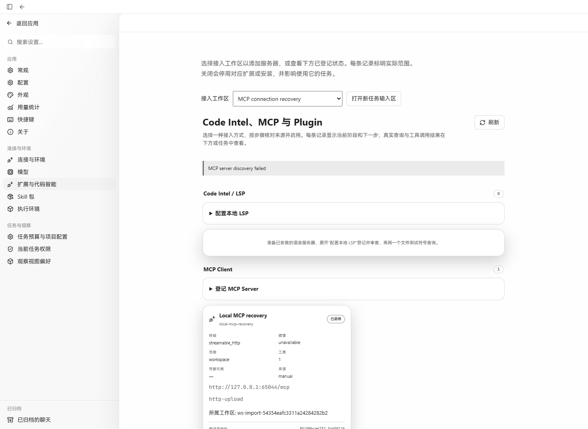
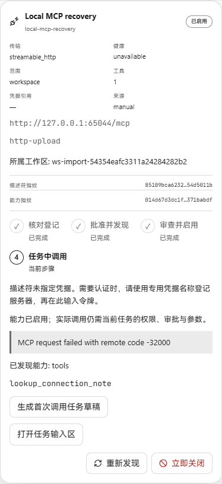
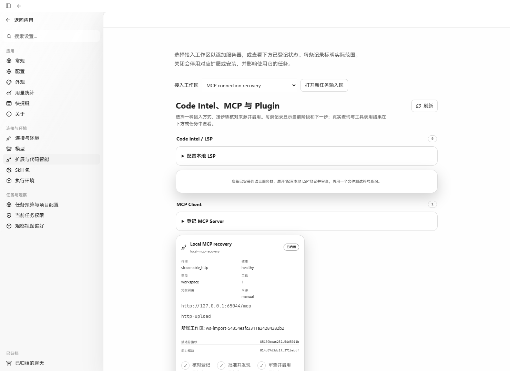

# MCP rediscovery status refresh

Verified on Windows with Chrome on 2026-10-22 (Asia/Hong_Kong). The three page
screenshots use the same 1480 × 1080 viewport; the error-detail image is an actual
element screenshot.

The baseline frontend was built from `fc0935d6fc03ca7abccbd148ce52d26c2bc154f8`.
Both frontends used the same production `cyberagent api serve` process and SQLite
store. The candidate was served from its production build using Vite preview's
existing API proxy. No application API responses, DOM content, or stored records
were replaced for the screenshots.

The local Streamable HTTP MCP service implemented `initialize`,
`notifications/initialized`, and `tools/list`. Its socket was closed to reproduce
disconnection, then reopened at the same endpoint. The registration was created,
reviewed, discovered, and enabled through the real API:

- Server: `local-mcp-recovery`, displayed as **Local MCP recovery**.
- Workspace: `ws-import-54354eafc3311a24284282b2`.
- Endpoint: `http://127.0.0.1:65044/mcp`.
- Discovered tool: `lookup_connection_note`.

## Observed behavior

| Step | Real API result | Visible result |
| --- | --- | --- |
| Baseline: stop the MCP service and click **重新发现** | POST refresh returns 503; a separate GET inventory confirms `unavailable` | Mutation error appears, but the card incorrectly retains `healthy` |
| Candidate: restore and rediscover, then stop the service and click **重新发现** | POST refresh returns 503, followed automatically by GET inventory 200 | Card becomes `unavailable`; mutation error remains visible |
| Candidate: make the MCP service return a JSON-RPC error containing a synthetic `token=` value | POST returns 503; automatic GET contains only `MCP request failed with remote code -32000` | Card displays the safe saved error; raw token text is absent from the API inventory and page |
| Candidate: restore the same MCP service and click **重新发现** | POST returns 202; automatic GET returns `healthy` with no health message | Card returns to `healthy`; mutation and saved health errors both disappear |

The candidate browser request log showed POST/GET pairs `503/200`, `503/200`, and
`202/200`. Its only two console errors were the expected 503 responses. The MCP
service recorded a fresh initialization and `tools/list` after recovery.

### Before: stale healthy status after failure

### After: saved unavailable status, with the original error retained

### After: safe error detail from the real inventory

### After: successful recovery clears the error

## Focused checks

- New regression failed on the baseline because the card never became
  `unavailable`.
- `npx vitest run src/components/extension-onboarding.test.tsx`: 12 passed. The
  regression checks scoped inventory refetch, the saved health/error, preservation
  of the mutation error, and successful recovery clearing both errors.
- `npm run build`: passed, including TypeScript; existing large-chunk warning.
- `go build -o output/playwright/mcp-refresh-status/cyberagent.exe ./cmd/cyberagent`:
  passed for the production API used by this acceptance run.

The product change invalidates the existing extensions query only when MCP
rediscovery fails. Existing success invalidation and mutation error rendering
remain in use.
