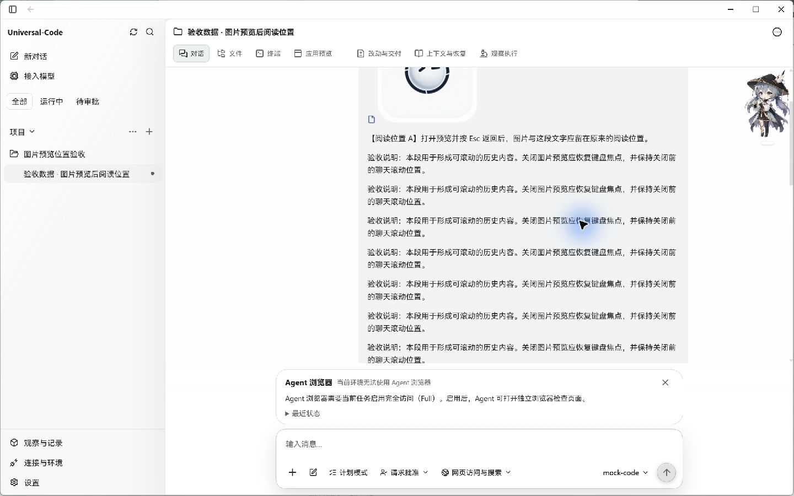
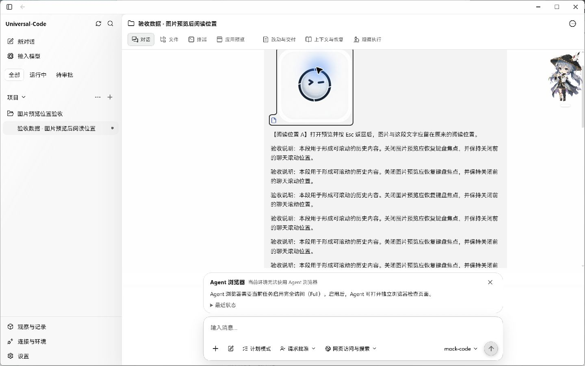
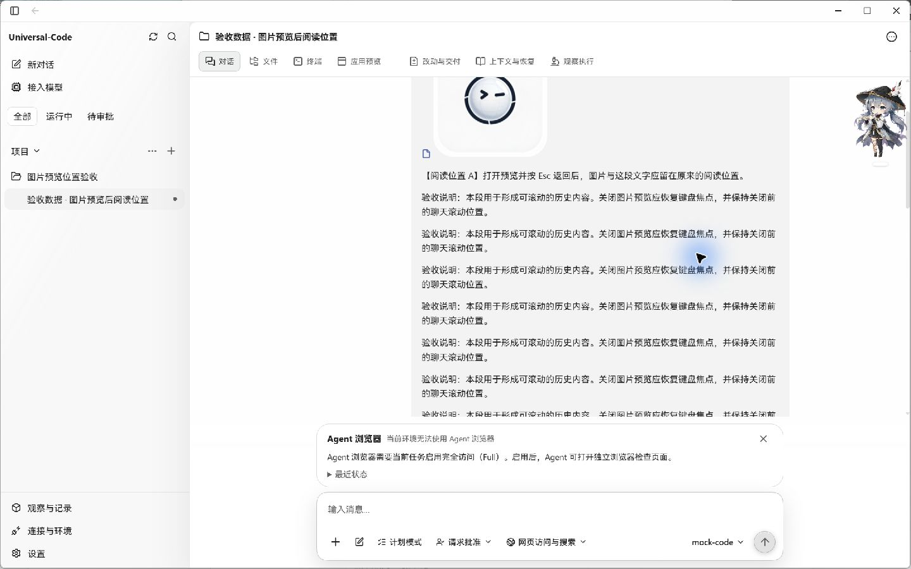
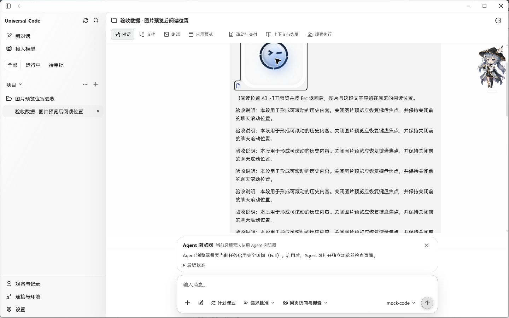

# 关闭预览后保留聊天阅读位置

## 问题与修改

图片的一部分已经滚出聊天可视区域时，点击剩余部分打开预览，再按 Esc 关闭，原来的 `focus()` 会把图片入口自动滚回可视区域，打断阅读位置。共用弹窗焦点恢复逻辑改为 `focus({ preventScroll: true })`；显式的返回入口和打开弹窗前的焦点两条路径均适用。

参考了安装版 Codex 26.1016.6573.0 的 `webview/assets/image-side-panel-c1c5699d6990.js`：其关闭分支恢复容器焦点时使用 `preventScroll`。本项目将该方式用于现有的弹窗返回入口。

## Windows 桌面实拍

以下四张图片均来自实际构建的 Universal-Code Windows EXE，窗口为 1440 × 900。验收使用同一份独立本地数据库、同一条明确标为验收数据的用户消息和仓库已有的 `apple-touch-icon.png`，未调用模型。消息通过真实 Store 保存，并由真实 Application / HTTP 消息和 transcript 路径核对后加载。

操作为：把图片滚到只有部分可见，直接点击可见部分，然后按 Esc 关闭预览。截图保存原始窗口捕获结果，没有替换页面、拼接或修改图片。右侧桌面宠物和鼠标光效属于测试桌面的已有显示。

| 版本 | 打开预览前 | 按 Esc 返回后 |
| --- | --- | --- |
| 修改前 |  |  |
| 修改后 |  |  |

旧版的“阅读位置 A”约从窗口 y=250 移到 y=330；新版该文字在打开前与返回后均约为 y=277。两次手动滚动的起点略有不同，应比较每一行的打开前与返回后。返回入口上的焦点轮廓仍然可见。

## 构建来源

- 修改前：main `513c9510ef0618e508cfccdccd55457f1735f46c`；EXE SHA-256：`0f523a2db2ba86594a6f8f8ac346a5e34da69ff9c94df80876109dd8fd353da9`。
- 修改后：同一 main 加本 PR 的两行焦点修复；EXE SHA-256：`2965c58121b0b8d252ec42b41cebaa06e77137e8ce5f5308750b8cf9f1a82070`。
- 前端生产构建及 Windows 原生构建通过。截图验收完成后，两版测试程序均已关闭。

## 其他验证

真实 Chromium 中另外验证了图片附件、文本附件和未指定返回入口的弹窗：关闭前后滚动位置相同，入口焦点恢复、Tab 循环、Esc 关闭及背景隔离正常。该检查使用生产组件的隔离页面；上方截图来自完整桌面应用。

以下相关测试共 16 项通过：

```sh
cd web
npm test -- src/hooks/use-modal-focus-trap.test.tsx src/v2/components/image-viewer.test.tsx src/v2/components/composer-text-attachment.test.tsx
```

OCR delegate 审查了本次修改的一个源码文件，未发现问题。`git diff --check` 通过。
