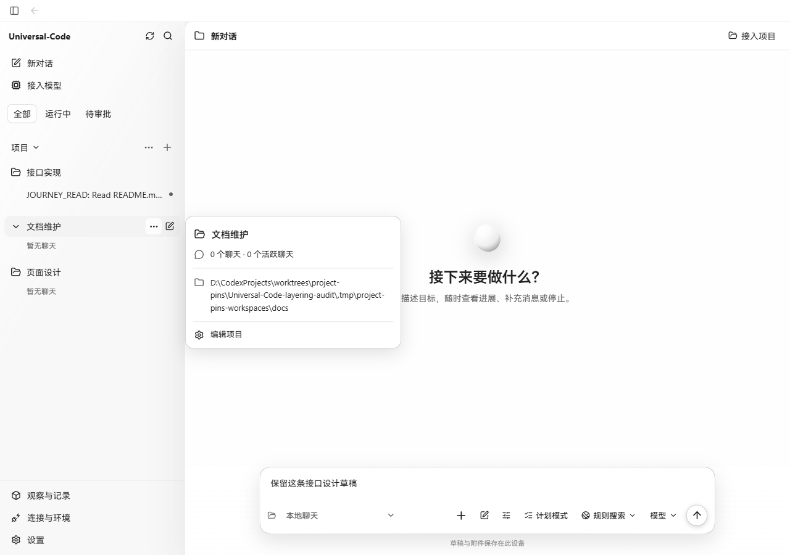
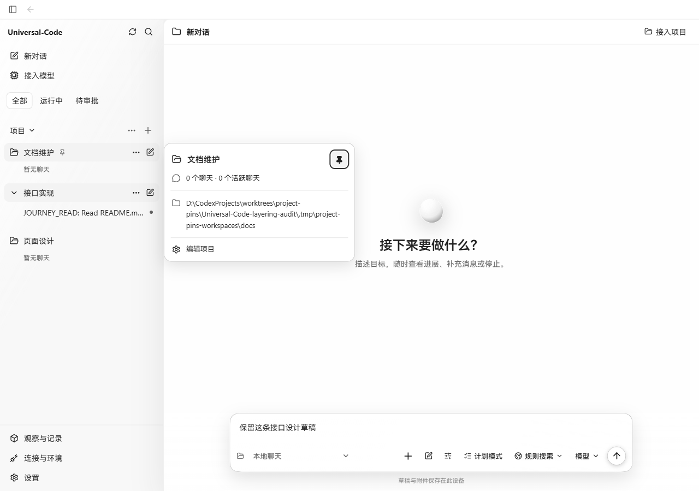
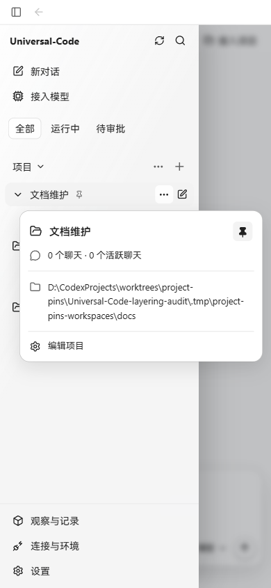

# 项目置顶

2026-10-22，Windows Chrome。前后截图使用同一个生产 Go API、SQLite 和三个实际项目；前端通过现有 Vite preview API 代理加载生产构建。未替换 API 响应、修改页面 DOM 或伪造聊天记录。

原版构建基于 `cace352a4b6515b211b826be598ca8f0fbded440`。宽屏前后为 1280 × 900，窄屏为 390 × 844。

## 实际操作

- 创建页面设计、接口实现、文档维护三个本地项目；接口实现中已有真实模型回复的聊天。
- 原顺序为接口实现、文档维护、页面设计。悬停打开文档维护详情，再点击详情按钮；通过 Shift+Tab、Enter 置顶，文档维护移到项目列表第一位，焦点保留在取消置顶按钮。
- 再次 Enter 取消置顶，恢复原顺序；随后重新置顶。三次操作没有发送 API 写入请求。
- 重新加载并连接同一服务，置顶顺序和“保留这条接口设计草稿”均保留。
- 390 px 下打开侧栏和项目详情，卡片 x=28、宽度350，文档 scrollWidth 与视口均为390，没有横向溢出。

置顶保存在当前设备，并按服务地址、数据存储隔离；同组项目沿用原排序，项目内聊天和置顶聊天保持原有规则。上一/下一聊天快捷导航读取实际渲染顺序。

## 真实截图

变更前：

变更后，键盘置顶并保留焦点、草稿：

窄屏：

## 验证范围

- `project-pins.test.tsx`、`sidebar.test.tsx`、`project-header.test.tsx`：35项通过。覆盖置顶/取消、实际聊天导航顺序、重新挂载、服务/数据库隔离、损坏的本地值和英文按钮。
- 悬停打开后点击详情再置顶的焦点回归，在修复前实际失败，修复后通过；浏览器重复同一触发路径通过。
- `npm run build`：通过，包含 TypeScript 检查。
- `go run ./cmd/protocolregistry -check`：通过；复用现有恢复存储，不新增协议标识。
- 原生桌面包未单独运行。

准备真实聊天时，第一份测试 README 未包含离线模型约定的证明文本，导致模型重复读取并失败；补回测试数据后通过真实发送得到成功回复。最终截图使用后续成功保存的聊天，未将该夹具问题计为产品验证通过。
