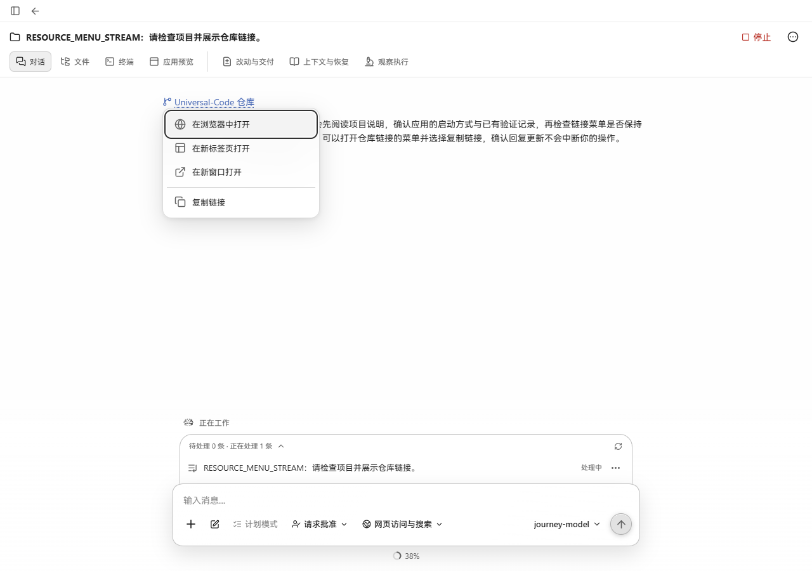
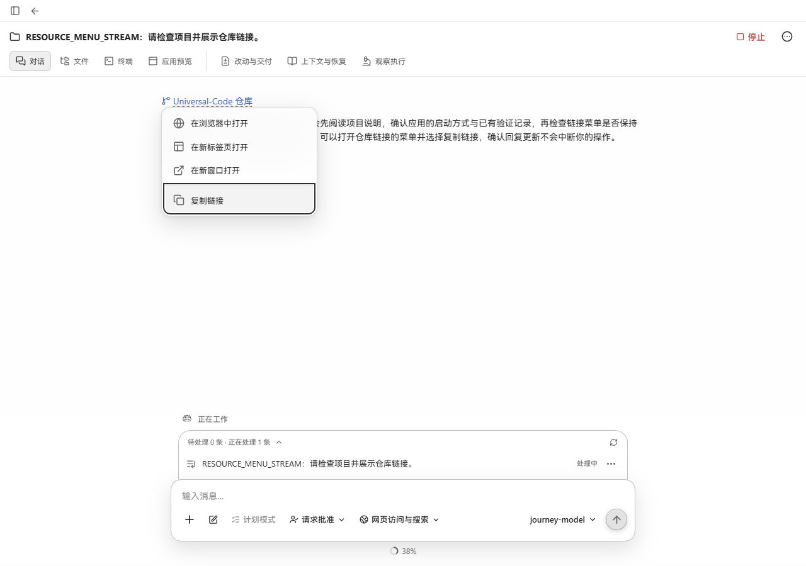

# 流式回复中的资源菜单焦点

2026-10-22，在 Windows 的 Microsoft Edge 中操作生产前端与 Go API。修复前来自 `fc0935d6fc03ca7abccbd148ce52d26c2bc154f8`，修复后仅修改资源菜单的关闭回调订阅。视口均为 1280 × 900，截图为浏览器原始输出。

生产 `workbenchjourney` API 使用临时项目和本地确定性模型；测试模型通过两个 SSE 文本片段输出同一份 `root_lifecycle.v1` 回复。链接先完整出现，操作员打开菜单并选择“复制链接”，再允许第二个片段到达。保留生产流式解析、脱敏和预览缓冲。

| 操作 | 修复前 | 修复后 |
| --- | --- | --- |
| 聚焦仓库链接，Shift+F10 打开菜单，再按 End | 选中“复制链接” | 选中“复制链接” |
| 下一段文字到达 | 焦点跳回“在浏览器中打开” | 保持“复制链接” |
| 按 Enter | 未执行，以免打开错误操作 | 复制准确的仓库 URL，显示“已复制链接”，焦点回到链接 |
| 再打开菜单后按 Escape | — | 真实页面确认关闭菜单并回到链接 |

两张图均在第二段文字到达后截图；黑色焦点框显示当前键盘操作项。

| 修复前 | 修复后 |
| --- | --- |
|  |  |

回归测试使用真实 `V2Narrative` 流式更新与文件菜单：在旧实现上失败，修复后通过。资源链接、文件附件和流式 Markdown 共 26 项聚焦测试通过，TypeScript 与生产构建通过。
