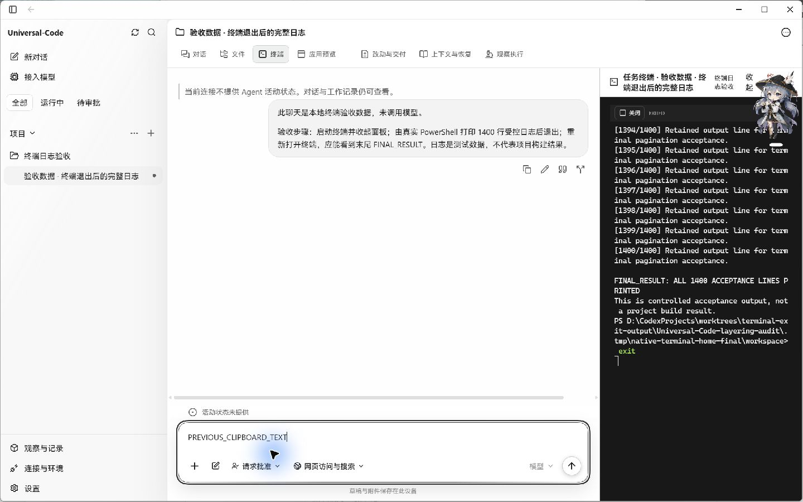
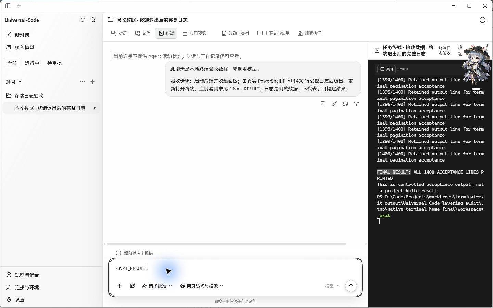
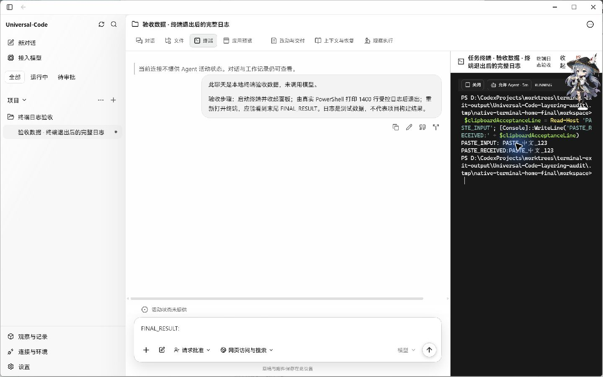

# 原生终端复制与粘贴验收

2026-10-23，在 Windows 11 10.0.26200 上运行修改前后的实际 Wails EXE。两份构建使用同一隔离测试聊天和 PowerShell 工作目录；截图来自原生窗口。没有调用模型、替换 DOM 或模拟 DesktopBridge。

## 复制前后对比

| 修改前 | 修改后 |
| --- | --- |
|  |  |

先把系统剪贴板设为受控文本 `PREVIOUS_CLIPBOARD_TEXT`，在已退出终端中双击选择实际日志中的 `FINAL_RESULT:`，按 Ctrl+C，再到聊天草稿按 Ctrl+V。草稿没有发送。

- 修改前：Ctrl+C 清除了选区，原生剪贴板仍是 `PREVIOUS_CLIPBOARD_TEXT`，聊天草稿也粘贴出该旧内容。
- 修改后：选区保留；原生 `ClipboardGetText()` 返回 `FINAL_RESULT:`，与 xterm 选区完全相同，聊天草稿粘贴正确。

右侧 1,400 行日志来自本地验收数据，不代表项目构建结果。右上角悬浮角色为本机桌面覆盖层；截图保留原始内容。

## 粘贴与中断

新建终端后，通过实际 DesktopBridge 启动 `Read-Host`，在等待文本输入时按 Ctrl+V 粘贴受控文本 `PASTE_中文_123`，再由桥接输入回车。PowerShell 实际输出 `PASTE_RECEIVED:PASTE_中文_123`；粘贴内容被作为字符串读取。

另外，通过桥接启动带有 30 秒等待的测试命令，在无选区时按 Ctrl+C，命令立即返回 PowerShell 提示符，未输出等待后的 `INTERRUPT_FAILED`。因此 Windows 的无选区 Ctrl+C 仍能中断命令。

## 实现与验证

- Windows：有选区的 Ctrl+C 复制，无选区时保留中断；Ctrl+V 粘贴。
- Windows/Linux：支持 Ctrl+Shift+C/V、Ctrl+Insert、Shift+Insert。Linux 普通 Ctrl+C/V 保持原行为；macOS 的原生快捷键保持原行为。
- 使用 Wails 原生文本剪贴板。读取失败或写入未确认时显示错误；粘贴经过 xterm 的换行和括号粘贴处理。
- 异步读取结束后核对终端实例、run、session 和运行状态；切换或卸载后不把旧粘贴应用到新会话。现有 16 KiB UTF-8 输入限制保持有效。
- 四个相关测试文件共 92 项通过；前端类型检查、生产构建通过。独立 OCR delegate 审查覆盖全部四个生产文件和测试增量，没有发现待修复问题。
- 原生实测覆盖 Windows。Linux/macOS 快捷键分支有自动测试，此次没有进行这两个系统的原生验收。

## 构建来源

| 项目 | 修改前 | 修改后 |
| --- | --- | --- |
| 源码提交 | `086d896a1e6bcf90abd930d25724fac5e1eeffb0` | `88c6eee9737842052bf158bc4f7490b2fa2efa66` |
| EXE SHA-256 | `C520EDA6149FC74A12036BB9CDF9042F967C470CF320020F5A8F3D3818D3AC01` | `923CDA7862F9D62EC47A7C360C9FFA793D1B2A925941EB53086906D5DBD08547` |

基线是 #477 的终端日志与样式修复，当前增量只补齐剪贴板操作。两份 EXE 均使用生产前端产物和 `desktop,production,wv2runtime.error` 标签；为读取真实桥接状态，通过临时 modfile 给 go-webview2 追加仅监听回环地址的调试端口 9235。临时依赖、数据库和二进制不在提交中。这些是验收构建。
