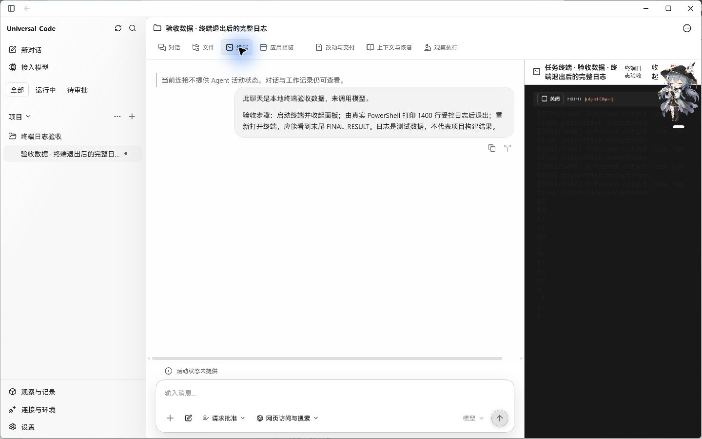
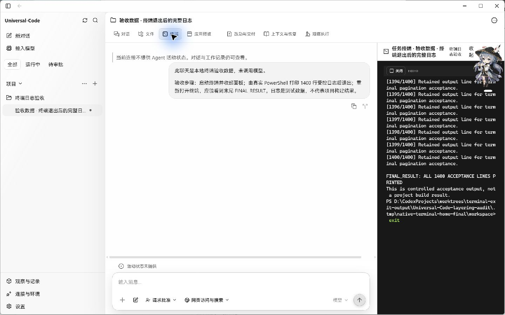
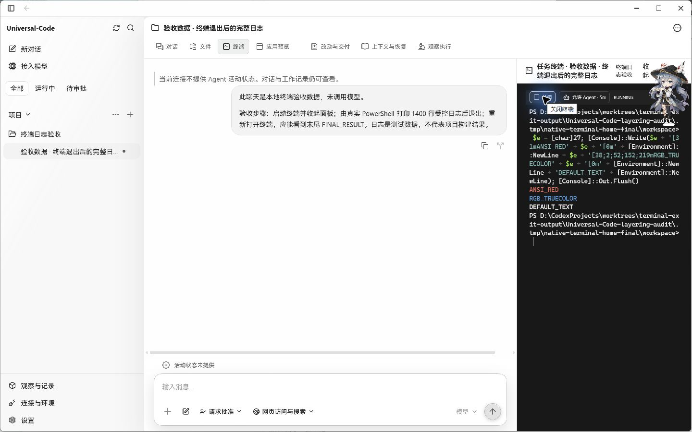

# 终端退出后的日志与显示验收

2026-10-23，在 Windows 11 10.0.26200 上运行实际 Wails EXE，截图来自原生窗口。聊天和工作目录使用隔离的测试数据；PowerShell 通过实际 DesktopBridge 打印 1,400 行本地测试日志后退出。截图中的日志不代表项目构建结果，未调用模型，也未替换 DOM 或桥接方法。

## 前后对比

| 修改前 | 修改后 |
| --- | --- |
|  |  |

修改前，后端保留了完整输出，界面重开后却在第一批 65,536 字节后停止，未显示第 1,400 行及末尾 `FINAL_RESULT`。生产 CSP 还阻止了 xterm 的动态样式，文字在暗色背景上不清楚。

修改后，实际会话保留 115,224 字节，界面读取两页（65,536 + 49,688），能看到第 1,400 行和末尾结果；退出码为 0，状态栏没有错误。初始历史按后端的 41×24 尺寸解析，在每一页的 xterm 写入回调完成后推进；历史还原期间不受面板滑入动画的 fit 影响。退出会话不会再发送终端自动应答或调整后端尺寸。

实际页面中，默认文字为 `rgb(237, 237, 237)`，ANSI 红色为 `rgb(239, 107, 93)`，RGB 样例为 `rgb(52, 152, 219)`。三个 xterm 样式元素均使用本次 HTML 响应的 nonce。重新请求 HTML 会生成新 nonce，响应与 HTML 匹配，HTML 使用 `no-store` 且没有 ETag。脚本策略仍为 `script-src 'self'`。

截图保留原始窗口内容；右上角的悬浮角色是本机桌面覆盖层。

## 构建来源

| 项目 | 修改前 | 修改后 |
| --- | --- | --- |
| 源码提交 | `f0da2d53622b7d8020056d69881781271f70da58` | `086d896a1e6bcf90abd930d25724fac5e1eeffb0` |
| EXE SHA-256 | `F6A05F633CF718E32E1153687C6DB932710748E927BEA29E0D44AEE8B4A93050` | `C520EDA6149FC74A12036BB9CDF9042F967C470CF320020F5A8F3D3818D3AC01` |

基线来自 main `513c9510`，包含与 #476 共用的 DOMPurify 依赖修复；两份 EXE 使用相同依赖修复。构建标签为 `desktop,production,wv2runtime.error`，使用实际生产前端产物。

为读取真实桥接状态，两个验收 EXE 都通过临时 modfile 使用本地 go-webview2 副本，仅追加 `--remote-debugging-address=127.0.0.1 --remote-debugging-port=9235`。临时依赖、日志、隔离数据库和二进制未提交。这是验收构建，不是发行包。

## 验证范围

- `npm test -- --run src/components/user-terminal-panel.test.tsx`：10 项通过，覆盖退出后多页、运行中持续读取、取消读取/解析、初始尺寸、错误恢复和输入状态。
- 真实 xterm 的 `open-user-terminal.test.ts` 通过，验证三个样式在连接 DOM 前取得 nonce，并恢复不支持 OffscreenCanvas 时的字符测量。
- 前端 typecheck 和生产 build 通过。
- `go test ./internal/webui ./internal/httpapi -run 'Test(Bundle|EmbeddedBundle|WebUI)' -count=1` 通过，覆盖 nonce、HTML 缓存、静态资源缓存和 API 边界。
- `go test ./internal/app -run TestAPIServeCLI -count=1` 通过，真实 CLI 页面含匹配的 nonce。
- Windows 原生验收完成以上截图流程。此次没有进行 macOS 原生终端验收。

## CSP 调整

HTML 响应产生随机 style nonce，xterm 的动态样式元素在首次挂载前取得该 nonce。`style-src` 继续限制其他内联样式元素；为 xterm 真彩色单元格和现有界面布局允许 `style-src-attr 'unsafe-inline'`，作用范围是整份 UI 文档的样式属性。脚本、API 认证与执行授权规则不变。该变化同步记录在 HTTP API 文档中。
