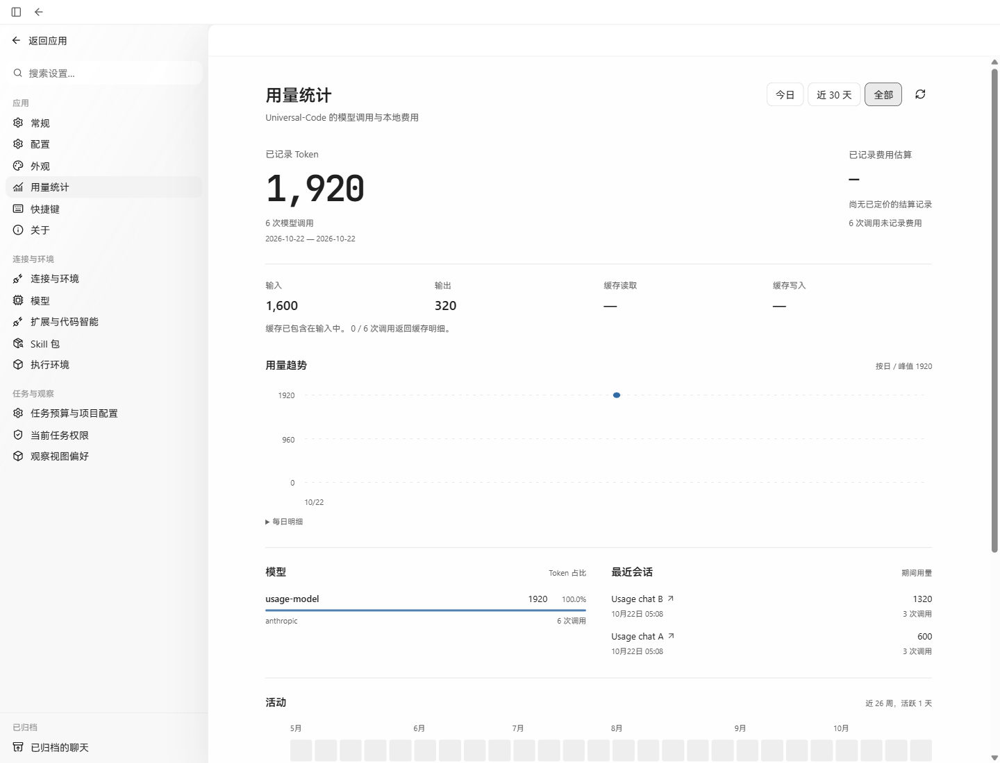
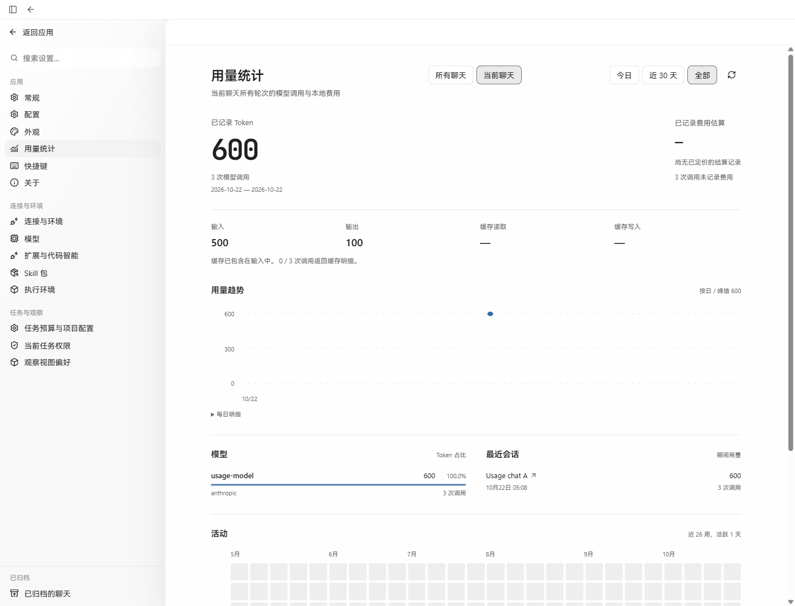
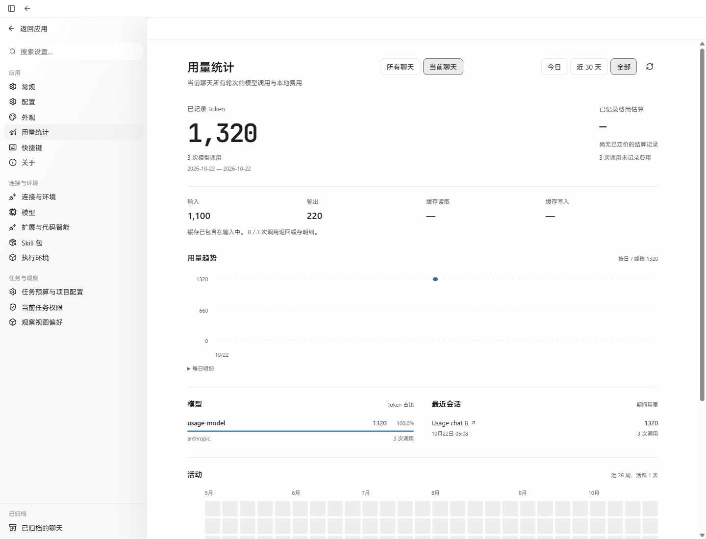
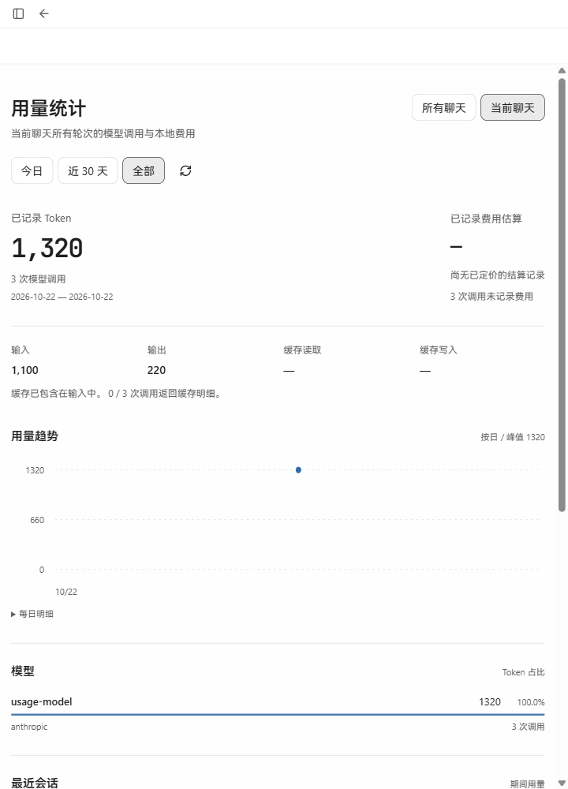

# Current chat usage acceptance

Verified on Windows with Chrome on 2026-10-22 (UTC+08:00).

Settings → Usage now offers **All chats** and **Current chat**. All chats and
30 days remain the defaults. Scope and reporting period are independent; select
All time to inspect the current chat's entire saved usage. The current-chat
option is disabled when no chat is selected.

## Actual application records

The before image uses the production frontend and Go API built from
`a07575e9ee863f94cf65d5add5623d27b7358d69`. The after images use this change's
production builds, restarted on the same port and SQLite home. Both versions
read the same saved records.

A local Anthropic-compatible HTTP provider returned deterministic replies and
usage receipts. The production API created both chats and executed all six
turns through `POST /threads/{thread_id}/turns`. After two replies in each chat,
the production `run cancel` CLI ended its idle Run; the next API turn created
the successor Run. No API response, DOM, or database record was fabricated for
the screenshots. The local model has no configured pricing or cache details.

| Scope | Runs | Replies / calls | Input | Output | Total | Calls without a recorded cost |
| --- | ---: | ---: | ---: | ---: | ---: | ---: |
| All chats | 4 | 6 | 1,600 | 320 | 1,920 | 6 |
| Usage chat A | 2 | 3 | 500 | 100 | 600 | 3 |
| Usage chat B | 2 | 3 | 1,100 | 220 | 1,320 | 3 |

The actual Thread bindings were:

- A: `thread-run-20261021210427-a65ab6aa350f`, Runs
  `run-20261021210427-a65ab6aa350f` and `run-20261021210813-6efb37dd8a49`.
- B: `thread-run-20261021210653-246739963ecb`, Runs
  `run-20261021210653-246739963ecb` and `run-20261021210813-98cf5c82a848`.

Real browser requests to `/api/v1/usage?period=all&utc_offset_minutes=480`
returned HTTP 200. Adding each Thread's `thread_id` returned the corresponding
totals above and exactly one recent conversation. Switching A → B while current
chat remained selected changed 600 → 1,320, including model totals, trend and
activity. Returning to the new-chat settings route disabled Current chat and
restored 1,920. Missing cost and cache coverage remained `—` with the existing
coverage explanation. The 720-pixel viewport wrapped the controls without overlap.

## Screenshots

Before: application-wide usage, with no chat scope control.

After: all three replies across chat A's two Runs.

After switching the current chat to B, using the same API and saved data.

Current chat at 720 × 1,000.

## Focused verification

- The HTTP regression first failed against the baseline: a valid `thread_id`
  returned 400. It passes with optional scope support and retains original defaults,
  read authorization, invalid-query rejection and the missing-Thread 404.
- `go test ./internal/store ./internal/httpapi -run '^(TestThreadUsageStatistics|TestUsageStatistics)' -count=1`
  passed. A real Thread continuation binds two Runs. Scoped receipts include
  root, specialist, compaction and fan-out calls; all four sources from another
  chat are excluded. Both priced and unpriced settlements are filtered, with
  existing period, coverage, untracked-cost and global semantics retained.
  Archived chats remain readable; deleted and missing chats return not found.
- `TestUsageStatisticsEmptyReadOnlyAndValidation` passed with both global and
  scoped queries under `PRAGMA query_only=ON` and unchanged SQLite write counts.
- `go test ./internal/httpapi -run '^TestOpenAPI' -count=1` passed.
- `npm test -- src/v2/components/usage-settings.test.tsx` passed (10 tests),
  including Settings prop wiring, disabled current scope, independent periods,
  an aborted A request resolving after B, and fallback to global when no chat is open.
- API generation, `npm run check:api`, and `npm run build` passed. Vite reported
  the existing large-chunk warning.

Only the documented live workflow was checked in Chrome. Settlement pricing,
auxiliary sources and delayed-response ordering were covered by the focused tests.
