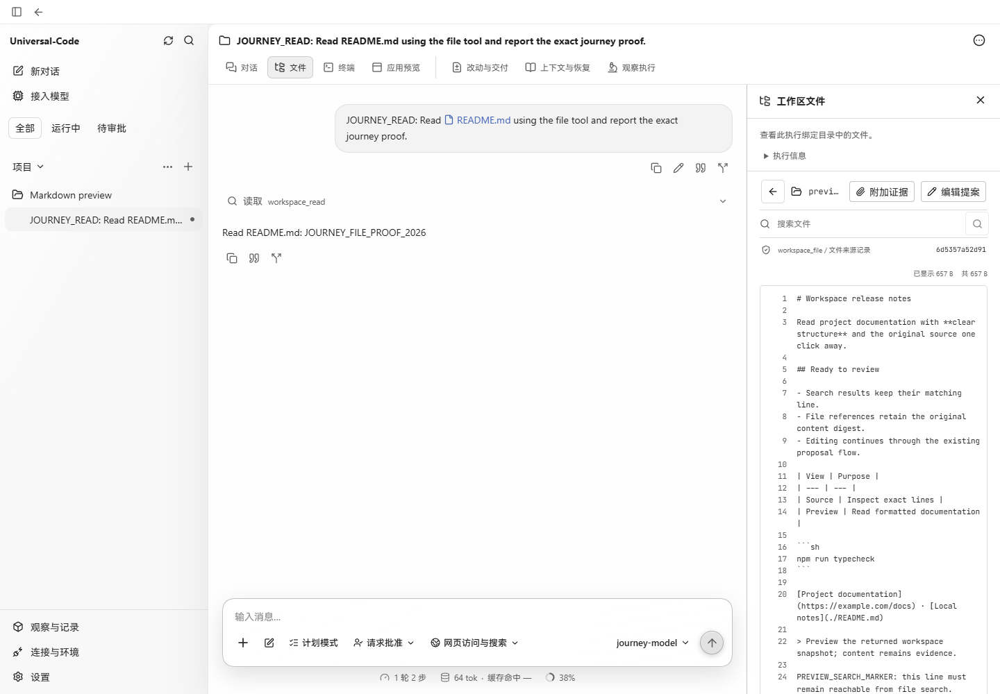
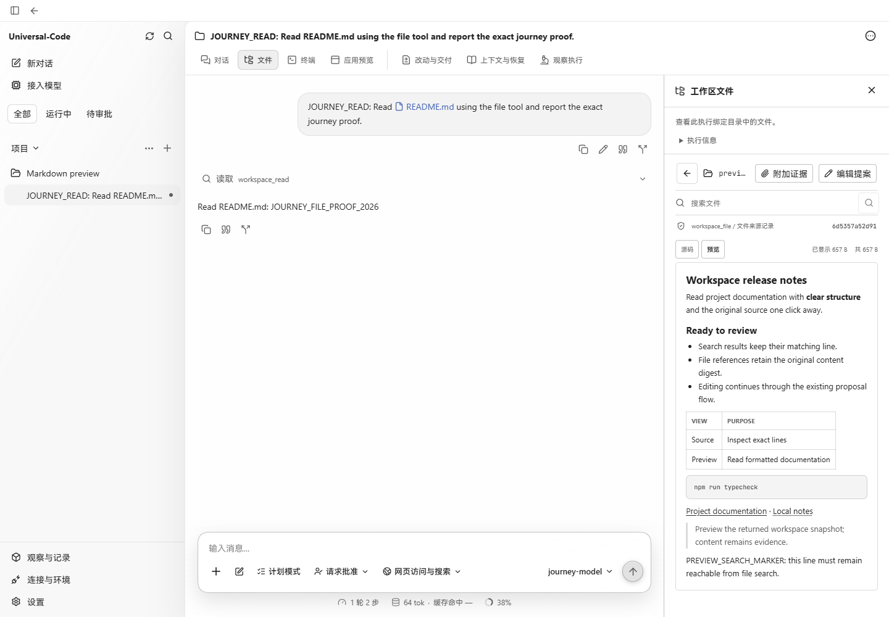

# Workspace Markdown preview

Captured in Chrome at 1440 × 1000 using the production renderer and the `workbenchjourney` production API harness, with its offline model provider and a disposable project. The harness was restarted after rebuilding because it loads the UI bundle at startup.

Both captures open the same 657-byte `preview-notes.md` sample from Workspace files. It contains headings, a list, a table, a fenced code block, an HTTPS link, and a relative file link. Its returned content digest begins with `6d5357a52d91` in both captures.

- **Before** (`5892e371bea0a20596d9684ecd1778049a143700`, PR #442): the file is available only as numbered Markdown source.
- **After** (this PR): selecting Preview shows formatted content. Source remains the initial view.
- Searching for `PREVIEW_SEARCH_MARKER` while previewing and clicking its result returned to Source, highlighted line 24, and displayed the position notice.
- The preview's HTTPS link retained `target="_blank"` and `rel="noreferrer noopener"`; the relative file link rendered as an inert span.

These are unmodified browser screenshots.

