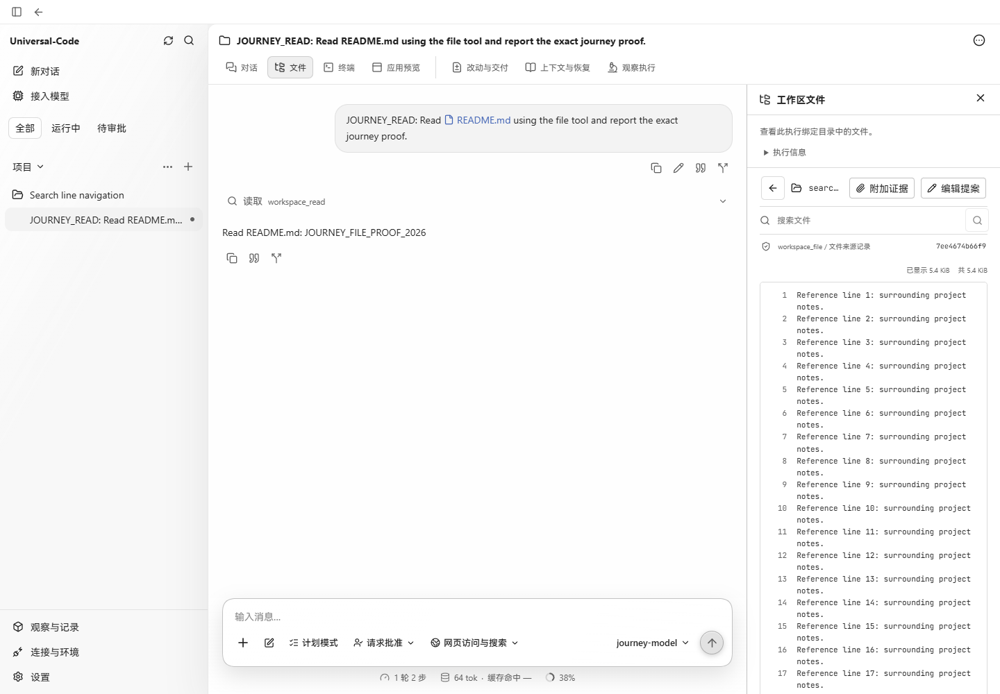
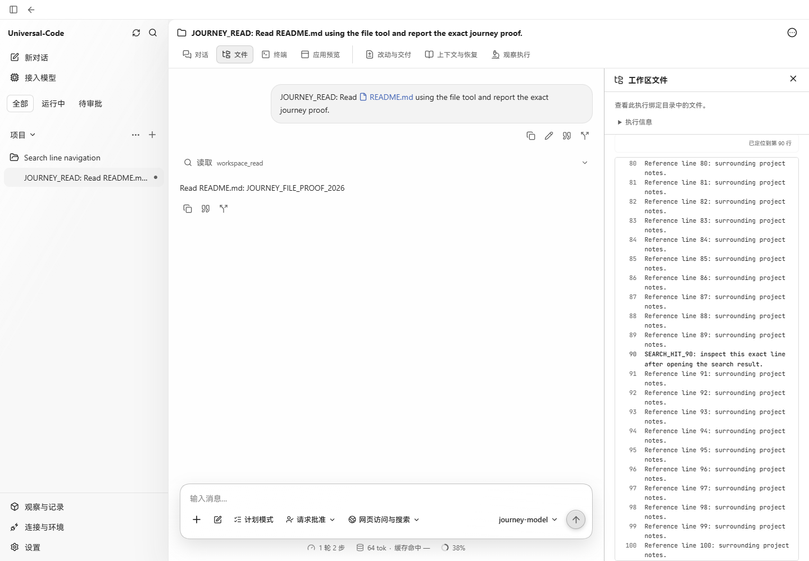

# Workspace search line navigation

Captured in Chrome at 1440 × 1000 using the production renderer and the `workbenchjourney` production API harness, with its offline model provider and disposable project.

The temporary project contained a 120-line `search-example.txt`; line 90 contained `SEARCH_HIT_90`. Both captures follow the same interaction: open workspace files, search for the marker, then click its result.

- **Before** (`fc0935d6fc03ca7abccbd148ce52d26c2bc154f8`): the file opened at the top without a highlighted line; the file scroll position was 0.
- **After** (`0567844fddc33093c61d5093149e8767e39db164`): line 90 was highlighted and visible, with the position notice; the file scroll position was 2702.

These are unmodified browser screenshots. The harness was restarted after rebuilding because it loads the UI bundle at startup.

